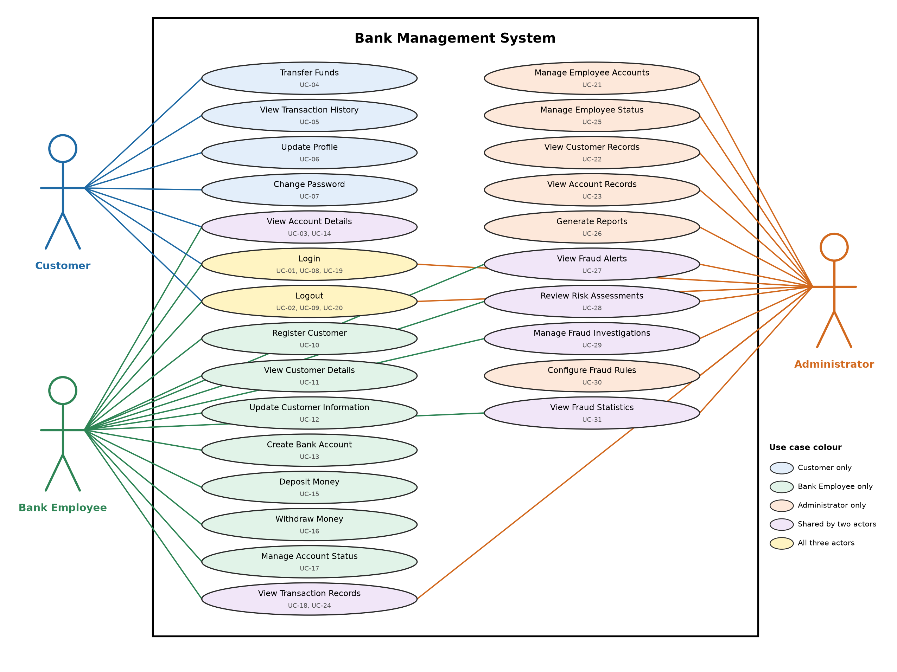

# Software Requirements Specification

## Bank Management System

| Item | Details |
|---|---|
| Document | Software Requirements Specification (SRS) |
| Project | Bank Management System (academic prototype) |
| Phase | Phase 1: Requirements and Analysis |
| Version | 1.2 |
| Date | 7 November 2026 |
| Standard followed | IEEE Std 830-1998 structure, aligned with ISO/IEC/IEEE 29148:2018 |
| Status | Baseline for design, test planning, and implementation verification |

### Revision History

| Version | Date | Description |
|---|---|---|
| 0.1 | Phase 1 | Initial problem statement, requirements, use cases, RTM and feasibility study |
| 1.0 | 29 Sep 2026 | Consolidated IEEE-style SRS; vague requirements refined to be measurable; security section added; use case diagram redrawn so Login and Logout are associated with all three actors |
| 1.1 | 21 Oct 2026 | Finalize technology stack: React with Vite (frontend), Node.js with Express (backend), MySQL (database), and REST API over HTTP; update environment and constraints (C-01, C-08) |
| 1.2 | 07 Nov 2026 | Refine requirements to incorporate the implemented MongoDB-based rule-driven fraud detection subsystem, asynchronous transactional outbox pipeline, dual-database architecture, and fraud monitoring access controls, while strictly preserving exactly 25 Functional Requirements (FR-01 to FR-25) and 18 Non-Functional Requirements (NFR-01 to NFR-18) |

---

## Table of Contents

1. [Introduction](#1-introduction)
   - 1.1 [Purpose](#11-purpose)
   - 1.2 [Scope](#12-scope)
   - 1.3 [Definitions, Acronyms and Abbreviations](#13-definitions-acronyms-and-abbreviations)
   - 1.4 [References](#14-references)
   - 1.5 [Document Overview](#15-document-overview)
2. [Overall Description](#2-overall-description)
   - 2.1 [Product Perspective](#21-product-perspective)
   - 2.2 [Product Functions](#22-product-functions)
   - 2.3 [User Classes and Characteristics](#23-user-classes-and-characteristics)
   - 2.4 [Operating Environment](#24-operating-environment)
   - 2.5 [Design and Implementation Constraints](#25-design-and-implementation-constraints)
   - 2.6 [Assumptions and Dependencies](#26-assumptions-and-dependencies)
   - 2.7 [External Interface Requirements](#27-external-interface-requirements)
3. [Functional Requirements](#3-functional-requirements)
   - 3.1 [Authentication](#31-authentication)
   - 3.2 [Customer Management](#32-customer-management)
   - 3.3 [Account Management](#33-account-management)
   - 3.4 [Deposit and Withdrawal](#34-deposit-and-withdrawal)
   - 3.5 [Fund Transfer](#35-fund-transfer)
   - 3.6 [Transaction Management and Fraud Auditing](#36-transaction-management-and-fraud-auditing)
   - 3.7 [User Account Management](#37-user-account-management)
   - 3.8 [Reports and Fraud Oversight](#38-reports-and-fraud-oversight)
4. [Non-Functional Requirements](#4-non-functional-requirements)
   - 4.1 [Security](#41-security)
   - 4.2 [Performance](#42-performance)
   - 4.3 [Reliability and Resilience](#43-reliability-and-resilience)
   - 4.4 [Usability](#44-usability)
   - 4.5 [Maintainability and Modularity](#45-maintainability-and-modularity)
   - 4.6 [Data Integrity](#46-data-integrity)
5. [Security](#5-security)
   - 5.1 [Security Objectives](#51-security-objectives)
   - 5.2 [Security Requirements](#52-security-requirements)
   - 5.3 [Security Objective to Requirement Mapping](#53-security-objective-to-requirement-mapping)
   - 5.4 [Threats Addressed](#54-threats-addressed)
6. [Use Case Model](#6-use-case-model)
   - 6.1 [Use Case Diagram](#61-use-case-diagram)
   - 6.2 [Actors](#62-actors)
   - 6.3 [Use Case Summary](#63-use-case-summary)
   - 6.4 [Key Use Case Descriptions](#64-key-use-case-descriptions)
7. [Requirement Validation and Traceability](#7-requirement-validation-and-traceability)
   - 7.1 [Requirement Quality Criteria](#71-requirement-quality-criteria)
   - 7.2 [Verification Methods](#72-verification-methods)
   - 7.3 [Traceability Chains](#73-traceability-chains)
   - 7.4 [Requirement Change Control](#74-requirement-change-control)

---

## 1. Introduction

### 1.1 Purpose

This document specifies the software requirements for the **Bank Management System (BMS)**. It describes what the system must do (functional requirements), the quality attributes and architectural constraints it must satisfy (non-functional requirements), and the security controls governing banking operations and post-transaction fraud detection.

The SRS is intended for:

- **Project team members:** to design, implement and test the system against verified specifications.
- **Course instructors and evaluators:** to assess the completeness, correctness, and rigor of the requirements.
- **Testers:** to derive functional and security test cases (see [Test Plan](test_plan.md)).
- **Designers:** to derive the software architecture, data schemas, and interface contracts (see [Software Architecture and Design Specification](architecture_design.md)).

### 1.2 Scope

The Bank Management System is a web-based academic prototype that centralizes customer records, bank accounts, financial transactions, and automated post-transaction fraud risk assessment for a single banking institution. It enforces role-based access control (RBAC) across three distinct user classes: **Customers**, **Bank Employees**, and **Administrators**.

**In scope:**

- User authentication (login, logout, password change) and role-based authorization barriers.
- Customer lifecycle management (registration, search, profile viewing, and contact details update).
- Bank account management (account creation, collision-resistant unique account number generation, balance enquiry, and administrative status management across Active, Inactive, and Frozen states).
- Core banking financial operations (cash deposits, cash withdrawals, and intra-bank fund transfers with balance and status validation).
- Authoritative financial transaction ledger recording with strict ACID guarantees in a relational database.
- Asynchronous, non-blocking post-transaction fraud risk evaluation using a Transactional Outbox pattern.
- Rule-based fraud risk scoring (0–100) and classification (`LOW`, `MEDIUM`, `HIGH`, `CRITICAL`) using configurable rule parameters stored in MongoDB.
- Operational fraud alert generation for transactions triggering enabled fraud rules or reaching high-risk classifications.
- Operational fraud monitoring, alert auditing, investigation lifecycle management (`OPEN`, `UNDER_REVIEW`, `RESOLVED`, `FALSE_POSITIVE`), and fraud rule configuration for authorized staff.
- Administrative reporting covering operational banking metrics (customer counts, account status distributions, transaction volumes) and fraud monitoring summary statistics.
- Employee account management (creation, update, and deactivation) by administrators.

**Out of scope** (see [Problem Statement](problem_statement.md#6-out-of-scope)):

- External payment networks, UPI, automated clearing houses (ACH), credit card gateways, or inter-bank settlements.
- Loan disbursement, interest calculations, fixed deposits, foreign exchange, or investment management services.
- Integration with the Reserve Bank of India (RBI) or real-world regulatory reporting gateways.
- Processing of real customer or financial records (only sanitized synthetic test data is used).
- **Automated synchronous blocking or account freezing by the fraud subsystem:** The fraud detection engine operates asynchronously and downstream of committed banking transactions; automated fraud decisions (`APPROVED`, `REVIEW_REQUIRED`, `FLAGGED`) represent advisory risk classifications for staff review and do not automatically reverse ledger entries or freeze customer accounts without human administrative action.

**Benefits:** elimination of manual reconciliation errors, deterministic balance consistency, unmodifiable transaction audit trails, decoupled asynchronous fraud risk detection without transaction latency penalties, and strict data isolation protecting sensitive fraud intelligence from customer exposure.

### 1.3 Definitions, Acronyms and Abbreviations

| Term | Definition |
|---|---|
| BMS | Bank Management System |
| SRS | Software Requirements Specification |
| FR | Functional Requirement (FR-01 to FR-25) |
| NFR | Non-Functional Requirement (NFR-01 to NFR-18) |
| UC | Use Case (UC-01 to UC-31) |
| TC | Test Case (defined in the Test Plan) |
| RTM | Requirement Traceability Matrix |
| SO | Security Objective (SO-01 to SO-04) |
| RBAC | Role-Based Access Control: access granted according to authenticated user role |
| API | Application Programming Interface (HTTP REST / JSON) |
| UI | User Interface (browser-based React single-page application) |
| ACID | Atomicity, Consistency, Isolation, Durability: relational database transaction guarantees |
| Dual-Database Architecture | System architecture utilizing MySQL as the primary financial ledger and MongoDB for analytical fraud documents |
| Transactional Outbox | Architectural pattern where banking transactions and corresponding fraud evaluation events are persisted atomically within a single MySQL transaction, guaranteeing at-least-once delivery to the fraud engine |
| Fraud Outbox Worker | Background daemon process that polls pending outbox events from MySQL via row leases (`FOR UPDATE SKIP LOCKED`), builds context, executes fraud rule evaluation, and records results in MongoDB |
| Fraud Rule | Configurable rule document stored in MongoDB defining an inspection condition, trigger threshold, and risk weight points |
| Fraud Risk Score | Aggregate integer score (0–100) calculated as the capped sum of weights of all triggered enabled fraud rules |
| Risk Classification | Categorical assessment level (`LOW` [0–29], `MEDIUM` [30–59], `HIGH` [60–79], `CRITICAL` [80–100]) and associated advisory decision (`APPROVED`, `REVIEW_REQUIRED`, `FLAGGED`) |
| Fraud Alert | Operational document recorded in MongoDB when a transaction triggers one or more enabled fraud rules or achieves a HIGH or CRITICAL risk classification, flagged for staff investigation |
| Fraud Investigation | Case record tracked in MongoDB for managing the operational review lifecycle (`OPEN`, `UNDER_REVIEW`, `RESOLVED`, `FALSE_POSITIVE`) of flagged transactions by Bank Employees and Administrators |
| Active Account | A bank account on which deposits, withdrawals, and fund transfers are permitted |
| Inactive Account | A deactivated bank account on which all financial transactions are rejected |
| Frozen Account | A temporarily blocked bank account on which all financial transactions are rejected until unfrozen by authorized staff |
| Financial Transaction | A completed cash deposit, cash withdrawal, or intra-bank fund transfer recorded in `bank_transactions` |
| Normal Prototype Usage | Execution conditions defined in assumption A-02 (up to 10 concurrent users, 1,000 customers, 10,000 transactions) |

### 1.4 References

1. IEEE Std 830-1998, *IEEE Recommended Practice for Software Requirements Specifications*.
2. ISO/IEC/IEEE 29148:2018, *Systems and software engineering — Life cycle processes — Requirements engineering*.
3. Project documentation:
   - [Problem Statement](problem_statement.md)
   - [Feasibility Study](feasibility_study.md)
   - [Requirements List](requirements.md)
   - [Actors and Use Cases](actors_usecases.md)
   - [Use Case Diagram](use_case_diagram.png)
   - [Requirement Traceability Matrix](rtm.md)
   - [Test Plan](test_plan.md)
   - [Software Architecture and Design Specification](architecture_design.md)
   - [Database Schema Analysis](../dbms/database_schema_analysis.md)

### 1.5 Document Overview

- **Section 2** describes the product perspective, dual-database architecture, functional summary, user classes, operating environment, design constraints, and operational assumptions.
- **Section 3** specifies the 25 Functional Requirements (FR-01 to FR-25) with testable acceptance criteria, incorporating outbox event generation, customer fraud isolation, staff fraud oversight, investigation management, and fraud summary reporting.
- **Section 4** specifies the 18 Non-Functional Requirements (NFR-01 to NFR-18), covering security, performance, financial consistency, outbox atomicity, immutability, modularity, and dual-database data integrity.
- **Section 5** defines the security objectives (SO-01 to SO-04), security requirements mapping, and threat countermeasures.
- **Section 6** details the use case model, actor responsibilities, use case inventory (UC-01 to UC-31), and key flow descriptions.
- **Section 7** defines the requirement quality criteria, verification methods, traceability chains, and change control procedures.

---

## 2. Overall Description

### 2.1 Product Perspective

The Bank Management System is a self-contained, multi-tier web application designed for a single banking institution. It replaces error-prone manual spreadsheets and disconnected ledger systems with a unified platform providing atomic transaction processing, deterministic balance accounting, and automated post-transaction fraud intelligence.

The system implements a **Dual-Database Architecture** supported by an asynchronous **Transactional Outbox Worker**:

```text
+-------------------------------------------------------------------------+
|                           Presentation Layer                            |
|             React Single-Page Application (Vite, CSS Modules)           |
|        [Customer Portal]    [Employee Workspace]    [Admin Console]     |
+-------------------------------------------------------------------------+
                                     │
                             HTTP / REST (JSON)
                                     │
+------------------------------------+------------------------------------+
|                         Business Logic Layer                            |
|                       Node.js & Express Server                          |
|  - Auth & RBAC Middleware          - Account & Transaction Services     |
|  - Customer Management Service     - Administrative Reporting Service   |
|  - Outbox Staging Service          - Fraud Dashboard & Alerts Service   |
+------------------------------------+------------------------------------+
              │                                      │
       Synchronous ACID                        Read-Only REST
      (MySQL Connection)                      (MongoDB Driver)
              │                                      │
              ▼                                      ▼
+-----------------------------+        +----------------------------------+
|    Primary Relational DB    |        |     Analytical Document DB       |
|    MySQL 8.0+ (InnoDB)      |        |     MongoDB 6.0+ Community       |
|  - users & customers        |        |  - fraud_rules                   |
|  - accounts & balances      |        |  - transaction_risk_assessments  |
|  - bank_transactions        |        |  - fraud_alerts                  |
|  - fraud_outbox_events      |        |  - fraud_investigations          |
+-----------------------------+        +----------------------------------+
              │                                      ▲
     Row Lease (SKIP LOCKED)                         │
              │                                      │
              ▼                                      │
+----------------------------------------------------+--------------------+
|                   Asynchronous Background Worker Layer                  |
|                           FraudOutboxWorker                             |
|  1. Claims PENDING outbox events with row-level locks                   |
|  2. Fetches authoritative transaction context from MySQL                |
|  3. Evaluates active fraud rules & computes aggregate risk score        |
|  4. Idempotently writes risk assessments & alerts to MongoDB            |
|  5. Marks outbox event COMPLETED (or schedules exponential retry)       |
+-------------------------------------------------------------------------+
```

#### Dual-Database Role Division
1. **Primary Relational Store (MySQL):** Authoritative source of truth for all financial state. Operates under InnoDB with strict ACID guarantees, foreign key constraints (`ON DELETE RESTRICT`), and row-level locks (`SELECT ... FOR UPDATE`). Manages `users`, `customers`, `employees`, `accounts`, `bank_transactions`, and `fraud_outbox_events`.
2. **Analytical Fraud Store (MongoDB):** Specialized document repository for dynamic fraud configuration and compliance auditing. Operates under the `bank_fraud_detection` database with JSON Schema validators and compound unique indexes. Manages `fraud_rules`, `transaction_risk_assessments`, `fraud_alerts`, and `fraud_investigations`.

### 2.2 Product Functions

The functional capabilities of the BMS are organized into eight functional areas spanning requirements FR-01 through FR-25:

| Function Area | Summary | Requirements |
|---|---|---|
| Authentication | User login, secure session termination, and role-based access control across all application endpoints | FR-01 – FR-03 |
| Customer Management | Customer registration by staff, identity profile retrieval, and role-delimited contact updates | FR-04 – FR-06 |
| Account Management | Account opening, unique account number allocation, balance enquiry, status transitions, and transaction blocking on restricted accounts | FR-07 – FR-11 |
| Deposit and Withdrawal | Cash deposits and withdrawals on active accounts with balance checks and overdraft prevention | FR-12 – FR-14 |
| Fund Transfer | Intra-bank account-to-account transfers with atomic debit/credit balance reconciliation | FR-15 – FR-17 |
| Transaction Management and Fraud Auditing | Unique transaction reference generation, atomic transaction ledger recording with transactional outbox event staging, customer history with fraud isolation, staff transaction oversight, fraud alert monitoring, investigation lifecycle tracking, and admin rule management | FR-18 – FR-21 |
| User Account Management | Self-service password changes, administrator creation of employee accounts, and employee deactivation | FR-22 – FR-24 |
| Reports and Fraud Oversight | Administrative operational reports (customers, accounts, transaction volumes) and fraud monitoring summary statistics (risk distributions, alert counts) | FR-25 |

### 2.3 User Classes and Characteristics

| User Class | Description | Expected Skill Level | Core Responsibilities & System Interactions |
|---|---|---|---|
| Customer | Holder of one or more bank accounts | Basic web browsing literacy | Authenticates to view personal account balances, execute intra-bank transfers, review personal transaction history (strictly isolated from internal fraud scores), and update contact details |
| Bank Employee | Authorized branch teller or customer service staff | Trained in banking procedures and operational software | Registers new customers, creates bank accounts, processes over-the-counter deposits and withdrawals, manages account operational status, audits transaction records, reviews fraud alerts, and manages fraud investigations |
| Administrator | System-level manager and operational supervisor | Trained in relational administration and risk policies | Manages employee accounts and lifecycle status, audits system-wide customer, account, and transaction ledgers, monitors fraud detection metrics, configures fraud rule weights and thresholds, and generates administrative reports |

### 2.4 Operating Environment

| Item | Specification |
|---|---|
| Client Platform | Modern desktop web browser (Google Chrome 110+, Mozilla Firefox 110+, Apple Safari 16+, or Microsoft Edge 110+) running a React single-page application built with Vite |
| Application Server | Node.js runtime environment (v18.x or v20.x LTS) executing an Express backend application server |
| Primary Relational Database | MySQL Community Server 8.0+ utilizing the InnoDB storage engine with support for ACID transactions, row-level locking, and `SELECT ... FOR UPDATE SKIP LOCKED` |
| Document Database | MongoDB Community Server 6.0+ running the `bank_fraud_detection` database with specialized unique compound indexes and moderate JSON Schema validators |
| Asynchronous Processing | Background worker daemon process (`FraudOutboxWorker`) embedded within the Node.js runtime, executing periodic event claims with configurable lease and backoff timers |
| Networking & Protocol | Local machine or isolated campus LAN deployment; client-server and inter-service communication over HTTP/JSON RESTful API; HTTPS recommended for non-local deployment |
| Development & Build Tools | Visual Studio Code, Git, GitHub repository, and npm package manager |

### 2.5 Design and Implementation Constraints

| ID | Constraint |
|---|---|
| C-01 | The presentation layer shall be implemented as a client-side single-page application using React, Vite, and modular CSS ([Feasibility Study](feasibility_study.md#1-technical-feasibility)). |
| C-02 | The system shall employ a dual-database architecture: MySQL (InnoDB) shall serve as the exclusive authoritative store for financial ledgers, account balances, and transactional outbox events; MongoDB shall serve as the document store for fraud rules, assessments, alerts, and investigations. Neither database shall compromise the integrity or availability of the other. |
| C-03 | Only free, open-source, or community-licensed tools, runtimes, and libraries shall be utilized ([Feasibility Study](feasibility_study.md#3-economic-feasibility)). |
| C-04 | Git and GitHub shall be used exclusively for version control, branching workflows, and documentation management. |
| C-05 | Only synthetic dummy test data shall be stored; no real customer personal identifiable information (PII) or actual banking credentials shall ever be used ([Feasibility Study](feasibility_study.md#6-legal-and-ethical-feasibility)). |
| C-06 | The system shall not connect to or depend upon external banking networks, clearance gateways, credit bureaus, or external web services. |
| C-07 | The functional scope is constrained to the 25 Functional Requirements (FR-01 to FR-25) and 18 Non-Functional Requirements (NFR-01 to NFR-18) baseline. |
| C-08 | The backend shall be developed using Node.js with the Express framework, exposing RESTful HTTP endpoints communicating via structured JSON request/response payloads, and hosting the background outbox worker daemon. |

### 2.6 Assumptions and Dependencies

| ID | Assumption / Dependency |
|---|---|
| A-01 | The application operates in the context of a single commercial bank with Indian Rupee (INR / ₹) as the sole base currency. All monetary transactions are computed and stored with exactly two decimal places (or integer paise: 1 INR = 100 paise). |
| A-02 | "Normal prototype usage" is defined as concurrent load of **up to 10 active users**, with database volumes holding up to **1,000 customers and 10,000 transaction records** in a local test environment. |
| A-03 | Over-the-counter deposits and cash withdrawals are initiated exclusively by authorized Bank Employees on behalf of customers (UC-15, UC-16). Customers cannot deposit or withdraw cash directly through the web client. |
| A-04 | Customers cannot self-register; customer onboarding is performed by an authorized Bank Employee (FR-04), who triggers initial credential issuance. Physical credential delivery is outside prototype scope. |
| A-05 | A customer entity may hold multiple distinct bank accounts (e.g., Savings, Checking) across the institution. |
| A-06 | Customer self-service profile updates (FR-06) are strictly restricted to contact details (email, phone, address). Legal identity fields (full name, date of birth) require in-person verification and can only be updated by Bank Employees. |
| A-07 | System bootstrap creates at least one administrative superuser account during initial database seeding. Self-registration of administrators is prohibited. |
| A-08 | Password change functionality (FR-22) is universally accessible to authenticated users across all three roles. |
| A-09 | Frozen or inactive bank accounts remain visible for balance enquiry and auditing (FR-09); only balance-altering financial operations are blocked (FR-11). |
| A-10 | Prior to operational testing, both MySQL and MongoDB instances are initialized, schemas migrated, indexes created, and baseline fraud rules seeded via automated scripts. |
| A-11 | **Asynchronous Decoupling:** Banking transactions commit synchronously and atomically in MySQL regardless of MongoDB's operational availability. If MongoDB is temporarily offline, outbox events accumulate safely in `PENDING` status in MySQL, and the outbox worker resumes processing once MongoDB reconnects. |
| A-12 | **Advisory Fraud Decisions:** Automated fraud classifications (`APPROVED`, `REVIEW_REQUIRED`, `FLAGGED`) represent post-transaction analytical risk evaluations for staff auditing. The fraud subsystem does not automatically block transactions, reverse completed ledger records, or freeze accounts. Account freezing remains strictly an authorized administrative function under FR-10. |

### 2.7 External Interface Requirements

| Interface | Specification |
|---|---|
| User Interface | Browser-based responsive web application with role-tailored dashboards: Customer Portal (accounts, transfers, statements), Employee Workspace (customer onboarding, account operations, cash desk, alert reviews, investigations), and Admin Console (employee management, fraud rule tuning, reports). |
| Software Interface (MySQL) | Node.js Express backend and outbox worker interface with MySQL via the `mysql2/promise` connection pool, executing parameterized SQL statements and managing explicit transaction boundaries (`START TRANSACTION`, `COMMIT`, `ROLLBACK`). |
| Software Interface (MongoDB) | Node.js Express backend and outbox worker interface with MongoDB via the official `mongodb` Node.js driver, executing indexed aggregations, reading rule configs, and performing idempotent document insertions. |
| Communication Interface | Client-to-server data exchange occurs via HTTP/1.1 RESTful APIs exchanging JSON payloads. Endpoints conform to standard HTTP status codes (200, 201, 400, 401, 403, 404, 409, 422, 500). |
| Hardware Interface | Standard commodity server hardware / developer workstation; no specialized cryptographic hardware or external HSM required. |

---

## 3. Functional Requirements

The functional requirements FR-01 to FR-25 represent the complete functional scope of the Bank Management System. All requirement identifiers are permanent and preserved without renumbering. Priority is designated as **High** (critical for prototype operation) or **Medium** (important operational support capability).

### 3.1 Authentication

| ID | Requirement | Use Case(s) | Priority | Acceptance Criterion |
|---|---|---|---|---|
| FR-01 | The system shall allow registered users to log in using valid credentials. | UC-01, UC-08, UC-19 | High | A registered active user who submits a valid username and password is authenticated, granted an active session, and presented with the dashboard corresponding to their assigned role. Invalid credentials or inactive accounts are rejected with a generic authentication error message. |
| FR-02 | The system shall allow authenticated users to log out securely. | UC-02, UC-09, UC-20 | High | Upon invoking logout, the user's active session is invalidated server-side. Subsequent requests to protected endpoints or browser history navigation actions are rejected with HTTP 401 Unauthorized. |
| FR-03 | The system shall provide different levels of access based on the user's role such as Customer, Bank Employee and Administrator. | All role-specific use cases | High | The system enforces server-side role validation on every API endpoint. Users attempting to access endpoints or resources outside their role receive an HTTP 403 Forbidden response. |

### 3.2 Customer Management

| ID | Requirement | Use Case(s) | Priority | Acceptance Criterion |
|---|---|---|---|---|
| FR-04 | The system shall allow authorized bank employees to register a new customer. | UC-10 | High | A Bank Employee who submits all mandatory customer details (name, email, phone, address, date of birth) creates a new customer profile and linked user record with a unique `customer_id` and initial credentials in an atomic transaction. |
| FR-05 | The system shall allow authorized users to view customer details. | UC-11, UC-22 | High | A Bank Employee or Administrator can search and view complete customer profile details by ID, name, or email. Customers can view only their own personal profile information. |
| FR-06 | The system shall allow customers or authorized employees to update permitted customer information. | UC-06, UC-12 | Medium | A Customer can update only their own contact details (email, phone, address). A Bank Employee can update contact details and authorized customer profile fields. Updates take effect immediately in the database. |

### 3.3 Account Management

| ID | Requirement | Use Case(s) | Priority | Acceptance Criterion |
|---|---|---|---|---|
| FR-07 | The system shall allow authorized bank employees to create a bank account for a registered customer. | UC-13 | High | A Bank Employee can create an account only for an existing customer. The account is initialized in **Active** status with a specified account type (Savings, Checking) and verified opening balance. |
| FR-08 | The system shall generate a unique account number for every bank account. | UC-13 | High | Every created account is assigned a unique account number formatted as `ACC-<TYPE>-<8-DIGITS>`. Uniqueness is guaranteed by collision-retry logic and a database-level unique constraint. |
| FR-09 | The system shall allow customers to view their account details and current balance. | UC-03, UC-14, UC-23 | High | A Customer can view the account number, account type, operational status, and real-time available balance for all accounts they own. Stored and displayed balances match exactly. |
| FR-10 | The system shall allow authorized employees to activate, deactivate, freeze or unfreeze a bank account. | UC-17 | High | A Bank Employee can transition an account's operational status between **Active**, **Inactive**, and **Frozen**. The status change is audited and takes effect immediately for all subsequent transactions. |
| FR-11 | The system shall prevent financial transactions on frozen or inactive accounts. | UC-04, UC-15, UC-16, UC-17 | High | Any deposit, withdrawal, or fund transfer involving a frozen or inactive account (as source or destination) is rejected with an appropriate error (HTTP 409 `ACC_001`). No account balance is modified, no financial transaction record is created in `bank_transactions`, and no fraud outbox event is staged. (Note: account freezing remains strictly an authorized administrative action under FR-10; the fraud detection subsystem does not automatically freeze accounts). |

### 3.4 Deposit and Withdrawal

| ID | Requirement | Use Case(s) | Priority | Acceptance Criterion |
|---|---|---|---|---|
| FR-12 | The system shall allow money to be deposited into an active bank account. | UC-15 | High | An authorized Bank Employee can deposit a valid positive amount into an active account. The account balance increases by exactly the deposited amount within an atomic database transaction. |
| FR-13 | The system shall allow money to be withdrawn from an active bank account. | UC-16 | High | An authorized Bank Employee can withdraw a valid positive amount not exceeding the current balance from an active account. The balance decreases by exactly the withdrawn amount within an atomic database transaction. |
| FR-14 | The system shall reject a withdrawal if the account does not contain sufficient balance. | UC-16 | High | Any withdrawal request exceeding the available balance is rejected with HTTP 422 `TXN_001` ("Insufficient balance"). Account balances remain unchanged, and no transaction record is created. |

### 3.5 Fund Transfer

| ID | Requirement | Use Case(s) | Priority | Acceptance Criterion |
|---|---|---|---|---|
| FR-15 | The system shall allow customers to transfer money from their account to another valid bank account. | UC-04 | High | An authenticated Customer can transfer a positive monetary amount from an active account they own to another existing active account within the bank. |
| FR-16 | The system shall verify that sufficient balance is available before processing a fund transfer. | UC-04 | High | Before executing a transfer, the system verifies that the source account's available balance is greater than or equal to the transfer amount. If balance is insufficient, the transfer is rejected without modifying either account. |
| FR-17 | The system shall update both the sender's and receiver's account balances after a successful transfer. | UC-04 | High | In a single atomic transaction under row-level locks, the source account balance decreases by amount X and the destination account balance increases by amount X. Neither balance changes if any portion of the operation fails. |

### 3.6 Transaction Management and Fraud Auditing

| ID | Requirement | Use Case(s) | Priority | Acceptance Criterion |
|---|---|---|---|---|
| FR-18 | The system shall generate a unique transaction ID for every successful financial transaction. | UC-04, UC-15, UC-16 | High | Every completed deposit, withdrawal, and fund transfer is assigned a unique primary key `transaction_id` and a unique cryptographic reference formatted as `TXN-<TYPE>-<12-HEX>`. Uniqueness is enforced by a database unique constraint. |
| FR-19 | The system shall record details of every completed deposit, withdrawal and fund transfer, and atomically stage a fraud evaluation event. | UC-04, UC-15, UC-16 | High | Within the exact same atomic MySQL transaction as the balance updates, the system: (1) inserts an immutable financial ledger record into `bank_transactions` containing transaction ID, reference, type, amount, source/destination accounts, and timestamp; and (2) inserts a corresponding event into `fraud_outbox_events` with status `PENDING` for asynchronous evaluation. If the transaction rolls back, neither the ledger record nor the outbox event is persisted. The transaction completion does not block on fraud evaluation. |
| FR-20 | The system shall allow customers to view their transaction history while preserving internal fraud confidentiality. | UC-05 | High | A Customer can view the chronological transaction history (newest first) for their own accounts only. The returned transaction records include banking details (ID, reference, type, amount, date/time, source/destination accounts, balance after) and strictly exclude all internal fraud risk scores, triggered rule codes, alert flags, and investigation notes. |
| FR-21 | The system shall allow authorized bank employees and administrators to view transaction records, monitor fraud alerts, manage investigations, and allow administrators to configure fraud rules. | UC-18, UC-24, UC-27, UC-28, UC-29, UC-30 | High | (1) Authorized Bank Employees and Administrators can query and view all banking transaction records filtered by account number, transaction type, and date range. (2) Authorized staff can view fraud alerts (`/api/fraud/alerts`), inspect transaction risk assessments (risk score, risk level, triggered rules), and update investigation case statuses (`OPEN`, `UNDER_REVIEW`, `RESOLVED`, `FALSE_POSITIVE`). (3) Administrators exclusively can view and update fraud rule configurations (thresholds and weights for `HIGH_AMOUNT`, `HIGH_VELOCITY`, `NEW_BENEFICIARY`, `UNUSUAL_HOUR`). Attempts by Bank Employees or Customers to modify rules return HTTP 403 `AUTH_002`. (4) Unauthenticated users and Customers are denied access to staff transaction queries and fraud endpoints with HTTP 401/403. |

### 3.7 User Account Management

| ID | Requirement | Use Case(s) | Priority | Acceptance Criterion |
|---|---|---|---|---|
| FR-22 | The system shall allow users to change their password. | UC-07 | Medium | An authenticated user who provides their correct current password and a valid new password can update their credentials. The new password is hashed using salted bcrypt (work factor >= 10); subsequent logins with the old password are rejected. |
| FR-23 | The system shall allow administrators to create and manage employee accounts. | UC-21 | High | An Administrator can create a new staff account with the Bank Employee role and update existing employee profile fields. The new employee can successfully log in and access employee-permitted functions. |
| FR-24 | The system shall allow administrators to deactivate employee accounts. | UC-25 | Medium | An Administrator can deactivate an employee account. Upon deactivation, that employee's active session is terminated, and subsequent login attempts are rejected with an account inactive error. |

### 3.8 Reports and Fraud Oversight

| ID | Requirement | Use Case(s) | Priority | Acceptance Criterion |
|---|---|---|---|---|
| FR-25 | The system shall allow administrators to view basic reports related to customers, accounts, and transactions, and allow authorized staff to view fraud monitoring statistics. | UC-26, UC-31 | Medium | (1) For a selected date range, administrators can generate operational reports displaying total customers (active/inactive), account breakdown by status and type, and transaction counts and total monetary volumes (deposits, withdrawals, transfers) matching stored data in MySQL. (2) Authorized staff (Bank Employees and Administrators) can access fraud overview statistics (`/api/fraud/dashboard/stats`) displaying total evaluated transactions, risk level breakdown (`LOW`, `MEDIUM`, `HIGH`, `CRITICAL`), open alert counts, and recent average risk scores matching stored data in MongoDB. |

---

## 4. Non-Functional Requirements

The non-functional requirements NFR-01 to NFR-18 define the quality attributes, operational limits, architectural constraints, and integrity guarantees of the system. All 18 IDs are permanent and preserved without renumbering.

### 4.1 Security

| ID | Requirement | Acceptance Criterion |
|---|---|---|
| NFR-01 | User passwords shall not be stored in plain text. They shall be stored only as salted one-way hashes produced by a password-hashing algorithm, and shall never be written to logs or returned in any response. | Direct inspection of the `users` table confirms passwords are stored exclusively as salted bcrypt hashes (work factor >= 10). Application logs, error traces, and API responses never contain plain-text passwords or hash values. |
| NFR-02 | The system shall restrict access to features based on the authenticated user's role. | Server-side authorization middleware validates role permissions on every request. Any attempt by a Customer to invoke Employee/Admin endpoints, or an Employee to invoke Admin-only endpoints (e.g. employee creation or fraud rule editing), is rejected with HTTP 403 `AUTH_002`. |
| NFR-03 | The system shall prevent unauthorized users from accessing customer, account, transaction, and fraud detection information. | Horizontal ownership checks ensure Customers cannot view accounts or transactions belonging to other customers (HTTP 403 `AUTH_002`). Customers are strictly denied access to all fraud endpoints (`/api/fraud/*`), risk assessments, alerts, and investigations. Unauthenticated requests are rejected with HTTP 401 `AUTH_003`. |
| NFR-04 | The system shall validate user input before processing banking operations and fraud configurations. It shall check required fields, data type, format, length, and permitted range, and shall reject invalid input without modifying stored data. | Input validation middleware rejects missing mandatory fields, invalid email/phone formats, negative or non-decimal monetary amounts, and invalid rule weights/thresholds with HTTP 400 `VAL_001`. No database modifications occur on validation failure. |
| NFR-05 | Sensitive banking and fraud management operations shall only be performed after successful authentication. Requests without a valid authenticated session shall be rejected. | Requests to protected banking or fraud routes lacking a valid session token/cookie return HTTP 401 `AUTH_003`. Expired or cleared sessions are immediately rejected. |

### 4.2 Performance

| ID | Requirement | Acceptance Criterion |
|---|---|---|
| NFR-06 | Normal system operations such as login, balance enquiry, viewing transaction history, and fraud summary statistics shall respond within 3 seconds for at least 95% of requests under normal prototype usage (up to 10 concurrent users in the local test environment; SRS assumption A-02). | Across 20 timed executions of each operation under normal usage load, at least 19 respond in under 3.0 seconds. |
| NFR-07 | Financial transactions shall be processed within 5 seconds for at least 95% of requests under normal prototype usage (up to 10 concurrent users in the local test environment; SRS assumption A-02). | Across 20 timed deposits, withdrawals, and transfers under normal usage load, at least 19 complete and return a response in under 5.0 seconds. The synchronous transaction response time is independent of downstream fraud evaluation latency. |

### 4.3 Reliability and Resilience

| ID | Requirement | Acceptance Criterion |
|---|---|---|
| NFR-08 | The system shall maintain consistent account balances after every successful financial transaction, with MySQL serving as the sole authoritative source of truth. | For every account in MySQL, the stored balance equals opening balance plus total credits minus total debits. Fraud assessment records stored in MongoDB are analytical documents and cannot alter, recalculate, or override MySQL account balances. |
| NFR-09 | If a transaction fails before completion, the system shall not leave account balances in a partially updated state. The banking transaction and corresponding outbox event shall be persisted atomically in MySQL. | When a simulated failure occurs during a transfer, both account balances remain unchanged, and neither a transaction ledger entry nor an outbox event is stored. The MySQL transaction commits or rolls back independently of MongoDB; temporary unavailability of MongoDB does not fail or roll back committed banking transactions. |
| NFR-10 | The system shall maintain immutable transaction records at the application service layer, protect referenced ledger rows from deletion via relational constraints, and ensure idempotent downstream fraud evaluation. | Completed transactions in MySQL are insert-only; no application interface supports updating or deleting ledger rows. A foreign key constraint with `ON DELETE RESTRICT` on `fraud_outbox_events.transaction_id` prevents deletion of referenced transaction records while an outbox event exists. The outbox worker operates under at-least-once delivery; in MongoDB, unique compound indexes (`uniq_assessment_transaction_id`, `uniq_alert_transaction_id`) enforce idempotent persistence so worker retries do not create duplicate assessments or alerts. |

### 4.4 Usability

| ID | Requirement | Acceptance Criterion |
|---|---|---|
| NFR-11 | After login, the user interface shall display a navigation menu that contains only the operations permitted for the logged-in user's role, and this menu shall be available on every page. | For each authenticated role, the navigation bar displays only permitted links (Customer: Accounts, Transfers, Statements; Employee: Customers, Accounts, Cash Desk, Fraud Monitoring; Admin: full management, Fraud Dashboard, Rules, Reports) and renders consistently across all views. |
| NFR-12 | When an operation is rejected, the system shall display a message that states the reason (for example, insufficient balance, frozen account or invalid input field). It shall not display stack traces, database errors or other internal system details. | Rejected operations return structured error envelopes (`{ success: false, errorCode, message }`) with safe, user-friendly descriptions. Database syntax errors, stack traces, and database connection strings are never exposed in UI or API responses. |
| NFR-13 | After login, users shall be able to access permitted core banking operations within at most 3 navigation actions. | From any role dashboard, users can navigate to permitted primary banking functions (e.g. transfer modal, account overview, cash deposit) in 3 or fewer clicks. |

### 4.5 Maintainability and Modularity

| ID | Requirement | Acceptance Criterion |
|---|---|---|
| NFR-14 | The system shall be divided into separate, decoupled modules for authentication, customer management, account management, transaction management, employee administration, reporting, and fraud detection. A change to one module shall not require changes to the internal code of unrelated modules. | Architectural code review confirms the existence of isolated domain modules interacting strictly via defined interfaces. The fraud detection subsystem operates independently via the transactional outbox repository (`recordOutboxEvent`) and read-only context queries, without modifying core banking transaction business logic. |
| NFR-15 | Source code shall follow a single naming convention documented by the team, and every business-logic module and public function shall include a comment describing its purpose, inputs and outputs. | Code review and automated linting (`npm run lint:frontend`) verify compliance with standard JavaScript conventions (camelCase variables, PascalCase React components, UPPER_CASE constants) and documented JSDoc annotations across all public functions. |

### 4.6 Data Integrity

| ID | Requirement | Acceptance Criterion |
|---|---|---|
| NFR-16 | Every customer, account, transaction, and fraud entity shall have a unique identifier. | Primary keys and unique constraints in MySQL enforce uniqueness for `customer_id`, `account_number`, `transaction_id`, and `event_id`. In MongoDB, unique index constraints enforce uniqueness for `ruleCode` and `transactionId` in `transaction_risk_assessments` and `fraud_alerts`. Duplicate identifier insertions are rejected by both databases. |
| NFR-17 | Account balances and transaction records shall remain consistent after deposit, withdrawal and fund transfer operations. | Under concurrent operations, row-level locking (`SELECT ... FOR UPDATE`) prevents race conditions, lost updates, and phantom balance increments. After any execution sequence, account balances match the arithmetic sum of their ledger records. |
| NFR-18 | The system shall prevent invalid or incomplete data from being stored across the dual-database architecture. | MySQL enforces relational column types, foreign key constraints, `NOT NULL` rules, and check constraints (e.g., balance >= 0) at the database layer. Application service layers enforce strict schema and monetary validation prior to persistence. MongoDB collections configure moderate JSON Schema validators with `validationAction: warn` for diagnostic auditing without disrupting background worker pipelines. |

---

## 5. Security

The Bank Management System processes sensitive financial assets, customer records, and operational risk intelligence. This section specifies the security objectives, controls, and threat countermeasures governing the system.

### 5.1 Security Objectives

| ID | Objective | Description |
|---|---|---|
| SO-01 | **Confidentiality** | Sensitive customer identity data, account balances, transaction records, and internal fraud detection intelligence (risk scores, triggered rules, fraud alerts, investigation notes) must be accessible exclusively to authenticated and authorized users. Customers must never access other customers' records or internal fraud intelligence. |
| SO-02 | **Integrity** | Financial balances and transaction records must be protected from unauthorized tampering, race conditions, and partial updates. Synchronous banking operations and outbox events must commit atomically in MySQL. Fraud rules and analytical records in MongoDB must be protected by application schema validation and role-based write barriers. |
| SO-03 | **Authentication & Authorization** | Every user must be authenticated before accessing protected banking or fraud management operations. Granular role-based access control (RBAC) must enforce strict least-privilege boundaries across Customers, Bank Employees, and Administrators. Rule configuration must be restricted exclusively to Administrators. |
| SO-04 | **Accountability & Auditability** | Every completed financial transaction must produce a unique, permanent, and unmodifiable ledger record. The lifecycle of outbox events, risk assessments, fraud alerts, and staff investigations must be fully auditable with immutable timestamps and operator identities. |

### 5.2 Security Requirements

The following requirements operationalize the security objectives. NFR-01 to NFR-05 constitute the primary security controls, supported by architectural and functional requirements:

| ID | Security Requirement | Rationale | Verified By |
|---|---|---|---|
| NFR-01 | Passwords stored only as salted bcrypt hashes; never logged or returned. | Prevents credential exposure in the event of database compromise or log leakage. | TC-09 |
| NFR-02 | Role-based feature restriction across all banking and fraud endpoints. | Prevents privilege escalation (e.g., Customer accessing employee functions or modifying fraud rules). | TC-03 |
| NFR-03 | Unauthorized users prevented from accessing customer, account, transaction, or fraud records. | Enforces strict horizontal isolation between customers and vertical isolation protecting internal fraud intelligence. | TC-03, TC-16 |
| NFR-04 | Comprehensive input validation before processing banking operations and fraud configurations. | Prevents SQL/NoSQL injection, negative balance manipulation, and malformed rule configurations. | TC-12 |
| NFR-05 | Mandatory authentication for all protected operations; invalid sessions rejected. | Prevents anonymous or spoofed invocation of banking or fraud management services. | TC-03, TC-13 |
| FR-02 | Secure session invalidation upon user logout. | Eliminates session replay attacks and unauthorized back-button navigation. | TC-13 |
| FR-11 | Strict transaction rejection on frozen or inactive accounts. | Enables the bank to quarantine compromised or suspended accounts immediately. | TC-08 |
| FR-20 | Customer transaction history strictly isolates and hides internal fraud metrics. | Ensures customers cannot reverse-engineer fraud detection thresholds or detect surveillance. | TC-16 |
| FR-21 | Staff transaction records, fraud monitoring, investigations, and admin rule configuration restricted by role. | Limits exposure of fraud alerts, risk scores, and investigation notes to verified banking staff, and restricts rule modification to Admins. | TC-19 |
| FR-24 | Immediate session revocation upon employee account deactivation. | Prevents terminated staff from accessing banking records or modifying fraud configurations. | TC-18 |
| NFR-09 | Atomic MySQL transaction execution for ledger and outbox persistence. | Guarantees balance consistency and prevents orphan transactions or missing outbox events. | TC-10 |
| NFR-10 | Application insert-only ledger immutability, `ON DELETE RESTRICT`, and unique index constraints. | Protects the historical audit trail and prevents ledger tampering or duplicate assessments. | TC-05, TC-07 |

### 5.3 Security Objective to Requirement Mapping

| Security Objective | Related Requirement IDs |
|---|---|
| SO-01 Confidentiality | NFR-01, NFR-02, NFR-03, NFR-05, NFR-12, FR-03, FR-05, FR-09, FR-20, FR-21 |
| SO-02 Integrity | NFR-04, NFR-08, NFR-09, NFR-10, NFR-16, NFR-17, NFR-18, FR-11, FR-16, FR-17, FR-19 |
| SO-03 Authentication and Authorization | NFR-01, NFR-02, NFR-03, NFR-05, FR-01, FR-02, FR-03, FR-21, FR-22, FR-23, FR-24 |
| SO-04 Accountability & Auditability | NFR-10, NFR-16, FR-18, FR-19, FR-21, FR-25 |

### 5.4 Threats Addressed

| Threat | Example Scenario | Countermeasure (Requirement) |
|---|---|---|
| Credential theft via database dump | Attacker accesses MySQL `users` table | Passwords hashed using salted bcrypt (work factor >= 10); original passwords unrecoverable (NFR-01). |
| Username enumeration | Error response specifies "Username does not exist" | Unified, generic login error returned for both invalid username and wrong password (FR-01, NFR-12). |
| Privilege escalation | Customer calls `/api/employees` or `/api/fraud/rules` | Server-side role validation middleware rejects non-permitted roles with HTTP 403 `AUTH_002` (NFR-02, FR-03). |
| Horizontal data tampering | Customer modifies account ID in URL to view another's records | Explicit customer ownership checks verify that requested account belongs to `req.user.customerId` (NFR-03, FR-09, FR-20). |
| Fraud intelligence leakage | Customer inspects network response to discover fraud score | Fraud assessment scores, triggered rules, and alerts are strictly excluded from customer transaction payloads (FR-20, NFR-03). |
| SQL / NoSQL injection | Attacker submits `' OR 1=1` or MongoDB operator objects | Parameterized SQL queries via `mysql2` and strict application-level schema validation with sanitized inputs (NFR-04, NFR-18). |
| Session reuse after logout | Attacker uses browser Back button after user leaves machine | Server-side session invalidation and cookie clearing on logout; protected routes reject invalidated session (FR-02, NFR-05). |
| Partial balance updates | Server crashes midway through fund transfer debit and credit | Atomic MySQL database transaction (`START TRANSACTION ... COMMIT`) rolls back all changes on failure (NFR-09, NFR-17). |
| Duplicate fraud event execution | Multiple background workers claim the same outbox event | MySQL 8.0 `SELECT ... FOR UPDATE SKIP LOCKED` with explicit row leasing and heartbeat renewal guarantees single-worker ownership (NFR-10, NFR-16). |
| Unauthorized fraud rule tampering | Disgruntled employee alters fraud threshold to bypass detection | Rule modification endpoints are strictly restricted to Administrators (`requireRole('ADMIN')`) (FR-21, NFR-02, NFR-03). |
| Sensitive log leakage | Worker logs error containing database connection string | Outbox worker error handler sanitizes error messages, stripping credentials and connection strings before logging or persistence (NFR-01, NFR-12). |

**Security limitations of the prototype:** Hardware security modules (HSM), multi-factor authentication (MFA/2FA), automated rate-limiting against distributed denial of service (DDoS), and encryption of database files at rest are outside the scope of this academic prototype ([Feasibility Study](feasibility_study.md#5-security-feasibility)).

---

## 6. Use Case Model

### 6.1 Use Case Diagram



*Figure 1: UML use case diagram of the Bank Management System.*

The use case diagram illustrates the interactions of the three primary actors (**Customer**, **Bank Employee**, and **Administrator**) with the 31 system use cases. Login and Logout (UC-01/UC-02, UC-08/UC-09, UC-19/UC-20) are shared across all actors. Core banking transactions, administrative management, and the five fraud oversight use cases (UC-27 to UC-31) are mapped to explicit role boundaries.

### 6.2 Actors

| Actor | Description | System Boundaries & Authorizations |
|---|---|---|
| Customer | Account holder in the bank | Permitted to log in, view owned accounts and balances, initiate intra-bank transfers, review personal transaction history (free of fraud metadata), update contact details, and change password. Denied access to all staff and fraud management operations. |
| Bank Employee | Authorized branch teller or customer service agent | Permitted to register customers, open accounts, perform cash deposits and withdrawals, manage account status, view transaction records, inspect fraud alerts, review risk assessments, manage fraud investigations, and view fraud statistics. Denied access to employee account creation and fraud rule editing. |
| Administrator | System supervisor and risk policy manager | Permitted to manage employee accounts and status, audit all customer, account, and transaction ledgers, review fraud alerts and risk assessments, manage fraud investigations, tune fraud rule weights and thresholds, and generate administrative operational reports and fraud statistics. |

### 6.3 Use Case Summary

The system use cases UC-01 through UC-31 are mapped to their primary actors and functional requirements:

| Use Case ID | Use Case Name | Actor | Related Requirements |
|---|---|---|---|
| UC-01 | Login | Customer | FR-01, FR-03, NFR-05 |
| UC-02 | Logout | Customer | FR-02 |
| UC-03 | View Account Details | Customer | FR-09, NFR-03 |
| UC-04 | Transfer Funds | Customer | FR-11, FR-15, FR-16, FR-17, FR-18, FR-19, NFR-04, NFR-07, NFR-08, NFR-09 |
| UC-05 | View Transaction History | Customer | FR-20, NFR-03 |
| UC-06 | Update Profile | Customer | FR-06 |
| UC-07 | Change Password | Customer | FR-22, NFR-01 |
| UC-08 | Login | Bank Employee | FR-01, FR-03 |
| UC-09 | Logout | Bank Employee | FR-02 |
| UC-10 | Register Customer | Bank Employee | FR-04, NFR-16, NFR-18 |
| UC-11 | View Customer Details | Bank Employee | FR-05 |
| UC-12 | Update Customer Information | Bank Employee | FR-06 |
| UC-13 | Create Bank Account | Bank Employee | FR-07, FR-08, NFR-16 |
| UC-14 | View Account Details | Bank Employee | FR-09 |
| UC-15 | Deposit Money | Bank Employee | FR-11, FR-12, FR-18, FR-19, NFR-08, NFR-09 |
| UC-16 | Withdraw Money | Bank Employee | FR-11, FR-13, FR-14, FR-18, FR-19, NFR-08, NFR-09 |
| UC-17 | Manage Account Status | Bank Employee | FR-10, FR-11 |
| UC-18 | View Transaction Records | Bank Employee | FR-21, NFR-03 |
| UC-19 | Login | Administrator | FR-01, FR-03 |
| UC-20 | Logout | Administrator | FR-02 |
| UC-21 | Manage Employee Accounts | Administrator | FR-23 |
| UC-22 | View Customer Records | Administrator | FR-05 |
| UC-23 | View Account Records | Administrator | FR-09 |
| UC-24 | View Transaction Records | Administrator | FR-21, NFR-03 |
| UC-25 | Manage Employee Status | Administrator | FR-24 |
| UC-26 | Generate Reports | Administrator | FR-25, NFR-03 |
| UC-27 | View Fraud Alerts | Bank Employee, Administrator | FR-21, NFR-03 |
| UC-28 | Review Risk Assessments | Bank Employee, Administrator | FR-21, NFR-03 |
| UC-29 | Manage Fraud Investigations | Bank Employee, Administrator | FR-21, NFR-03 |
| UC-30 | Configure Fraud Rules | Administrator | FR-21, NFR-02, NFR-03 |
| UC-31 | View Fraud Statistics | Bank Employee, Administrator | FR-25, NFR-03 |

### 6.4 Key Use Case Descriptions

#### UC-04 Transfer Funds (Customer)

| Field | Specification |
|---|---|
| Use Case ID | UC-04 |
| Actor | Customer |
| Precondition | The Customer has authenticated successfully and holds at least one active bank account with an available balance greater than zero. |
| Main Success Flow | 1. Customer navigates to Transfer Funds interface.<br>2. Customer selects the source account, inputs the destination account number, and enters the transfer amount.<br>3. System validates input format and monetary precision (NFR-04).<br>4. System verifies that source and destination accounts exist, are distinct, and both hold **Active** operational status (FR-11).<br>5. System verifies the source account holds sufficient available balance (FR-16).<br>6. In a single atomic MySQL transaction under row-level locks (`SELECT ... FOR UPDATE`):<br>&nbsp;&nbsp;&nbsp;&nbsp;a. System debits the source account balance by amount X (FR-17).<br>&nbsp;&nbsp;&nbsp;&nbsp;b. System credits the destination account balance by amount X (FR-17).<br>&nbsp;&nbsp;&nbsp;&nbsp;c. System generates a unique transaction reference and inserts an immutable record into `bank_transactions` (FR-18, FR-19).<br>&nbsp;&nbsp;&nbsp;&nbsp;d. System inserts a pending event into `fraud_outbox_events` with status `PENDING` (FR-19).<br>7. MySQL transaction commits successfully.<br>8. System displays confirmation with unique transaction reference and updated balance to the Customer.<br>9. Downstream: The asynchronous `FraudOutboxWorker` independently claims the staged outbox event, evaluates configured fraud rules, and records the assessment/alert in MongoDB without impacting the customer's completed transfer. |
| Alternative / Error Flows | - **Invalid input:** Validation fails; system displays specific field error; no database change.<br>- **Restricted account:** Source or destination is Frozen or Inactive; system rejects transfer with HTTP 409 `ACC_001`; zero balance changes; no outbox event.<br>- **Insufficient funds:** Transfer amount exceeds available balance; system rejects transfer with HTTP 422 `TXN_001`; balances unchanged.<br>- **Execution failure:** Database connection or lock error during transfer; MySQL rolls back transaction completely; HTTP 500 returned; zero partial updates. |
| Postcondition | On success, sender and receiver balances are updated, one immutable ledger record is persisted in MySQL, and one outbox event is queued for fraud evaluation. On failure, all data remains unchanged. |
| Requirements | FR-11, FR-15, FR-16, FR-17, FR-18, FR-19, NFR-04, NFR-07, NFR-08, NFR-09, NFR-10 |

#### UC-18 / UC-24 / UC-27 View Transaction Records and Fraud Auditing (Bank Employee / Administrator)

| Field | Specification |
|---|---|
| Use Case ID | UC-18 / UC-24 / UC-27 / UC-28 / UC-29 / UC-30 |
| Actor | Bank Employee, Administrator |
| Precondition | Staff user is authenticated with an authorized role (`EMPLOYEE` or `ADMIN`). |
| Main Success Flow | 1. User navigates to Transactions or Fraud Monitoring view.<br>2. User enters filter criteria (account number, transaction type, date range, or risk level).<br>3. System queries MySQL `bank_transactions` for financial ledger details.<br>4. For fraud oversight views, system queries MongoDB `transaction_risk_assessments` and `fraud_alerts` via the fraud aggregation service.<br>5. System displays paginated transaction records along with associated risk score, risk level (`LOW`, `MEDIUM`, `HIGH`, `CRITICAL`), policy decision (`APPROVED`, `REVIEW_REQUIRED`, `FLAGGED`), triggered rule summaries, and alert status.<br>6. For flagged alerts, user can inspect rule trigger breakdown and manage investigation status (`OPEN`, `UNDER_REVIEW`, `RESOLVED`, `FALSE_POSITIVE`).<br>7. For Administrators exclusively, the user can tune rule thresholds and weights via the rule configuration interface. |
| Alternative Flows | - **Customer access attempt:** Customer attempts to access staff transaction or fraud query endpoints; system returns HTTP 403 `AUTH_002`.<br>- **Employee rule modification attempt:** Employee attempts to modify fraud rule weights; system returns HTTP 403 `AUTH_002`.<br>- **Database timeout:** MongoDB temporarily unavailable; banking transactions from MySQL display with notice that fraud assessment details are pending retrieval. |
| Postcondition | Staff user successfully audits transaction ledgers, investigates fraud alerts, and tunes rule parameters without altering financial records. |
| Requirements | FR-21, NFR-02, NFR-03, NFR-12 |

#### UC-01 / UC-08 / UC-19 User Authentication (All Actors)

| Field | Specification |
|---|---|
| Use Case ID | UC-01 (Customer) / UC-08 (Employee) / UC-19 (Administrator) |
| Actor | Customer, Bank Employee, Administrator |
| Precondition | User holds an active registered account in the system. |
| Main Success Flow | 1. User enters username and password in login form.<br>2. System validates input presence and sanitizes fields (NFR-04).<br>3. System retrieves user record from MySQL `users` table.<br>4. System verifies password against stored hash using `bcrypt.compare` (NFR-01).<br>5. System checks account status is `ACTIVE` (FR-01).<br>6. System initializes an authenticated session, establishes secure HTTP-only session cookie, and records audit log.<br>7. System returns user role and redirects client to the role-tailored dashboard (NFR-11). |
| Alternative Flows | - **Invalid credentials / Inactive user:** Username not found, incorrect password, or status != ACTIVE; system returns generic HTTP 401 "Invalid username or password" (FR-01, NFR-12).<br>- **Deactivated account:** Administrator deactivated employee (FR-24); login is rejected. |
| Postcondition | On success, an active authenticated session exists, granting access strictly to role-permitted operations. |
| Requirements | FR-01, FR-03, NFR-01, NFR-02, NFR-05, NFR-11 |

---

## 7. Requirement Validation and Traceability

### 7.1 Requirement Quality Criteria

Every requirement in this specification has been verified against the standard IEEE 830 and ISO/IEC/IEEE 29148 quality attributes:

| Criterion | Method of Adherence in this SRS |
|---|---|
| Clear & Concise | Every requirement is formulated as a single, unambiguous statement using the normative verb "shall". |
| Unambiguous | Vague terms ("real-time", "fast", "user-friendly") are replaced with numerical thresholds, measurable timings, and explicit error codes (e.g. NFR-06, NFR-07). |
| Measurable | All performance, reliability, and security requirements define quantitative acceptance criteria (e.g. 95% within 3s/5s, bcrypt work factor >= 10). |
| Testable | Each requirement specifies an explicit acceptance criterion verified by defined test cases in the [Test Plan](test_plan.md). |
| Traceable | Requirements maintain persistent, non-reusable identifiers (FR-01 to FR-25, NFR-01 to NFR-18) mapped forward to design components and backward to use cases in the [RTM](rtm.md). |

### 7.2 Verification Methods

| Verification Method | Definition | Applicable Requirements |
|---|---|---|
| Test (T) | Executing automated unit, integration, or end-to-end tests against the runtime application to verify inputs, outputs, and status codes. | FR-01 – FR-25, NFR-01 – NFR-07, NFR-09, NFR-10, NFR-12, NFR-16 – NFR-18 |
| Inspection (I) | Formal static review of source code, configuration files, and database schemas. | NFR-01, NFR-14, NFR-15, NFR-16, NFR-18 |
| Analysis (A) | Qualitative and quantitative evaluation of architectural guarantees, concurrency models, and ledger balance reconciliation formulas. | NFR-08, NFR-09, NFR-10, NFR-17 |
| Demonstration (D) | Operational execution observed by an evaluator to verify user interface flows and navigation efficiency. | NFR-11, NFR-13 |

### 7.3 Traceability Chains

Complete requirements traceability is maintained in the [Requirement Traceability Matrix](rtm.md), connecting each requirement through the full engineering lifecycle:

$$\text{Requirement (FR/NFR)} \longrightarrow \text{Use Case (UC)} \longrightarrow \text{Architecture Component} \longrightarrow \text{Test Case (TC) / Review (REV)}$$

#### Illustrative Traceability Chains

| Requirement | Use Case | Architectural Component(s) | Verification Evidence |
|---|---|---|---|
| **FR-11** Block restricted accounts | UC-04, UC-15, UC-16, UC-17 | Account Service + Transaction Service | TC-08 (`tests/accounts.test.js` & `tests/transactions.test.js`) |
| **FR-15** Intra-bank transfer | UC-04 | Transaction Service + Data Access Layer | TC-07 (`tests/transactions.test.js` & `tests/transfers.test.js`) |
| **FR-18** Unique transaction ID | UC-04, UC-15, UC-16 | Transaction Service; MySQL Database | TC-05, TC-07, TC-15 (`tests/transactions.test.js`) |
| **FR-19** Ledger & outbox recording | UC-04, UC-15, UC-16 | Transaction Service + Fraud Outbox Repository + MySQL | TC-05, TC-07, TC-15; outbox integration tests |
| **FR-20** Customer history & fraud isolation | UC-05 | Account Service + Auth Middleware | TC-16 (`tests/accounts.test.js`); security reviews |
| **FR-21** Staff transaction, alerts & rule config | UC-18, UC-24, UC-27, UC-28, UC-29, UC-30 | Transaction Service + Fraud Dashboard Service + MongoDB | TC-19; fraud dashboard tests (`tests/fraudDashboard.test.js`) |
| **FR-25** Administrative reports & fraud stats | UC-26, UC-31 | Reporting Service + Fraud Dashboard Service | TC-19 (`tests/reports.test.js`); dashboard aggregation tests |
| **NFR-01** Password hashing | UC-01, UC-07 | Auth Service (bcrypt) | TC-09, TC-17 (`tests/auth.test.js`) |
| **NFR-03** Data access security & fraud isolation | UC-03, UC-05, UC-11, UC-18, UC-24, UC-27–UC-31 | Auth & RBAC Middleware; Route Handlers | TC-02, TC-03, TC-16, TC-19; customer isolation tests |
| **NFR-08** Financial consistency | UC-04, UC-15, UC-16 | Transaction Service; MySQL (InnoDB) | TC-07, TC-10; ledger balance reconciliation |
| **NFR-09** Transaction atomicity | UC-04, UC-15, UC-16 | Transaction Service; MySQL Outbox Staging | TC-10 (`tests/transactions.test.js`); rollback validation |
| **NFR-10** Record immutability & audit integrity | UC-04, UC-15, UC-16 | Transaction Service; MySQL + MongoDB | TC-05, TC-07; unique compound index constraints |
| **NFR-14** Modularity | All | Application Architecture (Services, Outbox Worker) | Architectural Review REV-01 |
| **NFR-18** Data integrity | All | Relational Constraints (MySQL) + Application Validation | TC-04, TC-12; MongoDB initialization tests |

### 7.4 Requirement Change Control

To ensure documentation and architectural integrity:

1. **Identifier Permanence:** Requirement identifiers FR-01 through FR-25 and NFR-01 through NFR-18 are permanent. No requirement ID shall ever be deleted, reordered, or reassigned.
2. **Synchronization Requirement:** Any modification to a requirement's wording or acceptance criteria necessitates corresponding updates in the [Revision History](#revision-history), the [RTM](rtm.md), the [Test Plan](test_plan.md), and the [Software Architecture and Design Specification](architecture_design.md).
3. **Traceability Verification:** Every modified requirement must maintain closed-loop traceability linking back to verified use cases and forward to executable test cases.
