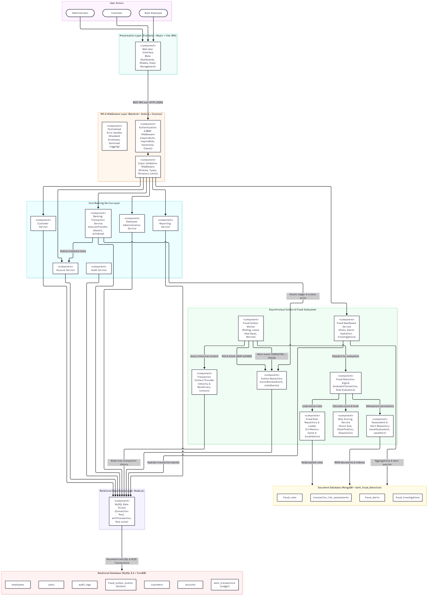
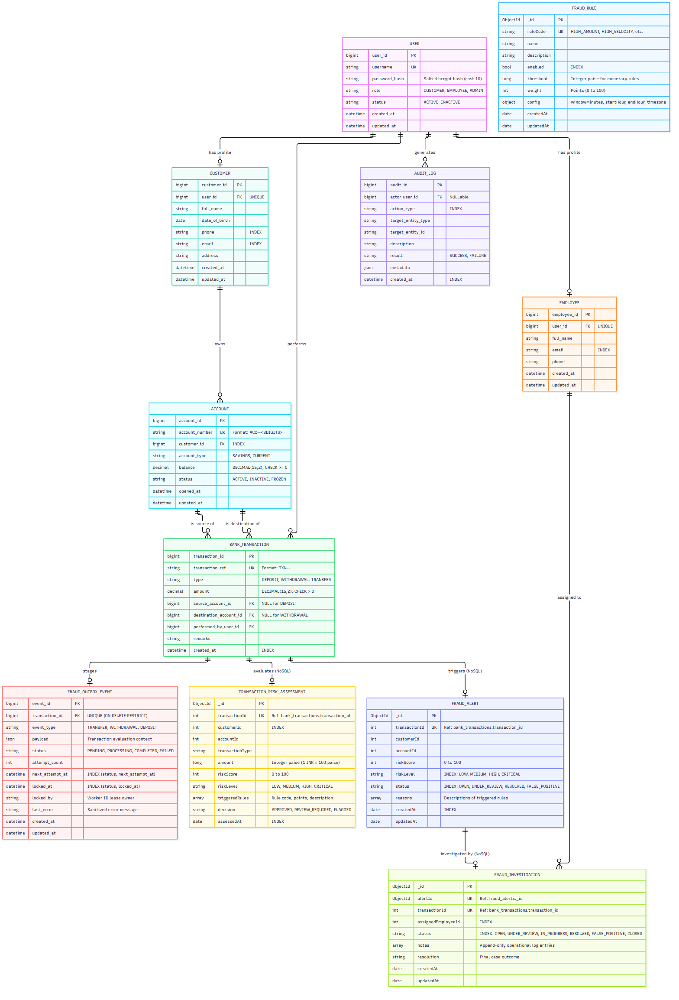
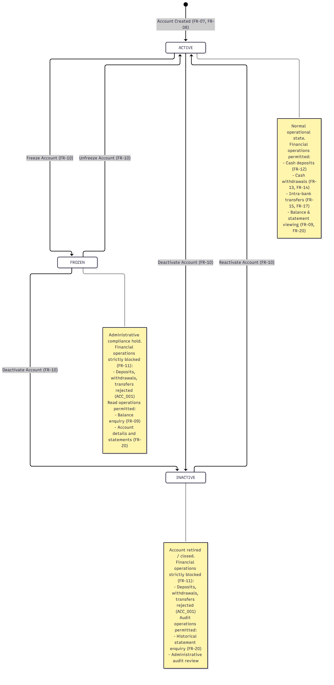
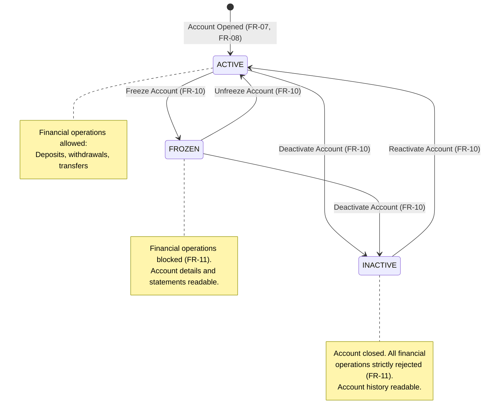
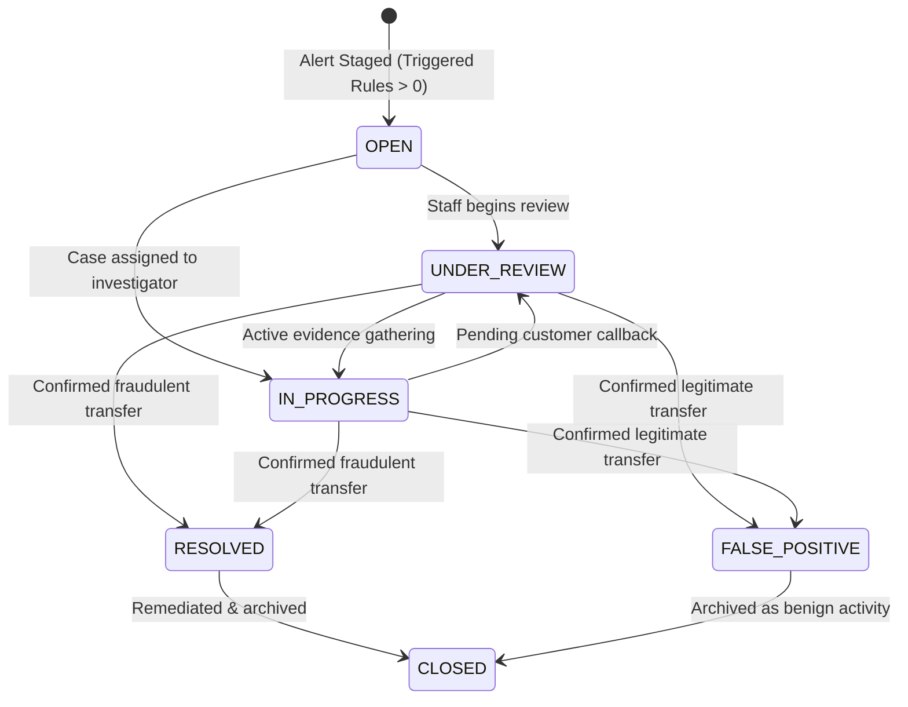
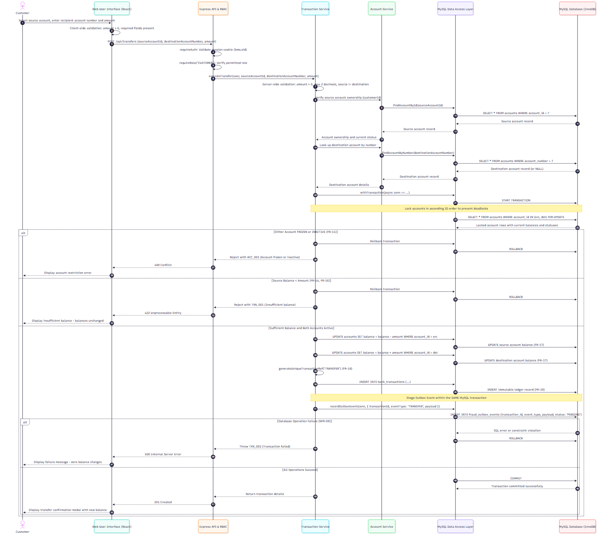
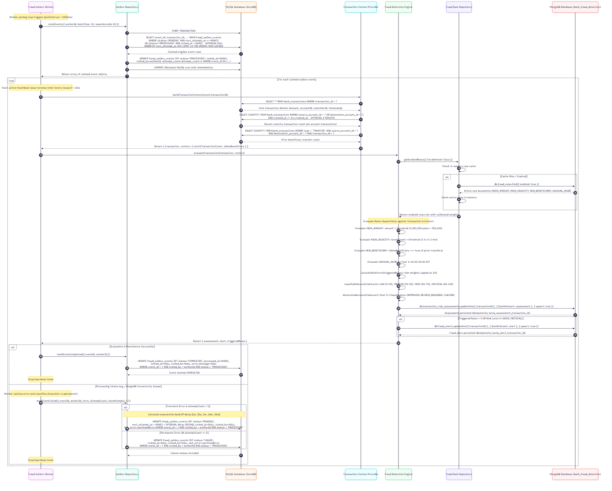
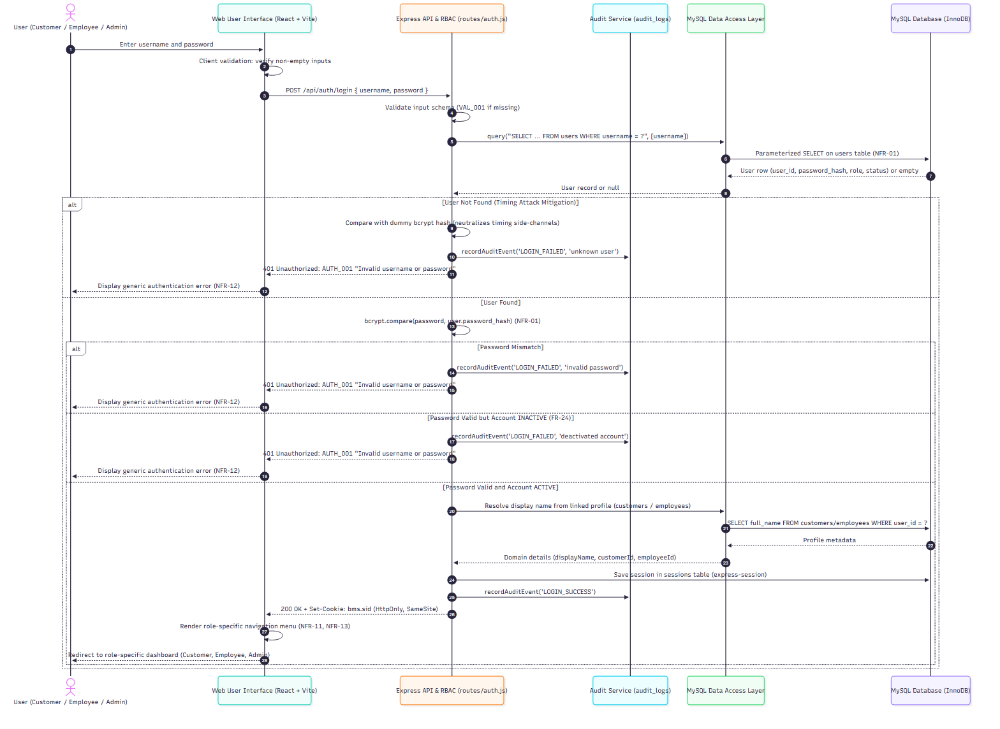

# Software Architecture and Design Specification

## Bank Management System with MongoDB-Based Rule-Driven Fraud Detection

| Item | Details |
|---|---|
| Document | Software Architecture and Design (SAD) Specification |
| Project | Bank Management System (BMS) with Asynchronous Fraud Detection Subsystem |
| Phase | Phase 1: Architecture, Preliminary Design, and Subsystem Integration |
| Version | 1.2 |
| Date | 7 November 2026 |
| Standard followed | IEEE Std 1016-2009 (Software Design Descriptions), ISO/IEC/IEEE 42010 concepts |
| Related documents | [SRS](SRS.md), [Test Plan](test_plan.md), [RTM](rtm.md), [Actors and Use Cases](actors_usecases.md) |
| Implementation Status | Fully Implemented Baseline Architecture |

### Revision History

| Version | Date | Description |
|---|---|---|
| 0.1 | 29 Sep 2026 | Initial preliminary architecture, three-tier model, and initial component boundaries |
| 1.0 | 14 Oct 2026 | Baseline IEEE-style architecture; formalized layered responsibilities, initial MySQL entity-relationship model, and sequence diagrams for login and transfer |
| 1.1 | 21 Oct 2026 | Technology stack finalization: React with Vite (frontend), Node.js with Express (backend), MySQL (relational database), and REST API over HTTP |
| 1.2 | 07 Nov 2026 | Comprehensive architectural refinement incorporating the dual-database architecture (MySQL + MongoDB), the asynchronous transactional outbox background pipeline, rule-driven fraud detection engine, role-based fraud dashboard, and reconciled API catalogue |

---

## Table of Contents

1. [Introduction](#1-introduction)
   - 1.1 [Purpose](#11-purpose)
   - 1.2 [Scope](#12-scope)
   - 1.3 [Design Goals](#13-design-goals)
   - 1.4 [Definitions and Acronyms](#14-definitions-and-acronyms)
2. [Architectural Overview](#2-architectural-overview)
   - 2.1 [System Overview](#21-system-overview)
   - 2.2 [Dual-Database Architecture Rationale](#22-dual-database-architecture-rationale)
   - 2.3 [Asynchronous Transactional Outbox Strategy](#23-asynchronous-transactional-outbox-strategy)
3. [Architecture Pattern](#3-architecture-pattern)
   - 3.1 [Layer Responsibilities](#31-layer-responsibilities)
   - 3.2 [Layering Rules and Boundaries](#32-layering-rules-and-boundaries)
   - 3.3 [Architectural Alternatives and Trade-Off Analysis](#33-architectural-alternatives-and-trade-off-analysis)
4. [Component Architecture](#4-component-architecture)
   - 4.1 [Component Diagram](#41-component-diagram)
   - 4.2 [Component Descriptions](#42-component-descriptions)
   - 4.3 [Fraud Detection Subsystem Architecture](#43-fraud-detection-subsystem-architecture)
5. [Requirement-to-Architecture Traceability](#5-requirement-to-architecture-traceability)
   - 5.1 [Functional Requirements Mapping](#51-functional-requirements-mapping)
   - 5.2 [Non-Functional Requirements Mapping](#52-non-functional-requirements-mapping)
6. [Security Architecture](#6-security-architecture)
   - 6.1 [Security Processing Flow](#61-security-processing-flow)
   - 6.2 [Security Controls and Protective Mechanisms](#62-security-controls-and-protective-mechanisms)
   - 6.3 [Role-to-Operation Authorization Matrix](#63-role-to-operation-authorization-matrix)
7. [Data Design](#7-data-design)
   - 7.1 [MySQL Relational Design (Authoritative Financial Store)](#71-mysql-relational-design-authoritative-financial-store)
   - 7.2 [MongoDB Document Design (Fraud Detection Store)](#72-mongodb-document-design-fraud-detection-store)
   - 7.3 [Cross-Database Referential Integrity and Logical References](#73-cross-database-referential-integrity-and-logical-references)
   - 7.4 [State Machine Models](#74-state-machine-models)
8. [Dynamic Design: UML Sequence Diagrams](#8-dynamic-design-uml-sequence-diagrams)
   - 8.1 [Sequence Diagram 1: Banking Transaction Processing (Fund Transfer)](#81-sequence-diagram-1-banking-transaction-processing-fund-transfer)
   - 8.2 [Sequence Diagram 2: Asynchronous Fraud Detection (Outbox Pipeline)](#82-sequence-diagram-2-asynchronous-fraud-detection-outbox-pipeline)
   - 8.3 [Sequence Diagram 3: User Authentication and Session Management](#83-sequence-diagram-3-user-authentication-and-session-management)
9. [API Design](#9-api-design)
   - 9.1 [Conventions and Standards](#91-conventions-and-standards)
   - 9.2 [Implemented API Endpoint Catalogue](#92-implemented-api-endpoint-catalogue)
   - 9.3 [API Endpoint Detailed Specifications](#93-api-endpoint-detailed-specifications)
10. [Error-Handling Protocols](#10-error-handling-protocols)
    - 10.1 [Standardized JSON Error Envelopes](#101-standardized-json-error-envelopes)
    - 10.2 [Banking Request Error Protocol](#102-banking-request-error-protocol)
    - 10.3 [Asynchronous Fraud Processing Error and Retry Protocol](#103-asynchronous-fraud-processing-error-and-retry-protocol)
    - 10.4 [Error Code Catalogue](#104-error-code-catalogue)
11. [Transaction Management and Concurrency](#11-transaction-management-and-concurrency)
    - 11.1 [Relational Concurrency and Row-Level Locking](#111-relational-concurrency-and-row-level-locking)
    - 11.2 [Deadlock Prevention Protocol](#112-deadlock-prevention-protocol)
    - 11.3 [Dual-Database Non-Distributed Transaction Rationale](#113-dual-database-non-distributed-transaction-rationale)
12. [Logging, Auditing, and Accountability](#12-logging-auditing-and-accountability)
    - 12.1 [Audit Log Architecture](#121-audit-log-architecture)
    - 12.2 [Sensitive Data Redaction Rules](#122-sensitive-data-redaction-rules)
13. [Deployment View](#13-deployment-view)
    - 13.1 [Runtime Deployment Topology](#131-runtime-deployment-topology)
    - 13.2 [Environment Configuration Management](#132-environment-configuration-management)
14. [Design Decisions and Trade-Off Rationale](#14-design-decisions-and-trade-off-rationale)
15. [Architecture and Design Validation Summary](#15-architecture-and-design-validation-summary)

---

## 1. Introduction

### 1.1 Purpose

This document provides the authoritative Software Architecture and Design (SAD) Specification for the **Bank Management System (BMS)**. It details the structural organization, component interactions, relational and document database schemas, security perimeters, dynamic execution sequences, and RESTful APIs of the system as implemented. 

The system implements a polyglot dual-database architecture: a relational **MySQL 8.0** database serving as the ACID financial ledger and transactional outbox, alongside a document-oriented **MongoDB** database powering a decoupled, rule-driven fraud detection subsystem.

### 1.2 Scope

The architecture covers all functional requirements (FR-01 through FR-25) and non-functional requirements (NFR-01 through NFR-18) established in the [SRS](SRS.md) across three distinct user roles: **Customer**, **Bank Employee**, and **Administrator**.

The scope encompasses:
- Single-page application presentation tier (React + Vite).
- RESTful application and API middleware tier (Node.js + Express).
- Core banking services (authentication, customer profile, account lifecycle, cash desk, fund transfers, reporting, auditing).
- Asynchronous transactional outbox pipeline and background worker.
- Rule-based fraud detection engine, risk scoring models, alert generation, and investigation case management.
- Polyglot persistence model (MySQL 8.0 InnoDB + MongoDB 6.0+).

Out-of-scope capabilities (external payment gateways, inter-bank NEFT/RTGS settlement, automated clearing houses, microservices meshes) are intentionally omitted to maintain focus on the DBMS Level 3 prototype objectives.

### 1.3 Design Goals

| Goal | Architectural Strategy | Requirements Supported |
|---|---|---|
| **Financial Integrity** | Strict ACID transactions in MySQL (InnoDB), row-level locking (`SELECT ... FOR UPDATE`), database-level check constraints (`balance >= 0`), and insert-only ledger rows. | NFR-08, NFR-09, NFR-10, NFR-17, NFR-18 |
| **Decoupled Resilience** | Asynchronous transactional outbox pattern decoupling synchronous banking transactions from downstream fraud analysis. Temporary MongoDB outages cannot block or roll back core banking operations. | NFR-09, NFR-10, NFR-14 |
| **Defensive Security** | Session-based authentication via HTTP-only signed cookies, salted bcrypt password hashing with timing attack mitigation, role-based access control (RBAC), and customer horizontal data isolation. | NFR-01 – NFR-05, NFR-12 |
| **Auditability & Accountability** | Dual-layer auditing: immutable relational financial transactions (`bank_transactions`), administrative activity trail (`audit_logs`), and document-level investigation logs (`fraud_investigations`). | NFR-10, NFR-16, FR-19, FR-21 |
| **High Maintainability** | Modular layered separation into independent service modules, distinct database repositories, centralized error middleware, and consistent naming conventions. | NFR-14, NFR-15 |
| **Predictable Performance** | Sub-3s operational response and sub-5s transaction execution under target prototype volume (up to 10 concurrent users; SRS assumption A-02) using indexed lookups and short lock durations. | NFR-06, NFR-07 |

### 1.4 Definitions and Acronyms

| Term / Acronym | Meaning |
|---|---|
| **ACID** | Atomicity, Consistency, Isolation, Durability — database transaction guarantees enforced by MySQL InnoDB. |
| **BMS** | Bank Management System. |
| **BSON** | Binary JSON — document storage format used natively by MongoDB. |
| **Idempotency** | The property where an operation produces identical system state regardless of whether it is executed once or multiple times. |
| **Lease Heartbeat** | Periodic renewal of a worker's lock timestamp on an outbox event to prevent premature lease expiration during active processing. |
| **Outbox Pattern** | Architectural pattern where outbound domain events are persisted into a local relational database table within the same ACID transaction as core business data, then asynchronously polled and processed. |
| **Paise** | Smallest monetary currency unit in the Indian Rupee system (1 INR = 100 paise). The fraud engine uses integer paise internally to avoid floating-point rounding errors. |
| **RBAC** | Role-Based Access Control — authorization mechanism restricting endpoint execution according to user role (`CUSTOMER`, `EMPLOYEE`, `ADMIN`). |
| **Sliding Inactivity Timeout** | Session expiration policy where the session lifetime is reset on every authenticated request (configured to 15 minutes). |

---

## 2. Architectural Overview

### 2.1 System Overview

The Bank Management System is engineered as a **Layered / Three-Tier Architecture extended with Asynchronous Transactional Outbox Background Processing**.

```text
┌─────────────────────────────────────────────────────────────────────────────────┐
│              Client Browser Tier (Customer / Employee / Admin)                  │
└────────────────────────────────────────┬────────────────────────────────────────┘
                                         │ HTTPS / HTTP REST API (JSON Payloads)
┌────────────────────────────────────────▼────────────────────────────────────────┐
│  PRESENTATION LAYER (Frontend — React Single-Page Application via Vite)        │
│  Role-Specific Dashboards · Interactive Modals · React State · Navigation       │
└────────────────────────────────────────┬────────────────────────────────────────┘
                                         │ Express Middleware Pipeline
┌────────────────────────────────────────▼────────────────────────────────────────┐
│  API & MIDDLEWARE LAYER (Node.js + Express)                                    │
│  Session Authentication (`bms.sid`) · Role Authorization (`requireRole`)        │
│  Input Validation Middleware · Centralized Error Handler (`errorHandler`)      │
├─────────────────────────────────────────────────────────────────────────────────┤
│  CORE BANKING SERVICES (Synchronous Service Layer)                              │
│  Customer Service · Account Service · Banking Transaction Service               │
│  Employee Administration Service · Reporting Service · Audit Service            │
├────────────────────────────────────────┬────────────────────────────────────────┤
│  RELATIONAL DATA ACCESS (MySQL DAL)    │  TRANSACTIONAL OUTBOX (Staging)         │
│  Connection Pool · `withTransaction`   │  `recordOutboxEvent(conn, ...)`        │
└───────────────────┬────────────────────┴───────────────────┬────────────────────┘
                    │ SQL Protocol (ACID)                    │ Staged Outbox Event
┌───────────────────▼────────────────────────────────────────▼────────────────────┐
│  PRIMARY RELATIONAL DATABASE (MySQL 8.0 / InnoDB) — Authoritative Financial     │
│  users · customers · employees · accounts · bank_transactions                   │
│  audit_logs · fraud_outbox_events                                               │
└────────────────────────────────────────┬────────────────────────────────────────┘
                                         │ Asynchronous Polling (SKIP LOCKED)
┌────────────────────────────────────────▼────────────────────────────────────────┐
│  ASYNCHRONOUS FRAUD SUBSYSTEM (Background Worker & Engine)                      │
│  Fraud Outbox Worker (`claimEvents`, lease renewal, exponential backoff)        │
│  Transaction Context Provider (queries historical context from MySQL)           │
│  Fraud Detection Engine (`evaluateTransaction`, calibrated rule execution)      │
│  Risk Scoring Service (0–100 score capping, risk level classification)          │
│  Fraud Rule Repository & In-Memory Cache (hot invalidation)                     │
│  Assessment & Alert Repository (`saveAssessment`, `saveAlert`)                  │
└────────────────────────────────────────┬────────────────────────────────────────┘
                                         │ MongoDB Wire Protocol
┌────────────────────────────────────────▼────────────────────────────────────────┐
│  DOCUMENT DATABASE (MongoDB 6.0+ — bank_fraud_detection)                        │
│  transaction_risk_assessments · fraud_alerts · fraud_rules · fraud_investigations│
└─────────────────────────────────────────────────────────────────────────────────┘
```

### 2.2 Dual-Database Architecture Rationale

The selection of a polyglot dual-database design is rooted in distinct operational and analytical requirements:

1. **MySQL 8.0 (InnoDB) — The Authoritative Financial Ledger:**
   - Financial accounting requires strict serializability, foreign key constraints, row-level locking (`SELECT ... FOR UPDATE`), and ACID guarantees.
   - Balances must never be subject to eventual consistency; overdrafts must be blocked synchronously at the moment of execution.
   - Relational schemas enforce column types (`DECIMAL(15,2)`), `NOT NULL` rules, and domain integrity (`CHECK (balance >= 0)`).
   - MySQL acts as the sole source of truth for account balances and financial ledgers.

2. **MongoDB — The Fraud Detection Document Store:**
   - Fraud evaluation generates complex, semi-structured analytical outputs, including arrays of triggered rules, variable rule configurations, and append-only investigator case notes.
   - Fraud rules require dynamic configuration schemas (e.g., velocity rules require `windowMinutes`, off-hour rules require `startHour`, `endHour`, `timezone`).
   - MongoDB aggregation pipelines provide high-performance multidimensional analytical queries (risk score distributions, average risk calculations, alert counts by risk level) without placing analytical query loads on the transactional MySQL database.
   - Document-level write isolation ensures that high-volume fraud logging does not compete with financial ledger write locks.

### 2.3 Asynchronous Transactional Outbox Strategy

Directly writing to both MySQL and MongoDB during a synchronous banking transaction introduces a **dual-write hazard**: if MySQL commits but MongoDB fails, or if a network partition occurs between the application and MongoDB, the system faces data divergence or hangs the customer's transfer. 

The BMS resolves this by employing the **Transactional Outbox Pattern**:
1. When a transaction executes in [`transactionService.js`](../../backend/src/services/transactionService.js), an immutable ledger record is inserted into `bank_transactions`, and a corresponding pending event is inserted into `fraud_outbox_events` **within the exact same MySQL database transaction**.
2. If MySQL commits, both the financial transfer and the outbox event exist durably. If MySQL rolls back, neither exists.
3. The background worker ([`fraudOutboxWorker.js`](../../backend/src/services/fraud/fraudOutboxWorker.js)) polls `fraud_outbox_events` asynchronously using MySQL 8.0 `FOR UPDATE SKIP LOCKED`.
4. The worker processes the event, evaluates fraud rules, persists assessment records in MongoDB, and marks the outbox event `COMPLETED`.
5. If MongoDB is temporarily unavailable, the banking transaction has already succeeded; outbox events accumulate safely in MySQL and are retried automatically with exponential backoff once MongoDB recovers.

---

## 3. Architecture Pattern

### 3.1 Layer Responsibilities

The system enforces a clear separation of concerns across five logical tiers:

| Layer | Primary Responsibilities | Architectural Constraints (Must NOT) |
|---|---|---|
| **1. Presentation Layer** | Renders React views, role-tailored dashboards, form input handling, client-side validation for UX, modal flows, and sanitized error display. | Must NOT contain core banking business logic or execute SQL/MongoDB queries directly. |
| **2. API & Middleware Layer** | Route dispatching, session authentication (`bms.sid`), role-based authorization (`requireRole`), request parameter sanitation, and centralized exception handling. | Must NOT execute raw database queries or expose internal database error details to clients. |
| **3. Business Logic / Service Layer** | Coordinates core banking operations (balance checks, transfer orchestration, employee lifecycle, report compilation) and fraud rule evaluation. | Must NOT construct raw SQL strings directly; communicates strictly through repositories and data access modules. |
| **4. Data Access Layer (DAL)** | Encapsulates parameterized SQL queries, connection pooling, transaction boundaries (`withTransaction`), row locking, and MongoDB Mongoose/native operations. | Must NOT make business policy decisions (e.g., overdraft eligibility or role permissions). |
| **5. Database Tier** | MySQL guarantees ACID durability and relational constraints. MongoDB guarantees document persistence, schema validation, and analytical aggregation. | Must NOT be directly accessible from the public internet or the client browser. |

### 3.2 Layering Rules and Boundaries

1. **Strict Downward Invocation:** A layer may only call components in the layer immediately below it. The Presentation Layer communicates exclusively with the Express API via HTTP; it never interacts with the data access layer or database engines.
2. **Authoritative Server-Side Validation:** Client-side validation is strictly for user experience. All validation checks (data types, mandatory fields, monetary ranges, account status, ownership) are repeated authoritatively on the backend.
3. **Repository Abstraction:** Domain services never write inline SQL. All relational interactions pass through `config/db.js` or specialized repositories (`outboxRepository.js`).
4. **Decoupled Fraud Processing:** The fraud subsystem communicates with core banking strictly via read-only transaction context queries and the outbox repository; it never mutates core financial tables.

### 3.3 Architectural Alternatives and Trade-Off Analysis

| Architectural Pattern | Evaluation for BMS Prototype | Final Decision & Rationale |
|---|---|---|
| **Monolithic Layered with Outbox (Selected)** | Combines simple deployment, zero distributed network overhead for core operations, strict ACID consistency for money, and asynchronous resilience for fraud detection. | **Selected:** Ideal for an academic prototype; achieves enterprise-grade reliability patterns without distributed operational complexity. |
| **Microservices Architecture** | Would divide banking, auth, and fraud into separate microservices communicating over HTTP/gRPC. | **Rejected:** Introduces distributed transaction challenges (two-phase commit or saga patterns for dual-balance transfers), network failure modes, service discovery overhead, and excessive deployment complexity for a single-server prototype. |
| **Synchronous Dual-Database Writes** | Writing to MySQL and MongoDB simultaneously inside the HTTP request cycle. | **Rejected:** Creates dual-write vulnerability; a failure in MongoDB would either abort a valid financial transfer or leave MySQL committed without fraud audit records. |
| **Single-Tier (Direct-to-Database)** | Browser communicates directly with Firebase or MySQL via client libraries. | **Rejected:** Unacceptable security posture; business logic and database credentials cannot be safely protected in browser runtimes. |

---

## 4. Component Architecture

### 4.1 Component Diagram

The following diagram illustrates the complete component architecture, dependencies, and communication boundaries across the Bank Management System:



*Figure 1: Component Diagram. Source specification: [diagrams/component_diagram.md](diagrams/component_diagram.md)*

### 4.2 Component Descriptions

| Component ID | Component Name | Technology | Responsibility | Primary Collaborators |
|---|---|---|---|---|
| **CMP-01** | **Web User Interface** | React 18, Vite, Tailwind CSS | Single-page application rendering role-specific views for Customers, Employees, and Admins; state management; form validation; and async HTTP communication. | Browser Actors, CMP-02 (API Middleware) |
| **CMP-02** | **Authentication & RBAC Middleware** | Node.js, Express, `express-session` | Validates session cookies (`bms.sid`), checks user active status, enforces role boundaries (`requireRole`), and verifies customer resource ownership. | CMP-01, CMP-03, CMP-11 |
| **CMP-03** | **Input Validation Middleware** | Node.js, custom validators | Validates incoming request headers, parameters, and JSON payloads (required fields, formats, lengths, monetary precision) before business logic execution. | CMP-02, CMP-05 through CMP-10, CMP-16 |
| **CMP-04** | **Centralized Error Handler** | Node.js Express middleware | Intercepts all operational and system exceptions, translates error codes, generates tracking UUIDs, logs stack traces locally, and returns sanitized JSON error envelopes. | All Express API routes |
| **CMP-05** | **Customer Service** | Node.js service | Handles customer registration, profile lookups, and authorized contact information updates. | CMP-03, CMP-11 (MySQL DAL) |
| **CMP-06** | **Account Service** | Node.js service | Opens customer accounts, generates collision-resistant unique account numbers (`ACC-<TYPE>-<8-DIGITS>`), manages account status, and answers balance queries. | CMP-03, CMP-07, CMP-11 |
| **CMP-07** | **Banking Transaction Service** | Node.js service (`transactionService.js`) | Coordinates deposits, withdrawals, and customer transfers; acquires row locks; updates balances; inserts ledger rows; and stages outbox events. | CMP-06, CMP-11, CMP-12 (Outbox Repo) |
| **CMP-08** | **Employee Administration Service** | Node.js service | Implements administrative employee management: account provisioning, role enforcement, status deactivation, and session revocation. | CMP-02, CMP-03, CMP-10, CMP-11 |
| **CMP-09** | **Reporting Service** | Node.js service (`reports.js`) | Executes database-level SQL aggregations (`COUNT`, `SUM`, `AVG`) to produce system summaries, customer metrics, account status distributions, and transaction volume reports. | CMP-11 (MySQL DAL) |
| **CMP-10** | **Audit Service** | Node.js service (`auditService.js`) | Records auditable administrative, security, and banking events into the `audit_logs` table for institutional governance. | CMP-02, CMP-08, CMP-11 |
| **CMP-11** | **MySQL Data Access Layer** | Node.js `mysql2/promise` pool | Manages MySQL connection pool, parameterized query execution, row-level locks (`SELECT ... FOR UPDATE`), and atomic transaction scope (`withTransaction`). | CMP-05 – CMP-10, CMP-12, CMP-17 (MySQL) |
| **CMP-12** | **Transactional Outbox Repository** | Node.js repository (`outboxRepository.js`) | Atomically stages events into `fraud_outbox_events` (`recordOutboxEvent`), claims eligible batches with `FOR UPDATE SKIP LOCKED` (`claimEvents`), and updates outbox states. | CMP-07, CMP-13, CMP-17 (MySQL) |
| **CMP-13** | **Background Fraud Worker** | Node.js background process (`fraudOutboxWorker.js`) | Asynchronously polls outbox events, maintains lease heartbeats, invokes context enrichment, triggers fraud evaluation, and executes retry backoffs. | CMP-12, CMP-14, CMP-15 |
| **CMP-14** | **Transaction Context Provider** | Node.js provider (`transactionContextProvider.js`) | Performs read-only queries against MySQL ledger history to build analytical context (recent transaction velocity count, first-time beneficiary check). | CMP-11 (MySQL DAL), CMP-13 |
| **CMP-15** | **Fraud Detection Engine & Rules** | Node.js engine (`fraudDetectionService.js`, `fraudEngine.js`) | Evaluates transactions against enabled MongoDB rules (`HIGH_AMOUNT`, `HIGH_VELOCITY`, `NEW_BENEFICIARY`, `UNUSUAL_HOUR`), aggregates risk scores (0–100), and classifies risk levels. | CMP-13, CMP-18 (MongoDB), Risk Scoring |
| **CMP-16** | **Fraud Dashboard Service** | Node.js service (`fraudDashboardService.js`) | Serves fraud overview metrics via MongoDB aggregation pipelines, lists paginated alerts with hydrated MySQL banking details, and manages investigation case lifecycles. | CMP-11, CMP-18 (MongoDB) |
| **CMP-17** | **Relational Database** | MySQL 8.0 (InnoDB) | Authoritative storage for core banking entities (`users`, `customers`, `employees`, `accounts`, `bank_transactions`, `audit_logs`, `fraud_outbox_events`). | CMP-11 (MySQL DAL) |
| **CMP-18** | **Document Database** | MongoDB 6.0+ (`bank_fraud_detection`) | Analytical storage for fraud management collections (`transaction_risk_assessments`, `fraud_alerts`, `fraud_rules`, `fraud_investigations`). | CMP-15, CMP-16 |

### 4.3 Fraud Detection Subsystem Architecture

The fraud detection subsystem is implemented as an asynchronous, decoupled pipeline designed to evaluate transaction risks without imposing latency or availability risks on core banking operations:

1. **Transactional Event Staging (CMP-12):** When a financial transaction is committed within `transactionService.js` (CMP-07), an outbox event is inserted into MySQL table `fraud_outbox_events` (CMP-17) within the same ACID database transaction (`withTransaction`). This guarantees atomic event creation with zero dual-write risk.
2. **Lease-Based Worker Consumption (CMP-13):** The background worker continuously polls for `PENDING` events using MySQL 8.0 `SELECT ... FOR UPDATE SKIP LOCKED`. Claimed events are leased with a 60-second lock duration and an active 20-second heartbeat renewal, allowing concurrent worker nodes to operate without duplicate claims or deadlocks.
3. **Context Enrichment (CMP-14):** `transactionContextProvider.js` queries MySQL read-only ledger history to construct historical analytical metrics, including recent transaction velocity count across all account transactions (2-minute sliding window) and first-time transfer to a beneficiary check.
4. **Rule Engine & Risk Evaluation (CMP-15):** The enriched transaction is passed to `fraudDetectionService.js`, which retrieves enabled rules from MongoDB `fraud_rules` (CMP-18, cached in-memory with hot invalidation). Four concrete rules are evaluated sequentially:
   - `HIGH_AMOUNT`: Strictly greater than configured paise threshold (weight: 30, threshold: 5,000,000 paise = ₹50,000.00; triggers when `amount > rule.threshold`).
   - `HIGH_VELOCITY`: Account transaction frequency count strictly exceeds configured threshold in 2 minutes (weight: 25, threshold: > 3 transactions involving the primary account).
   - `NEW_BENEFICIARY`: First-time transfer to a beneficiary (weight: 25, threshold: 0 prior transfers from sender account to recipient account).
   - `UNUSUAL_HOUR`: Transaction initiated between 01:00 and 05:00 IST (weight: 20).

   Total risk score is aggregated: $\text{riskScore} = \min(100, \sum \text{triggeredRuleWeights})$.

   The calculated risk score maps to categorical risk levels and automated assessment classifications (`decision`):

   | Risk Score Range | Categorical Risk Level | Assessment Classification (`decision`) | Operational & Compliance Interpretation |
   |:---:|:---:|:---:|---|
   | **0 – 29** | `LOW` | `APPROVED` | Benign transaction; approved for automated closure in fraud audit. |
   | **30 – 59** | `MEDIUM` | `REVIEW_REQUIRED` | Elevated risk; flagged for routine compliance review. Alert created if any rule triggered. |
   | **60 – 79** | `HIGH` | `FLAGGED` | High risk; immediate fraud alert generated for investigator triage. |
   | **80 – 100** | `CRITICAL` | `FLAGGED` | Severe risk; immediate high-priority fraud alert generated for urgent triage. |

   > [!IMPORTANT]
   > **Asynchronous Assessment vs. Banking Settlement:** The fraud engine executes asynchronously in the background worker *after* the financial transaction has successfully committed to the MySQL ledger. The assessment classifications (`APPROVED`, `REVIEW_REQUIRED`, `FLAGGED`) stored in MongoDB `transaction_risk_assessments.decision` are analytical fraud dispositions for auditing and investigation. They do not approve, reject, block, or reverse the already-settled financial transfer.
5. **Analytical Persistence & Alert Dispatch (CMP-18):**
   - A risk assessment document is upserted into MongoDB `transaction_risk_assessments`.
   - If any rule triggered (`triggeredRules.length > 0`) or risk level is HIGH/CRITICAL, a fraud alert is upserted into `fraud_alerts`. Unique indexes on `transactionId` guarantee idempotency during worker retries.
   - MySQL outbox record status is updated to `COMPLETED`.
6. **Operational Monitoring & Case Management (CMP-16):**
   - Bank employees and administrators access `FraudDashboard.jsx` (CMP-01) powered by `fraudDashboardService.js` (CMP-16).
   - Real-time aggregation pipelines compute total assessments, alert volume, average risk score, and status breakdowns.
   - Compliance officers can inspect hydrated alerts, create investigation cases (`fraud_investigations`), append timestamped notes, and update case lifecycle statuses (`UNDER_REVIEW`, `IN_PROGRESS`, `RESOLVED`, `FALSE_POSITIVE`, `CLOSED`).
   - Administrators can reconfigure rule thresholds, adjust weights, and toggle rule enablement via `PATCH /api/fraud/rules/:ruleCode`.

---

## 5. Requirement-to-Architecture Traceability

### 5.1 Functional Requirements Mapping

The 25 Functional Requirements defined in the [SRS](SRS.md) map directly to architectural components:

| Requirement ID | Requirement Description | Primary Architectural Component | Data Store |
|---|---|---|---|
| **FR-01** | User authentication | CMP-02 Authentication & RBAC Middleware | MySQL (`users`, `audit_logs`) |
| **FR-02** | User logout | CMP-02 Authentication & RBAC Middleware | MySQL (`sessions`) |
| **FR-03** | Role-based access control | CMP-02 Authentication & RBAC Middleware | Express Middleware |
| **FR-04** | Register customer account | CMP-05 Customer Service | MySQL (`users`, `customers`) |
| **FR-05** | View customer details | CMP-05 Customer Service | MySQL (`customers`) |
| **FR-06** | Update customer details | CMP-05 Customer Service | MySQL (`customers`) |
| **FR-07** | Create bank account | CMP-06 Account Service | MySQL (`accounts`) |
| **FR-08** | Generate unique account number | CMP-06 Account Service | MySQL (`accounts.account_number`) |
| **FR-09** | View account details and balance | CMP-06 Account Service | MySQL (`accounts`) |
| **FR-10** | Manage account status | CMP-06 Account Service | MySQL (`accounts.status`) |
| **FR-11** | Block restricted accounts | CMP-06 Account Service + CMP-07 Transaction Service | MySQL (`accounts.status`) |
| **FR-12** | Deposit money | CMP-07 Banking Transaction Service | MySQL (`accounts`, `bank_transactions`) |
| **FR-13** | Withdraw money | CMP-07 Banking Transaction Service | MySQL (`accounts`, `bank_transactions`) |
| **FR-14** | Overdraft balance protection | CMP-07 Banking Transaction Service | MySQL (`accounts.balance`, `CHECK`) |
| **FR-15** | Transfer funds | CMP-07 Banking Transaction Service | MySQL (`accounts`, `bank_transactions`) |
| **FR-16** | Balance check before transfer | CMP-07 Banking Transaction Service | MySQL (`accounts.balance` locked) |
| **FR-17** | Update sender & receiver balances | CMP-07 Banking Transaction Service | MySQL (`accounts.balance`) |
| **FR-18** | Generate unique transaction ID | CMP-07 Banking Transaction Service | MySQL (`bank_transactions.transaction_ref`) |
| **FR-19** | Record transaction & stage outbox | CMP-07 Transaction Service + CMP-12 Outbox Repo | MySQL (`bank_transactions`, `fraud_outbox_events`) |
| **FR-20** | Customer transaction history | CMP-07 Banking Transaction Service | MySQL (`bank_transactions`) |
| **FR-21** | Staff transaction & fraud view | CMP-07 Transaction Service + CMP-16 Fraud Dashboard | MySQL (`bank_transactions`) + MongoDB (`fraud_alerts`) |
| **FR-22** | Change password *(Scheduled)* | CMP-02 Authentication & RBAC Middleware | MySQL (`users.password_hash`) |
| **FR-23** | Manage employee accounts | CMP-08 Employee Administration Service | MySQL (`users`, `employees`) |
| **FR-24** | Deactivate employee accounts | CMP-08 Employee Administration Service + CMP-02 | MySQL (`users.status`, session store) |
| **FR-25** | System reports & fraud stats | CMP-09 Reporting Service + CMP-16 Fraud Dashboard | MySQL Aggregations + MongoDB Aggregations |

### 5.2 Non-Functional Requirements Mapping

| Requirement ID | Quality Attribute | Architectural Mechanism | Responsible Component |
|---|---|---|---|
| **NFR-01** | Password Security | Salted bcrypt one-way hashing (work factor 10); passwords never logged or returned in API responses. | CMP-02 Authentication Middleware |
| **NFR-02** | Role-Based Access | Server-side `requireRole` middleware checks every endpoint against user session role. | CMP-02 Authentication Middleware |
| **NFR-03** | Data Access Security | Customer ownership checks prevent horizontal data access; fraud endpoints strictly barred from customers. | CMP-02 Authentication Middleware |
| **NFR-04** | Input Validation | Centralized validation checks data types, non-negative amounts, date ranges, and sanitizes strings. | CMP-03 Input Validation Middleware |
| **NFR-05** | Authentication Precedence | Protected routes require valid active session before executing any business logic. | CMP-02 Authentication Middleware |
| **NFR-06** | System Operations Latency | Design target: SQL database aggregations (`COUNT`, `SUM`, `AVG`) utilize indexed keys to satisfy the 3-second system response limit under normal prototype load. | CMP-09 Reporting Service, CMP-11 |
| **NFR-07** | Transaction Latency | Design target: Row locks are held briefly for atomic balance updates; outbox staging decouples downstream analysis so transfers satisfy the 5-second response limit. | CMP-07 Banking Transaction Service |
| **NFR-08** | Financial Consistency | MySQL InnoDB ACID transactions enforce exact math; MySQL is sole authoritative source of truth. | CMP-07 Transaction Service, CMP-17 |
| **NFR-09** | Atomicity & Rollback | `withTransaction` wraps balance updates, ledger insert, and outbox staging; rolls back completely on error. | CMP-07 Transaction Service, CMP-11 |
| **NFR-10** | Record Immutability | Insert-only ledger table; `ON DELETE RESTRICT` protects referenced transaction records from deletion. | CMP-07, CMP-11, CMP-17 |
| **NFR-11** | Usability & Role Views | Role-specific top navigation menus and views rendered dynamically based on authenticated profile. | CMP-01 Web User Interface |
| **NFR-12** | Safe Error Handling | Structured error envelopes (`{ success: false, error: { code, message, referenceId } }`) without leaking internals. | CMP-04 Centralized Error Handler |
| **NFR-13** | Navigation Efficiency | Direct top-level navigation and 1-click modal dialogues ensure core operations complete in $\le 3$ clicks. | CMP-01 Web User Interface |
| **NFR-14** | Modularity & Decoupling | Layered structure; fraud subsystem communicates exclusively via transactional outbox and read-only context. | Architecture-wide |
| **NFR-15** | Code Standards & JSDoc | Standard camelCase/PascalCase naming conventions, ESLint compliance, and JSDoc module headers. | Architecture-wide |
| **NFR-16** | Unique Identifiers | Auto-increment primary keys, unique account format (`ACC-<TYPE>-<8-DIGITS>`), cryptographic transaction refs. | CMP-06, CMP-07, CMP-17, CMP-18 |
| **NFR-17** | Concurrency Safety | Row-level locking (`SELECT ... FOR UPDATE`) in ascending account ID order prevents lost updates and deadlocks. | CMP-07 Banking Transaction Service |
| **NFR-18** | Dual-Database Integrity | MySQL enforces relational schema, FKs, and check constraints; MongoDB enforces JSON Schema validators. | CMP-11, CMP-17, CMP-18 |

---

## 6. Security Architecture

### 6.1 Security Processing Flow

Every incoming HTTP request passes through an enforced multi-stage security pipeline before reaching business logic or data storage:

```text
HTTP Request from Client Browser
  │
  ▼
1. Transport & CORS Validation
   (Restricted to client origin; rejects cross-origin script requests)
  │
  ▼
2. Session Authentication (`requireAuth`)
   (Validates signed `bms.sid` cookie against MySQL session store; verifies user is ACTIVE)
  │
  ▼
3. Role-Based Authorization (`requireRole`)
   (Matches session role against permitted endpoint roles: CUSTOMER, EMPLOYEE, ADMIN)
  │
  ▼
4. Horizontal Ownership Verification
   (For CUSTOMER role: validates that requested accountId/customerId belongs to logged-in user)
  │
  ▼
5. Fraud Clearance Check
   (Customers strictly forbidden from accessing /api/fraud/*; returns HTTP 403 AUTH_002)
  │
  ▼
6. Input Validation Middleware
   (Validates types, required fields, decimal format, regex bounds; rejects with HTTP 400 VAL_001)
  │
  ▼
7. Business Service & Data Layer Execution
   (Executes business logic within parameterized SQL queries inside ACID transaction boundaries)
```

### 6.2 Security Controls and Protective Mechanisms

| Control Mechanism | Implementation Details | Threats Mitigated | SRS Objective |
|---|---|---|---|
| **Salted Password Hashing** | Bcrypt algorithm with cost factor 10 and random salt. Passwords are never stored in plain text, logged, or returned in API responses. | Credential compromise, database leak exposure | SO-01, SO-03 |
| **Timing Attack Defense** | When a login attempt specifies an unknown username, a dummy bcrypt comparison is executed against a precomputed static hash (`$2b$10$wT8K8U1yH4Cq...`) before returning `AUTH_001`. | User enumeration via response timing | SO-01 |
| **Secure Session Handling** | HTTP-only, `SameSite=Lax` session cookies (`bms.sid`) signed by a server-side secret; stored in MySQL table `sessions`. Configured with a sliding 15-minute inactivity timeout. | Session hijacking, Cross-Site Scripting (XSS) token theft | SO-01, SO-03 |
| **Immediate Invalidation on Deactivation** | When an administrator deactivates an employee or customer, `users.status` becomes `INACTIVE`. On the subsequent request, `requireAuth` queries the database and immediately rejects the session. | Continued unauthorized access by terminated staff | SO-03 |
| **Role-Based Authorization** | Centralized `requireRole('EMPLOYEE', 'ADMIN')` middleware guards all management, staff, and fraud routes. Unauthorized roles receive HTTP 403 `AUTH_002`. | Privilege escalation | SO-03 |
| **Horizontal Isolation** | Customer requests query only accounts owned by `req.user.customerId`. Attempts to specify other account IDs in transfers or statements return HTTP 403 `AUTH_002`. | Insecure Direct Object References (IDOR) | SO-01 |
| **Fraud Clearance Protection** | All `/api/fraud/*` endpoints are explicitly barred from Customer accounts. Only Employees and Admins have access; rule configuration is restricted strictly to Admins. | Internal fraud scoring leakage, insider manipulation | SO-01, SO-03 |
| **SQL Injection Prevention** | All MySQL interactions execute via parameterized queries (`conn.execute('SELECT ... WHERE id = ?', [id])`). No user input is ever concatenated into SQL. | SQL injection (SQLi) | SO-02 |
| **Cross-Site Scripting (XSS)** | React's JSX virtual DOM automatically escapes all rendered variables. Input validation rejects malicious payloads before persistence. | Stored and Reflected XSS | SO-01, SO-02 |
| **Sanitized Error Envelopes** | Error responses return standardized error codes and safe messages. Stack traces and database syntax errors are logged server-side only. | Information disclosure | SO-01 |
| **Outbox Credential Redaction** | `sanitizeErrorMessage` in `outboxRepository.js` strips MongoDB URIs, database passwords, and secrets before saving error messages into `fraud_outbox_events.last_error`. | Credential leakage in error logs | SO-01 |

### 6.3 Role-to-Operation Authorization Matrix

| Banking & Fraud Operation | Endpoint Path | Customer | Bank Employee | Administrator |
|---|---|:---:|:---:|:---:|
| **Login / Logout / Safe Profile** | `/api/auth/login`, `/logout`, `/me` | ✔ | ✔ | ✔ |
| **View Own Accounts & History** | `/api/accounts`, `/api/accounts/:id/transactions` | ✔ *(Own)* | ✔ *(All)* | ✔ *(All)* |
| **Update Own Contact Details** | `/api/customers/profile`, `/api/customers/:id` | ✔ *(Contact)* | ✔ *(All)* | ✔ *(All)* |
| **Customer Fund Transfer** | `/api/transfers`, `/api/transactions/transfer` | ✔ *(From Own)* | — | — |
| **Register New Customer** | `POST /api/customers` | — | ✔ | ✔ |
| **Open Bank Account** | `POST /api/accounts` | — | ✔ | ✔ |
| **Manage Account Status** | `PATCH /api/accounts/:id/status` | — | ✔ | ✔ |
| **Cash Desk (Deposit / Withdraw)** | `POST /api/transactions/deposit`, `/withdraw` | — | ✔ | — |
| **View All Transaction Records** | `GET /api/transactions` | — | ✔ | ✔ |
| **Manage Employee Accounts** | `POST /api/employees`, `PUT /api/employees/:id` | — | — | ✔ |
| **Deactivate Employee / Revoke Sessions**| `PATCH /api/employees/:id/status`, `/revoke-sessions` | — | — | ✔ |
| **Generate System Reports** | `GET /api/reports/overview`, `/customers`, `/transactions` | — | — | ✔ |
| **View System Audit Logs** | `GET /api/audit-logs` | — | — | ✔ |
| **View Fraud Dashboard & Stats** | `GET /api/fraud/dashboard/stats` | — | ✔ | ✔ |
| **List & Filter Fraud Alerts** | `GET /api/fraud/alerts` | — | ✔ | ✔ |
| **Create & Update Investigations** | `POST /api/fraud/alerts/:id/investigations`, `PATCH ...` | — | ✔ | ✔ |
| **View Fraud Rules (Read-Only)** | `GET /api/fraud/rules` | — | ✔ | ✔ |
| **Modify Fraud Rules (Thresholds/Weights)**| `PATCH /api/fraud/rules/:ruleCode` | — | — | ✔ |

---

## 7. Data Design

The Bank Management System implements a polyglot persistence design, maintaining relational consistency for financial accounting in MySQL while utilizing MongoDB for rule-based analytical fraud monitoring.



*Figure 2: Dual-Database Entity-Relationship and Document Model. Source specification: [diagrams/data_model.md](diagrams/data_model.md)*

### 7.1 MySQL Relational Design (Authoritative Financial Store)

The relational schema is implemented in MySQL 8.0 using the InnoDB storage engine to guarantee ACID transaction semantics:

#### 1. Table: `users`
Core identity and credentials store for all system actors.

| Column | Data Type | Nullable | Constraints & Defaults | Purpose |
|---|---|:---:|---|---|
| `user_id` | `BIGINT` | No | `PRIMARY KEY`, `AUTO_INCREMENT` | Unique internal user identifier |
| `username` | `VARCHAR(50)` | No | `UNIQUE`, `INDEX` | Alphanumeric login username |
| `password_hash` | `VARCHAR(255)` | No | Salted bcrypt hash | Secure one-way password hash |
| `role` | `ENUM('CUSTOMER', 'EMPLOYEE', 'ADMIN')` | No | `INDEX` | Role-based authorization classification |
| `status` | `ENUM('ACTIVE', 'INACTIVE')` | No | `DEFAULT 'ACTIVE'`, `INDEX` | Account access status |
| `created_at` | `DATETIME` | No | `DEFAULT CURRENT_TIMESTAMP` | Record creation timestamp |
| `updated_at` | `DATETIME` | No | `ON UPDATE CURRENT_TIMESTAMP` | Last profile update timestamp |

#### 2. Table: `customers`
Customer demographic and profile details, linked 1-to-1 with a `users` record.

| Column | Data Type | Nullable | Constraints & Defaults | Purpose |
|---|---|:---:|---|---|
| `customer_id` | `BIGINT` | No | `PRIMARY KEY`, `AUTO_INCREMENT` | Unique customer entity identifier |
| `user_id` | `BIGINT` | No | `UNIQUE`, `FK -> users(user_id) ON DELETE RESTRICT` | Link to authentication record |
| `full_name` | `VARCHAR(100)` | No | Legal full name |
| `date_of_birth` | `DATE` | No | Must be past date | Date of birth for KYC compliance |
| `phone` | `VARCHAR(20)` | No | `INDEX` | Contact mobile number |
| `email` | `VARCHAR(100)` | No | `INDEX` | Contact electronic mail address |
| `address` | `VARCHAR(255)` | No | Physical residential address |
| `created_at` | `DATETIME` | No | `DEFAULT CURRENT_TIMESTAMP` | Profile creation timestamp |
| `updated_at` | `DATETIME` | No | `ON UPDATE CURRENT_TIMESTAMP` | Profile modification timestamp |

#### 3. Table: `employees`
Bank staff profile records, linked 1-to-1 with a `users` record.

| Column | Data Type | Nullable | Constraints & Defaults | Purpose |
|---|---|:---:|---|---|
| `employee_id` | `BIGINT` | No | `PRIMARY KEY`, `AUTO_INCREMENT` | Unique employee staff identifier |
| `user_id` | `BIGINT` | No | `UNIQUE`, `FK -> users(user_id) ON DELETE RESTRICT` | Link to staff user account |
| `full_name` | `VARCHAR(100)` | No | Legal full name |
| `email` | `VARCHAR(100)` | No | `INDEX` | Official corporate email |
| `phone` | `VARCHAR(20)` | No | Official contact number |
| `created_at` | `DATETIME` | No | `DEFAULT CURRENT_TIMESTAMP` | Record creation timestamp |
| `updated_at` | `DATETIME` | No | `ON UPDATE CURRENT_TIMESTAMP` | Record modification timestamp |

#### 4. Table: `accounts`
Financial bank account ledgers belonging to registered customers.

| Column | Data Type | Nullable | Constraints & Defaults | Purpose |
|---|---|:---:|---|---|
| `account_id` | `BIGINT` | No | `PRIMARY KEY`, `AUTO_INCREMENT` | Internal primary key |
| `account_number` | `VARCHAR(30)` | No | `UNIQUE`, `INDEX` (`ACC-<TYPE>-<8DIGITS>`) | Public bank account number |
| `customer_id` | `BIGINT` | No | `FK -> customers(customer_id) ON DELETE RESTRICT`, `INDEX` | Account owner reference |
| `account_type` | `VARCHAR(20)` | No | `DEFAULT 'SAVINGS'` | Account category |
| `balance` | `DECIMAL(15,2)`| No | `DEFAULT 0.00`, `CHECK (balance >= 0.00)` | Authoritative financial balance |
| `status` | `ENUM('ACTIVE', 'INACTIVE', 'FROZEN')` | No | `DEFAULT 'ACTIVE'`, `INDEX` | Transactional operating state |
| `opened_at` | `DATETIME` | No | `DEFAULT CURRENT_TIMESTAMP` | Account opening timestamp |
| `updated_at` | `DATETIME` | No | `ON UPDATE CURRENT_TIMESTAMP` | Last balance modification time |

#### 5. Table: `bank_transactions`
Insert-only financial transaction ledger.

| Column | Data Type | Nullable | Constraints & Defaults | Purpose |
|---|---|:---:|---|---|
| `transaction_id`| `BIGINT` | No | `PRIMARY KEY`, `AUTO_INCREMENT` | Unique internal transaction ID |
| `transaction_ref`| `VARCHAR(64)`| No | `UNIQUE`, `INDEX` (`TXN-<TYPE>-<HEX>`) | Cryptographic reference ID |
| `type` | `ENUM('DEPOSIT', 'WITHDRAWAL', 'TRANSFER')` | No | Transaction category |
| `amount` | `DECIMAL(15,2)`| No | `CHECK (amount > 0.00)` | Transaction monetary value in INR |
| `source_account_id`| `BIGINT` | Yes | `FK -> accounts(account_id) ON DELETE RESTRICT`, `INDEX` | Debited account (`NULL` on deposit) |
| `destination_account_id`| `BIGINT`| Yes | `FK -> accounts(account_id) ON DELETE RESTRICT`, `INDEX` | Credited account (`NULL` on withdrawal) |
| `performed_by_user_id`| `BIGINT`| No | `FK -> users(user_id) ON DELETE RESTRICT` | User who initiated transaction |
| `remarks` | `VARCHAR(255)` | Yes | Optional customer/staff remarks |
| `created_at` | `DATETIME` | No | `DEFAULT CURRENT_TIMESTAMP`, `INDEX` | Ledger posting timestamp |

*Check Constraints:*
- `chk_transaction_amount`: `amount > 0.00`
- `chk_transaction_type_accounts`: Enforces that `DEPOSIT` has destination only, `WITHDRAWAL` has source only, and `TRANSFER` has both source and destination accounts with `source_account_id <> destination_account_id`.

#### 6. Table: `audit_logs`
Centralized activity audit trail for administrative and security governance.

| Column | Data Type | Nullable | Constraints & Defaults | Purpose |
|---|---|:---:|---|---|
| `audit_id` | `BIGINT` | No | `PRIMARY KEY`, `AUTO_INCREMENT` | Unique audit entry identifier |
| `actor_user_id` | `BIGINT` | Yes | `FK -> users(user_id) ON DELETE SET NULL`, `INDEX` | User who triggered the action |
| `action_type` | `VARCHAR(64)` | No | `INDEX` (e.g. `LOGIN_SUCCESS`, `TRANSFER`, `EMPLOYEE_DEACTIVATED`) | Categorical event type |
| `target_entity_type`| `VARCHAR(32)`| Yes | Target category (`ACCOUNT`, `USER`, `EMPLOYEE`) |
| `target_entity_id` | `VARCHAR(64)`| Yes | `INDEX (target_entity_type, target_entity_id)` | Primary key of modified entity |
| `description` | `VARCHAR(500)` | No | Human-readable audit narrative |
| `result` | `ENUM('SUCCESS', 'FAILURE')` | No | `DEFAULT 'SUCCESS'`, `INDEX` | Outcome of attempted operation |
| `metadata` | `JSON` | Yes | Structured contextual metadata |
| `created_at` | `DATETIME` | No | `DEFAULT CURRENT_TIMESTAMP`, `INDEX` | Audit event timestamp |

#### 7. Table: `fraud_outbox_events`
Transactional outbox staging table ensuring at-least-once asynchronous event delivery.

| Column | Data Type | Nullable | Constraints & Defaults | Purpose |
|---|---|:---:|---|---|
| `event_id` | `BIGINT` | No | `PRIMARY KEY`, `AUTO_INCREMENT` | Unique outbox event identifier |
| `transaction_id` | `BIGINT` | No | `UNIQUE`, `FK -> bank_transactions(transaction_id) ON DELETE RESTRICT` | Referenced financial transaction |
| `event_type` | `VARCHAR(32)` | No | Transaction category |
| `payload` | `JSON` | No | Transaction context snapshot |
| `status` | `ENUM('PENDING', 'PROCESSING', 'COMPLETED', 'FAILED')` | No | `DEFAULT 'PENDING'`, `INDEX` | Lifecycle outbox delivery state |
| `attempt_count` | `INT` | No | `DEFAULT 0` | Cumulative worker retry count |
| `next_attempt_at`| `DATETIME` | No | `DEFAULT CURRENT_TIMESTAMP`, `INDEX` | Earliest time for next retry |
| `locked_at` | `DATETIME` | Yes | `INDEX` | Lease acquisition timestamp |
| `locked_by` | `VARCHAR(128)`| Yes | Identifier of active worker node |
| `last_error` | `VARCHAR(1000)`| Yes | Sanitized error narrative |
| `created_at` | `DATETIME` | No | `DEFAULT CURRENT_TIMESTAMP`, `INDEX` | Event staging timestamp |
| `updated_at` | `DATETIME` | No | `ON UPDATE CURRENT_TIMESTAMP` | Last outbox update timestamp |

*Key Compound Indexes for Worker Performance:*
- `idx_outbox_poll`: `(status, next_attempt_at)` — Enables fast polling by background workers without table scans.
- `idx_outbox_lease`: `(status, locked_at)` — Facilitates rapid identification of expired worker leases.

---

### 7.2 MongoDB Document Design (Fraud Detection Store)

The fraud detection subsystem uses MongoDB (database: `bank_fraud_detection`) to store configurable rules, risk evaluations, alert queues, and case investigations.

#### 1. Collection: `transaction_risk_assessments`
Stores detailed analytical evaluations generated for every completed banking transaction.

```json
{
  "_id": { "$oid": "672b1234abcd5678ef901234" },
  "transactionId": 88990175,
  "customerId": 1,
  "accountId": 101,
  "transactionType": "TRANSFER",
  "amount": 6000000,
  "riskScore": 55,
  "riskLevel": "MEDIUM",
  "triggeredRules": [
    {
      "ruleCode": "HIGH_AMOUNT",
      "points": 30,
      "description": "Transaction amount ₹60,000.00 exceeds configured threshold of ₹50,000.00"
    },
    {
      "ruleCode": "NEW_BENEFICIARY",
      "points": 25,
      "description": "First-time transfer to recipient account ACC-SAV-1002"
    }
  ],
  "decision": "REVIEW_REQUIRED",
  "assessedAt": { "$date": "2026-11-06T10:15:30.000Z" }
}
```

- **JSON Schema Validation:** Enforces required fields (`transactionId`, `customerId`, `accountId`, `transactionType`, `amount`, `riskScore`, `riskLevel`, `decision`, `assessedAt`), integer paise bounds, and risk level enums (`LOW`, `MEDIUM`, `HIGH`, `CRITICAL`).
- **Assessment Decision vs. Financial Settlement:** The `decision` field (`APPROVED`, `REVIEW_REQUIRED`, `FLAGGED`) records an analytical fraud disposition recommendation for compliance triage. It does not block, reject, or undo the already-committed financial transaction in MySQL.
- **Indexes:**
  - `uniq_assessment_transaction_id`: `{ transactionId: 1 }` (`unique: true`) — Enforces idempotency; duplicate worker retries will not duplicate assessment records.
  - `idx_assessment_customer_id`: `{ customerId: 1 }`
  - `idx_assessment_risk_level`: `{ riskLevel: 1 }`
  - `idx_assessment_assessed_at`: `{ assessedAt: -1 }`

#### 2. Collection: `fraud_alerts`
Stores alerts requiring investigation, generated whenever at least one fraud rule triggers or when risk reaches HIGH/CRITICAL.

```json
{
  "_id": { "$oid": "672b1234abcd5678ef901235" },
  "transactionId": 88990175,
  "customerId": 1,
  "accountId": 101,
  "riskScore": 55,
  "riskLevel": "MEDIUM",
  "status": "OPEN",
  "reasons": [
    "HIGH_AMOUNT triggered (30 points)",
    "NEW_BENEFICIARY triggered (25 points)"
  ],
  "createdAt": { "$date": "2026-11-06T10:15:30.000Z" },
  "updatedAt": { "$date": "2026-11-06T10:15:30.000Z" }
}
```

- **Alert Generation Policy:** An alert is created whenever `triggeredRules.length > 0` OR `riskLevel IN ('HIGH', 'CRITICAL')`.
- **Indexes:**
  - `uniq_alert_transaction_id`: `{ transactionId: 1 }` (`unique: true`) — Guarantees idempotent single-alert generation per banking transaction.
  - `idx_alert_status`: `{ status: 1 }`
  - `idx_alert_risk_level`: `{ riskLevel: 1 }`
  - `idx_alert_created_at`: `{ createdAt: -1 }`

#### 3. Collection: `fraud_rules`
Stores configurable fraud detection rules with integer paise thresholds and calibrated risk weights.

```json
{
  "_id": { "$oid": "672b1234abcd5678ef901236" },
  "ruleCode": "HIGH_AMOUNT",
  "name": "Unusually High Transaction Amount",
  "description": "Flags transactions exceeding configured monetary threshold",
  "enabled": true,
  "threshold": 5000000,
  "weight": 30,
  "createdAt": { "$date": "2026-11-01T00:00:00.000Z" },
  "updatedAt": { "$date": "2026-11-06T12:00:00.000Z" }
}
```

- **Active Calibrated Rule Set (Total Weight Capacity = 100):**
  1. `HIGH_AMOUNT` (Weight: 30, Default Threshold: 5,000,000 paise = ₹50,000.00; triggers when `amount > threshold`)
  2. `HIGH_VELOCITY` (Weight: 25, Default Threshold: 3 transactions in 2-minute window involving the primary account)
  3. `NEW_BENEFICIARY` (Weight: 25, Default Threshold: 0 prior transfers from sender account to destination account)
  4. `UNUSUAL_HOUR` (Weight: 20, Default Config: 01:00 to 05:00 IST)
- **Indexes:**
  - `uniq_rule_code`: `{ ruleCode: 1 }` (`unique: true`)
  - `idx_rule_enabled`: `{ enabled: 1 }`

#### 4. Collection: `fraud_investigations`
Manages formal compliance and investigator audit cases opened for flagged transactions.

```json
{
  "_id": { "$oid": "672b1234abcd5678ef901237" },
  "alertId": { "$oid": "672b1234abcd5678ef901235" },
  "transactionId": 88990175,
  "assignedEmployeeId": 2,
  "status": "UNDER_REVIEW",
  "notes": [
    {
      "noteId": "a1b2c3d4",
      "authorId": 2,
      "authorName": "Jane Doe",
      "note": "Contacted customer by phone to verify ₹60,000 transfer to new beneficiary.",
      "createdAt": { "$date": "2026-11-06T10:30:00.000Z" }
    }
  ],
  "resolution": null,
  "createdAt": { "$date": "2026-11-06T10:20:00.000Z" },
  "updatedAt": { "$date": "2026-11-06T10:30:00.000Z" }
}
```

- **Indexes:**
  - `uniq_investigation_alert_id`: `{ alertId: 1 }` (`unique: true`, `sparse: true`)
  - `uniq_investigation_transaction_id`: `{ transactionId: 1 }` (`unique: true`, `sparse: true`)
  - `idx_investigation_employee_id`: `{ assignedEmployeeId: 1 }`
  - `idx_investigation_status`: `{ status: 1 }`

---

### 7.3 Cross-Database Referential Integrity and Logical References

A foundational architectural principle of the Bank Management System's polyglot persistence design is the explicit distinction between **relational foreign keys enforced by MySQL** and **logical document references maintained across MongoDB collections**:

1. **Relational Enforcement in MySQL:**
   - MySQL 8.0 (InnoDB) strictly enforces relational integrity through schema-level foreign key constraints with `ON DELETE RESTRICT` (e.g., `customers.user_id -> users.user_id`, `accounts.customer_id -> customers.customer_id`, `bank_transactions.account_id -> accounts.account_id`).
   - Any attempt to delete or alter a parent entity referenced by active accounts or financial transactions is rejected at the database engine level. This guarantees that financial ledgers cannot contain orphan records.

2. **Logical References in MongoDB:**
   - MongoDB documents store relational identifiers (`transactionId`, `customerId`, `accountId`, `assignedEmployeeId`) as 64-bit integer numbers or strings, rather than BSON ObjectIDs.
   - MongoDB is a non-relational document store and **does not enforce foreign key constraints, cascading deletes, or cross-database join integrity**.
   - These identifiers serve as *logical pointers* back to authoritative MySQL entities.
   - For example, when `fraudDashboardService.js` serves the fraud alert queue (`GET /api/fraud/alerts`), it queries MongoDB for alerts, collects the associated `transactionId` values, and executes a batch `SELECT ... FROM bank_transactions JOIN accounts ... WHERE transaction_id IN (...)` in MySQL to dynamically *hydrate* alerts with real-time customer and account metadata.

3. **Cross-Database Consistency & Lifecycle Management:**
   - **No Orphan Fraud Records:** Because fraud evaluation is triggered strictly from the `fraud_outbox_events` table—which is committed inside the exact same ACID transaction as the banking ledger entry—fraud assessments and alerts are only ever created for transactions that successfully committed to MySQL.
   - **Immutable History:** Financial transactions in MySQL are append-only and cannot be deleted (`ON DELETE RESTRICT`). Therefore, logical pointers in MongoDB never become dangling references under normal operation.
   - **Independent Failure Domains:** A failure, network partition, or schema evolution in MongoDB does not block, corrupt, or rollback the MySQL financial ledger.

---

### 7.4 State Machine Models

#### 1. Account Status State Machine
Governs whether bank accounts permit balance debits, credits, or transfers:



*Figure 3: Account Status State Diagram. Source specification: [diagrams/account_status_states.md](diagrams/account_status_states.md)*



#### 2. Fraud Investigation Lifecycle State Machine
Controls investigator workflow transitions for flagged alerts:



---

## 8. Dynamic Design: UML Sequence Diagrams

### 8.1 Sequence Diagram 1: Banking Transaction Processing (Fund Transfer)

This sequence diagram depicts the synchronous banking transaction execution flow. A customer fund transfer updates sender and receiver balances, creates an immutable ledger entry, and stages a transactional outbox event into MySQL within a single atomic database transaction. Downstream fraud evaluation is decoupled and asynchronous; it is not a synchronous prerequisite for banking transaction success.



*Figure 4: Banking Transaction Processing Sequence Diagram. Source specification: [diagrams/fund_transfer_sequence.md](diagrams/fund_transfer_sequence.md)*

#### Execution Sequence Steps:
1. **Initiation:** Customer selects a source account, enters destination account number, transfer amount, and optional remarks in the React UI (`CustomerTransferModal.jsx`).
2. **Client Validation:** React verifies that amount is a positive number with at most 2 decimal places and mandatory fields are populated.
3. **HTTP Dispatch:** UI sends `POST /api/transfers` with the JSON payload.
4. **Authentication & Authorization:** Express `requireAuth` validates the `bms.sid` session cookie; `requireRole('CUSTOMER')` verifies the user role.
5. **Ownership Check:** The service layer verifies that `sourceAccountId` is owned by the authenticated customer. Unauthorized attempts return HTTP 403 `AUTH_002`.
6. **Recipient Lookup:** Destination account is retrieved by account number. If not found, returns HTTP 404 `ACC_002`.
7. **ACID Transaction Start:** `withTransaction(async (conn) => { ... })` begins an atomic MySQL transaction (`START TRANSACTION`).
8. **Row-Level Locking:** Accounts are locked in ascending numerical order (`SELECT ... WHERE account_id IN (src, dst) FOR UPDATE`) to eliminate race conditions and avoid deadlocks.
9. **Status & Balance Verification:**
   - If either account is `FROZEN` or `INACTIVE`, the transaction rolls back and returns HTTP 409 `ACC_001`.
   - If `sourceAccount.balance < amount`, the transaction rolls back and returns HTTP 422 `TXN_001` ("Insufficient balance").
10. **Dual-Balance Ledger Update:** Source account is debited by `amount`, destination account is credited by `amount`.
11. **Immutable Ledger Insertion:** A unique cryptographic reference (`TXN-TRANSFER-<HEX>`) is generated, and a record is inserted into `bank_transactions`.
12. **Outbox Event Staging:** `recordOutboxEvent` inserts an event into `fraud_outbox_events` with status `PENDING` **within the same MySQL transaction connection**.
13. **Commit & Response:** The MySQL transaction commits (`COMMIT`). Express returns HTTP 201 Created containing transaction references and updated sender balance.

#### Rollback Failure Path:
If an unexpected database error, connection loss, or lock timeout occurs at any point before commit, `conn.rollback()` executes automatically. Account balances remain completely unchanged, no ledger row is saved, zero orphan outbox events are staged, and HTTP 500 `TXN_003` is returned.

---

### 8.2 Sequence Diagram 2: Asynchronous Fraud Detection (Outbox Pipeline)

This sequence diagram illustrates the asynchronous fraud detection background pipeline. The background worker polls MySQL using lease-based row locking (`SKIP LOCKED`), retrieves historical banking context, evaluates configurable MongoDB fraud rules, persists risk assessments and alerts, and updates outbox status with exponential backoff support.



*Figure 5: Asynchronous Fraud Detection Sequence Diagram. Source specification: [diagrams/fraud_detection_sequence.md](diagrams/fraud_detection_sequence.md)*

#### Execution Sequence Steps:
1. **Polling Trigger:** The worker loop in `fraudOutboxWorker.js` executes every 5000ms.
2. **Atomic Batch Claiming:** Worker calls `claimEvents()` in `outboxRepository.js`. It executes:
   ```sql
   SELECT event_id, transaction_id, payload, attempt_count
   FROM fraud_outbox_events
   WHERE (status = 'PENDING' AND next_attempt_at <= NOW())
      OR (status = 'PROCESSING' AND locked_at < NOW() - INTERVAL 60 SECOND)
   ORDER BY next_attempt_at ASC LIMIT 10
   FOR UPDATE SKIP LOCKED;
   ```
3. **Lease Binding & Commit:** Claimed rows are updated to `status = 'PROCESSING'`, `locked_at = NOW()`, `locked_by = workerId`, and `attempt_count = attempt_count + 1`. The transaction commits immediately, releasing row locks before downstream MongoDB processing begins.
4. **Heartbeat Timer:** An active heartbeat timer runs every 20 seconds (`leaseSeconds / 3`), renewing `locked_at = NOW()` for claimed events while processing is in progress.
5. **Context Enrichment:** `transactionContextProvider.js` queries MySQL to construct historical context:
   - Recent transaction count within the 2-minute velocity window across all account transactions (deposits, withdrawals, transfers).
   - Beneficiary history check (whether the destination account previously received transfers from sender).
6. **Rule Evaluation:** `fraudDetectionService.js` loads active rules from MongoDB (served via in-memory cache) and evaluates each sequentially:
   - `HIGH_AMOUNT`: Amount strictly greater than configured threshold (`amount > rule.threshold`, default: 5,000,000 paise = ₹50,000.00).
   - `HIGH_VELOCITY`: Account transaction count (deposits, withdrawals, transfers) strictly exceeds threshold within sliding window (`count > rule.threshold`, default: > 3 transactions in 2 minutes).
   - `NEW_BENEFICIARY`: First-time transfer to a beneficiary account (`isNewBeneficiary === true`, 0 prior transfers from sender to destination account).
   - `UNUSUAL_HOUR`: Transaction timestamp falls within configured nighttime window (01:00 to 05:00 IST).
7. **Scoring & Classification:** Sums triggered weights (strictly capped at 100), classifies categorical risk level (`LOW`, `MEDIUM`, `HIGH`, `CRITICAL`), and assigns post-transaction assessment classification (`APPROVED`, `REVIEW_REQUIRED`, `FLAGGED`). These classifications represent analytical compliance dispositions, not decisions to approve or block the already-settled financial transfer.
8. **Idempotent Persistence:** 
   - Upserts assessment document into MongoDB `transaction_risk_assessments`.
   - If `triggeredRules.length > 0` or risk is HIGH/CRITICAL, upserts alert document into MongoDB `fraud_alerts`. Unique indexes guarantee worker retries will not duplicate documents.
9. **Event Completion:** Worker updates MySQL `fraud_outbox_events` setting `status = 'COMPLETED'`, `processed_at = NOW()`, `locked_at = NULL`, `locked_by = NULL`.

#### Error and Recovery Path:
- **Transient Failures (e.g., MongoDB unreachable):** The worker catches the error, determines it is transient, and calculates an exponential backoff delay based on `attempt_count` (`[0s, 30s, 2m, 10m, 30m]`). It sets `status = 'PENDING'`, `next_attempt_at = NOW() + delay`, and stores a sanitized error message (stripping database URIs).
- **Permanent Failures / Max Attempts Exceeded:** If an error is non-retryable (e.g. `FraudValidationError`, `TXN_NOT_FOUND`) or attempts reach 5, the event is marked `status = 'FAILED'`.
- **Worker Crash Recovery:** If a worker crashes mid-processing, its heartbeat ceases. Once `locked_at < NOW() - 60s`, another worker automatically reclaims the event via `FOR UPDATE SKIP LOCKED`.

---

### 8.3 Sequence Diagram 3: User Authentication and Session Management

Covers user authentication, session creation in MySQL, cookie issuance, and timing attack mitigation:



*Figure 6: User Login Sequence Diagram. Source specification: [diagrams/login_sequence.md](diagrams/login_sequence.md)*

#### Execution Sequence Steps:
1. User enters username and password in React login interface.
2. React dispatches `POST /api/auth/login`.
3. Input validation rejects empty fields with HTTP 400 `VAL_001`.
4. Express queries MySQL `users` table for `username = ?`.
5. If user does not exist, a dummy bcrypt comparison executes against a static precomputed hash to neutralize response timing side-channels, and returns HTTP 401 `AUTH_001`.
6. If user exists, `bcrypt.compare(password, user.password_hash)` evaluates the salted hash.
7. If password mismatches, an audit event (`LOGIN_FAILED`) is recorded, and HTTP 401 `AUTH_001` is returned.
8. If password matches, `users.status` is checked. Inactive users are rejected with HTTP 401 `AUTH_001`.
9. Express session middleware creates a cryptographically random session identifier (`bms.sid`), stores session data in MySQL table `sessions`, logs `LOGIN_SUCCESS`, and sets a signed HTTP-only cookie.
10. Response HTTP 200 OK returns user ID, role, and display name.

---

## 9. API Design

### 9.1 Conventions and Standards

- **Base URL:** `/api`
- **Protocol:** REST over HTTP/HTTPS with JSON request and response bodies.
- **Session Authentication:** Authenticated requests provide signed HTTP-only cookie `bms.sid`.
- **Monetary Values:** API payloads express monetary values in standard Indian Rupees (INR) as floating-point decimals with at most 2 decimal places (e.g. `1500.50`). Internal fraud rules and assessment collections store monetary amounts as 64-bit integer paise (1 INR = 100 paise) to eliminate floating-point representation drift.
- **Date Formats:** ISO 8601 extended UTC format (e.g., `2026-11-06T10:15:30.000Z`).
- **Standard Success Response:** `{ "success": true, "data": { ... } }`
- **Standard Error Response:** `{ "success": false, "errorCode": "...", "message": "...", "error": { "code": "...", "message": "...", "referenceId": "..." } }`

### 9.2 Implemented API Endpoint Catalogue

| Category | HTTP Method | Path | Required Role | Summary Purpose | Key Requirements |
|---|---|---|---|---|---|
| **Authentication** | `POST` | `/api/auth/login` | Public | Authenticate user, issue session cookie | FR-01, FR-03, NFR-01 |
| | `POST` | `/api/auth/logout` | Authenticated | Destroy active server session, clear cookie | FR-02, NFR-05 |
| | `GET` | `/api/auth/me` | Authenticated | Return safe profile of currently authenticated user | FR-01, FR-03 |
| **Customers** | `GET` | `/api/customers` | Employee, Admin | Search and list customer profiles | FR-05, NFR-03 |
| | `POST` | `/api/customers` | Employee, Admin | Register new customer and provision user login | FR-04, NFR-16, NFR-18 |
| | `GET` | `/api/customers/:customerId` | Employee, Admin, Customer *(Own)* | Retrieve detailed customer profile | FR-05, NFR-03 |
| | `PUT` | `/api/customers/:customerId` | Employee, Admin, Customer *(Contact)* | Update permitted customer profile details | FR-06, NFR-03 |
| | `GET` | `/api/customers/profile` | Customer *(Own)* | Convenience alias for customer's own profile | FR-05, NFR-03 |
| | `PUT` | `/api/customers/profile` | Customer *(Own)* | Convenience alias to update own contact details | FR-06, NFR-03 |
| **Employees** | `GET` | `/api/employees` | Administrator | List all bank employees with activity summaries | FR-23, NFR-02 |
| | `POST` | `/api/employees` | Administrator | Provision new bank employee staff account | FR-23, NFR-01, NFR-18 |
| | `GET` | `/api/employees/overview` | Administrator | High-level employee headcount and status metrics | FR-23, FR-25 |
| | `GET` | `/api/employees/:employeeId` | Administrator | Retrieve specific employee record | FR-23 |
| | `PUT` | `/api/employees/:employeeId` | Administrator | Update permitted employee profile fields | FR-23 |
| | `PATCH`| `/api/employees/:employeeId/status` | Administrator | Activate or deactivate employee account | FR-24 |
| | `POST` | `/api/employees/:employeeId/revoke-sessions` | Administrator | Invalidate all active sessions for employee | FR-24 |
| | `GET` | `/api/employees/:employeeId/activities` | Administrator | View audit trail of employee's recent actions | FR-23, FR-24 |
| **Accounts** | `GET` | `/api/accounts` | Authenticated | List accounts (filtered by customer ownership) | FR-09, NFR-03 |
| | `POST` | `/api/accounts` | Employee, Admin | Open bank account with verified zero opening balance | FR-07, FR-08, NFR-16 |
| | `GET` | `/api/accounts/summary` | Customer *(Own)* | Retrieve customer total balance across all accounts | FR-09, NFR-03 |
| | `GET` | `/api/accounts/:accountId` | Customer *(Own)*, Staff | Retrieve specific account balance and status | FR-09, NFR-03 |
| | `PATCH`| `/api/accounts/:accountId/status` | Employee, Admin | Transition account status (ACTIVE, INACTIVE, FROZEN) | FR-10, FR-11 |
| | `POST` | `/api/accounts/:accountId/deposits` | Employee | Branch cash deposit into active account | FR-11, FR-12, FR-18 |
| | `POST` | `/api/accounts/:accountId/withdrawals` | Employee | Branch cash withdrawal from active account | FR-11, FR-13, FR-14 |
| | `POST` | `/api/accounts/:accountId/transfers` | Customer *(Own)* | Account-scoped fund transfer endpoint | FR-15 – FR-17 |
| | `GET` | `/api/accounts/:accountId/transactions` | Customer *(Own)*, Staff | Chronological transaction history of an account | FR-20, FR-21 |
| | `GET` | `/api/accounts/:accountId/statement` | Customer *(Own)*, Staff | Running-balance account statement | FR-20, NFR-08 |
| | `GET` | `/api/accounts/:accountId/statement/csv` | Customer *(Own)*, Staff | Export account statement in CSV format | FR-20 |
| **Transfers** | `POST` | `/api/transfers` | Customer | Customer-initiated intra-bank fund transfer | FR-15 – FR-19, NFR-09 |
| | `POST` | `/api/transfers/verify-beneficiary` | Customer | Pre-transfer validation of recipient account | FR-15, NFR-04 |
| **Transactions**| `POST` | `/api/transactions/deposit` | Employee | Centralized cash deposit endpoint | FR-11, FR-12, FR-19 |
| | `POST` | `/api/transactions/withdraw` | Employee | Centralized cash withdrawal endpoint | FR-11, FR-13, FR-14 |
| | `POST` | `/api/transactions/transfer` | Customer *(Own)* | Centralized fund transfer endpoint | FR-15 – FR-19 |
| | `GET` | `/api/transactions` | Employee, Admin | Search and filter financial transaction records | FR-21, NFR-03 |
| | `GET` | `/api/transactions/:transactionId/receipt`| Authenticated | Retrieve printable transaction receipt | FR-18, FR-20 |
| **Fraud Subsystem**| `GET` | `/api/fraud/dashboard/stats` | Employee, Admin | Overview fraud statistics via MongoDB aggregations | FR-25, UC-31 |
| | `GET` | `/api/fraud/alerts` | Employee, Admin | Paginated fraud alerts listing with MySQL details | FR-21, UC-27 |
| | `GET` | `/api/fraud/alerts/:id` | Employee, Admin | Detailed fraud alert by ObjectId or transactionId | FR-21, UC-27, UC-28 |
| | `POST` | `/api/fraud/alerts/:id/investigations` | Employee, Admin | Create or link investigation case for an alert | UC-29 |
| | `GET` | `/api/fraud/investigations` | Employee, Admin | Query investigations with status filtering | UC-29 |
| | `GET` | `/api/fraud/investigations/:id` | Employee, Admin | Retrieve investigation details and notes trail | UC-29 |
| | `PATCH`| `/api/fraud/investigations/:id` | Employee, Admin | Update investigation status and append notes | UC-29 |
| | `GET` | `/api/fraud/rules` | Employee, Admin | List active fraud rules with thresholds and weights | UC-30 |
| | `PATCH`| `/api/fraud/rules/:ruleCode` | Administrator | Update rule threshold or weight with cache flush | UC-30 |
| **Reports** | `GET` | `/api/reports/dashboard` | Administrator | System-wide high-level dashboard summaries | FR-25 |
| | `GET` | `/api/reports/overview` | Administrator | Institutional customer, account, and volume metrics | FR-25 |
| | `GET` | `/api/reports/customers` | Administrator | Customer growth and registration breakdown | FR-25 |
| | `GET` | `/api/reports/accounts` | Administrator | Account distribution and aggregate balance report | FR-25 |
| | `GET` | `/api/reports/transactions` | Administrator | Transaction volume breakdown by type | FR-25 |
| | `GET` | `/api/reports/export/:reportType` | Administrator | Export report data in CSV format | FR-25 |
| **Audit Logs** | `GET` | `/api/audit-logs` | Administrator | Search administrative and security audit trail | SO-04 |
| | `GET` | `/api/audit-logs/filters` | Administrator | Retrieve distinct action types and entities | SO-04 |
| | `GET` | `/api/audit-logs/my-activity` | Authenticated | Retrieve current user's recent audited actions | SO-04 |
| **Diagnostics** | `GET` | `/api/health` | Public | System health check (Express, MySQL, MongoDB) | Diagnostic |
| | `GET` | `/api/health/diagnostics` | Administrator | Detailed operational metrics and connectivity probes | Diagnostic |

*Note on Unimplemented APIs:* The self-service password change endpoint (`PUT /api/auth/password`) remains planned for a future release (corresponding to FR-22 remaining **Pending Implementation**).

### 9.3 API Endpoint Detailed Specifications

#### 9.3.1 `POST /api/transfers`
- **Role:** `CUSTOMER`
- **Purpose:** Executes an atomic fund transfer between two bank accounts.
- **Request Body:**
  ```json
  {
    "sourceAccountId": 101,
    "destinationAccountNumber": "ACC-SAV-88992211",
    "amount": 1500.00,
    "remarks": "Tuition fees"
  }
  ```
- **Success Response (201 Created):**
  ```json
  {
    "success": true,
    "data": {
      "transactionId": 88990175,
      "transactionRef": "TXN-TRANSFER-A4F7B291",
      "type": "TRANSFER",
      "amount": 1500.00,
      "sourceAccountId": 101,
      "sourceAccountNumber": "ACC-SAV-11223344",
      "destinationAccountId": 105,
      "destinationAccountNumber": "ACC-SAV-88992211",
      "sourceBalanceAfter": 8500.00,
      "timestamp": "2026-11-06T10:15:30.000Z",
      "remarks": "Tuition fees"
    }
  }
  ```
- **Error Codes:** `VAL_001` (invalid body), `AUTH_002` (account not owned by customer), `ACC_002` (destination not found), `ACC_001` (source/dest frozen or inactive), `TXN_001` (insufficient balance), `TXN_002` (amount $\le 0$ or same account transfer), `TXN_003` (database transaction rollback).

#### 9.3.2 `GET /api/fraud/dashboard/stats`
- **Role:** `EMPLOYEE`, `ADMIN`
- **Purpose:** Computes system-wide fraud monitoring metrics using MongoDB aggregation pipelines.
- **Success Response (200 OK):**
  ```json
  {
    "success": true,
    "data": {
      "totalAssessments": 42,
      "totalAlerts": 12,
      "recentAverageRiskScore": 34.5,
      "riskDistribution": {
        "LOW": 20,
        "MEDIUM": 14,
        "HIGH": 5,
        "CRITICAL": 3
      },
      "alertsByStatus": {
        "OPEN": 8,
        "UNDER_REVIEW": 2,
        "RESOLVED": 1,
        "FALSE_POSITIVE": 1
      }
    }
  }
  ```

#### 9.3.3 `GET /api/fraud/alerts`
- **Role:** `EMPLOYEE`, `ADMIN`
- **Purpose:** Lists paginated fraud alerts with hydrated MySQL banking transaction details.
- **Query Parameters:** `page` (default: 1), `limit` (default: 10), `riskLevel` (`LOW`, `MEDIUM`, `HIGH`, `CRITICAL`), `status` (`OPEN`, `UNDER_REVIEW`, `RESOLVED`, `FALSE_POSITIVE`), `transactionId`.
- **Success Response (200 OK):**
  ```json
  {
    "success": true,
    "data": {
      "alerts": [
        {
          "alertId": "672b1234abcd5678ef901235",
          "transactionId": 88990175,
          "customerId": 1,
          "customerName": "John Doe",
          "accountId": 101,
          "accountNumber": "ACC-SAV-11223344",
          "transactionRef": "TXN-TRANSFER-A4F7B291",
          "transactionType": "TRANSFER",
          "amount": 60000.00,
          "riskScore": 55,
          "riskLevel": "MEDIUM",
          "status": "OPEN",
          "reasons": [
            "HIGH_AMOUNT triggered (30 points)",
            "NEW_BENEFICIARY triggered (25 points)"
          ],
          "createdAt": "2026-11-06T10:15:30.000Z"
        }
      ],
      "pagination": {
        "page": 1,
        "limit": 10,
        "total": 1,
        "pages": 1
      }
    }
  }
  ```

#### 9.3.4 `PATCH /api/fraud/rules/:ruleCode`
- **Role:** `ADMIN` strictly (Employees receive HTTP 403 `AUTH_002`)
- **Purpose:** Updates rule threshold or weight in MongoDB and invalidates in-memory cache.
- **Request Body:**
  ```json
  {
    "threshold": 60000.00,
    "weight": 35,
    "enabled": true
  }
  ```
- **Success Response (200 OK):**
  ```json
  {
    "success": true,
    "data": {
      "ruleCode": "HIGH_AMOUNT",
      "threshold": 6000000,
      "thresholdRupees": 60000.00,
      "weight": 35,
      "enabled": true,
      "updatedAt": "2026-11-06T12:00:00.000Z"
    }
  }
  ```

---

## 10. Error-Handling Protocols

### 10.1 Standardized JSON Error Envelopes

The BMS implements centralized exception management through [`errorHandler.js`](../../backend/src/middleware/errorHandler.js). All client-facing rejections uniformly adhere to the standard envelope format:

```json
{
  "success": false,
  "errorCode": "TXN_001",
  "message": "Insufficient balance",
  "error": {
    "code": "TXN_001",
    "message": "Insufficient balance",
    "referenceId": "5a4f9e12-3b8c-4a1d-9e6f-7c8d9e0f1a2b",
    "details": []
  }
}
```

- `errorCode` / `error.code`: Machine-readable error identifier.
- `message` / `error.message`: User-friendly, sanitized diagnostic message.
- `error.referenceId`: Unique UUID generated per error occurrence, logged server-side to allow developers to correlate client issues with internal server logs without exposing internal system details.

### 10.2 Banking Request Error Protocol

1. **Validation Rejections:** Parameter or schema failures return HTTP 400 `VAL_001` or `TXN_002` immediately. No database transaction is initialized.
2. **Authentication Failures:** Missing, expired, or invalid sessions return HTTP 401 `AUTH_003`. Invalid login credentials return HTTP 401 `AUTH_001`.
3. **Authorization Rejections:** Role violations and horizontal resource ownership mismatches return HTTP 403 `AUTH_002`.
4. **Account State Conflicts:** Restricted accounts return HTTP 409 `ACC_001`.
5. **Overdraft Protection:** Insufficient balances return HTTP 422 `TXN_001`. The transaction rolls back cleanly, leaving balances unchanged.
6. **System Exceptions:** Uncaught exceptions trigger automatic MySQL transaction rollback via `withTransaction` and return HTTP 500 `SYS_001`. Stack traces and SQL syntax errors are never returned to the client.

### 10.3 Asynchronous Fraud Processing Error and Retry Protocol

Because fraud evaluation runs in the background worker, errors do not affect the customer's HTTP response. Instead, they are handled through a resilient outbox retry lifecycle:

1. **Error Classification:**
   - **Permanent Errors:** Failures resulting from malformed outbox payloads, missing transaction IDs (`TXN_NOT_FOUND`), or schema bugs (`FraudValidationError`, `FraudConfigurationError`). These are non-retryable and are marked `status = 'FAILED'` immediately.
   - **Transient Errors:** Network dropouts, temporary MongoDB unavailability, or database connection pool exhaustion. These are retried using exponential backoff.
2. **Exponential Backoff Schedule:**
   - Attempt 1: Immediate execution
   - Attempt 2: Delay 30 seconds
   - Attempt 3: Delay 2 minutes
   - Attempt 4: Delay 10 minutes
   - Attempt 5: Delay 30 minutes
   - If `attempt_count >= 5`, status transitions to `FAILED`.
3. **Lease Expiration and Recovery:** If a worker crashes while an event is in `PROCESSING` state, its lease expires after 60 seconds. Another worker automatically reclaims the event using `FOR UPDATE SKIP LOCKED`.
4. **Credential Sanitation:** Before persisting errors into `fraud_outbox_events.last_error`, `sanitizeErrorMessage()` redacts MongoDB connection URIs, database passwords, and secrets.

### 10.4 Error Code Catalogue

| Error Code | HTTP Status | User-Facing Message | Root Cause Scenario | Requirements |
|---|:---:|---|---|---|
| `AUTH_001` | 401 | Invalid username or password | Wrong password, non-existent user, or deactivated account | FR-01, FR-24 |
| `AUTH_002` | 403 | You are not authorized to perform this operation | Role boundary violation or cross-customer access attempt | FR-03, NFR-02, NFR-03 |
| `AUTH_003` | 401 | Please log in to continue | Missing, expired, or logged-out session cookie | FR-02, NFR-05 |
| `VAL_001` | 400 | Invalid input | Missing mandatory fields, format errors, invalid types | NFR-04, NFR-18 |
| `VAL_002` | 409 | Value already in use | Duplicate username during customer or employee creation | NFR-16 |
| `CUST_001` | 404 | Customer not found | Specified customer ID does not exist | FR-05 |
| `CUST_002` | 400 | Invalid customer data | Validation failure on customer attributes (e.g. future birth date) | FR-04, FR-06 |
| `EMP_001` | 404 | Employee not found | Specified employee ID does not exist | FR-23, FR-24 |
| `ACC_001` | 409 | Account is frozen or inactive | Financial operation attempted on restricted account | FR-11 |
| `ACC_002` | 404 | Account not found | Destination or source account number does not exist | FR-09, FR-15 |
| `TXN_001` | 422 | Insufficient balance | Withdrawal or transfer exceeds available balance | FR-14, FR-16 |
| `TXN_002` | 400 | Invalid amount | Amount $\le 0$, non-numeric, or more than 2 decimal places | NFR-04 |
| `TXN_003` | 500 | Transaction failed. No money was moved. | Database failure during financial update (rolled back) | NFR-09 |
| `TXN_004` | 400 | Source and destination accounts must be different | Customer attempted transfer to the same account | FR-15 |
| `SYS_001` | 500 | Something went wrong. Please try again later. | Unhandled internal server exception | NFR-12 |

---

## 11. Transaction Management and Concurrency

### 11.1 Relational Concurrency and Row-Level Locking

The BMS processes financial transactions using MySQL's **InnoDB** storage engine with strict row-level exclusive locks:

1. **Locking Directive (`SELECT ... FOR UPDATE`):** Before inspecting balances or applying updates, the service layer locks the relevant account rows. This prevents concurrent transactions from reading stale balance snapshots.
2. **Prevention of Lost Updates (NFR-08, NFR-17):** If two concurrent transfers attempt to draw from Account A simultaneously, the first transaction acquires the exclusive row lock. The second transaction blocks until the first commits or rolls back. When the second transaction unblocks, it reads the newly updated balance, guaranteeing overdraft protection.

### 11.2 Deadlock Prevention Protocol

When executing intra-bank transfers between Account A and Account B, a classic circular wait deadlock could occur if Transfer 1 locks Account A then B, while Transfer 2 locks Account B then A.

The BMS eliminates deadlocks through a **deterministic locking hierarchy**:
```javascript
// Deterministic locking in transactionService.js
const accountIds = [sourceAccountId, destinationAccountId].sort((a, b) => a - b);
const [rows] = await conn.execute(
  `SELECT account_id, balance, status FROM accounts WHERE account_id IN (?, ?) FOR UPDATE`,
  accountIds
);
```
By locking accounts in ascending numerical ID order regardless of whether the account is sender or receiver, circular wait conditions are mathematically impossible.

### 11.3 Dual-Database Non-Distributed Transaction Rationale

The BMS explicitly avoids distributed two-phase commit (2PC) protocols across MySQL and MongoDB:
- **XA / 2PC Drawbacks:** Distributed transactions require coordinator locks across both databases, drastically reducing throughput and introducing coordinator failure states.
- **Outbox Architecture Solution:** MySQL commits the financial transaction and stages the outbox event in one local ACID transaction. MongoDB persists the risk assessment asynchronously under at-least-once semantics. Idempotent MongoDB indexes (`uniq_assessment_transaction_id`) ensure that repeated deliveries do not create duplicate records.

---

## 12. Logging, Auditing, and Accountability

### 12.1 Audit Log Architecture

The BMS maintains accountability through three complementary audit mechanisms:

1. **Financial Accounting Ledger (`bank_transactions`):** An immutable, insert-only relational table recording every deposit, withdrawal, and transfer with unique cryptographic references (`transaction_ref`). Rows are never updated or deleted.
2. **Administrative & Security Audit Trail (`audit_logs`):** A relational log capturing actor identity, action type, target entity, outcome, and metadata for logins, logouts, customer updates, account status changes, employee provisioning, and session revocations.
3. **Fraud Case Log (`fraud_investigations`):** An append-only MongoDB document array capturing investigator timestamps, staff identity, case progression notes, and remediation decisions.

### 12.2 Sensitive Data Redaction Rules

To uphold confidentiality (NFR-01, NFR-03, SO-01), the following strict redaction policies are enforced across all application logs and database error columns:

| Data Category | Handling in Application Logs | Handling in Outbox Errors |
|---|---|---|
| **Plain-text Passwords** | **STRICTLY FORBIDDEN.** Never logged under any circumstance. | Never logged. |
| **Password Hashes** | Redacted. Hashes are excluded from console output and API envelopes. | Never logged. |
| **Session Cookies / Secrets** | Omitted from logging. | Stripped by regex redactor. |
| **Database Connection Strings** | Redacted. `mongodb://...` and `mysql://...` strings replaced with `[REDACTED]`. | Redacted via `sanitizeErrorMessage()`. |
| **Customer PII (Address, DOB)** | Excluded from general server logs; stored only in authorized database rows. | Excluded from outbox errors. |

---

## 13. Deployment View

### 13.1 Runtime Deployment Topology

For local evaluation, academic defense, and development, the Bank Management System deploys across single-node runtime processes:

```text
┌─────────────────────────────────────────────────────────────────────────────┐
│                           LOCAL HOST ENVIRONMENT                            │
│                                                                             │
│  ┌───────────────────────────────┐     ┌─────────────────────────────────┐  │
│  │ Client Web Browser (Chrome)   │     │ Node.js Application Runtime     │  │
│  │ http://localhost:5173         │     │ http://localhost:5000           │  │
│  │                               │     │                                 │  │
│  │ React Single-Page Application │ HTTP│ Express API Web Server          │  │
│  │ (Vite Dev Server / Build)     ├────►│ Central Error Middleware        │  │
│  │ UI State & Component Virtual  │     │ Session Management (`bms.sid`)  │  │
│  │ DOM Escaping                  │     │ Background Fraud Outbox Worker  │  │
│  └───────────────────────────────┘     └───────┬─────────────────┬───────┘  │
│                                                │                 │          │
│                                       SQL Port │        Wire Port│          │
│                                           3306 │             27017          │
│                                                ▼                 ▼          │
│                                 ┌─────────────────┐   ┌──────────────────┐  │
│                                 │ MySQL 8.0 Server│   │ MongoDB Server   │  │
│                                 │ (InnoDB Engine) │   │ (v6.0+ Community)│  │
│                                 │                 │   │                  │  │
│                                 │ Database:       │   │ Database:        │  │
│                                 │ bank_management │   │ bank_fraud_      │  │
│                                 │ _system         │   │ detection        │  │
│                                 └─────────────────┘   └──────────────────┘  │
└─────────────────────────────────────────────────────────────────────────────┘
```

- **Frontend Node:** React SPA served via Vite on `http://localhost:5173`.
- **Backend Node:** Express application on `http://localhost:5000`. The background fraud outbox worker runs as an integrated child lifecycle within this process (disabled during unit tests via `process.env.FRAUD_WORKER_ENABLED`).
- **Primary Database:** MySQL 8.0 listening on standard port `3306`.
- **Fraud Subsystem Database:** MongoDB 6.0+ listening on standard port `27017`.

### 13.2 Environment Configuration Management

All database hostnames, ports, credentials, and session secrets are managed through environment variables loaded via `dotenv` (from `backend/.env` or root `.env`). No credentials or connection URIs are committed to source control.

Key environment variables:
- `PORT`: Express server port (default: `5000`).
- `CLIENT_URL`: Permitted CORS origin for React frontend (`http://localhost:5173`).
- `DB_HOST`, `DB_PORT`, `DB_USER`, `DB_PASSWORD`, `DB_NAME`: MySQL connection parameters.
- `MONGODB_URI`: MongoDB connection string (`mongodb://127.0.0.1:27017/bank_fraud_detection`).
- `SESSION_SECRET`: Cryptographic signing secret for session cookies.
- `SESSION_MAX_AGE_MINUTES`: Sliding inactivity expiration duration (default: `15`).
- `FRAUD_WORKER_POLL_INTERVAL_MS`: Outbox worker polling frequency (default: `5000`).
- `FRAUD_WORKER_BATCH_SIZE`: Maximum outbox events claimed per polling cycle (default: `10`).
- `FRAUD_WORKER_LEASE_SECONDS`: Worker event lock duration before reclaiming (default: `60`).
- `FRAUD_WORKER_MAX_ATTEMPTS`: Maximum retry attempts before marking `FAILED` (default: `5`).

---

## 14. Design Decisions and Trade-Off Rationale

| Decision ID | Architectural Choice | Alternatives Evaluated | Rationale & Trade-Offs |
|---|---|---|---|
| **DD-01** | **Layered / Three-Tier Architecture** | Microservices Architecture, Event-Driven Actor Model | Simple, maintainable, and appropriate for a university prototype. Avoids distributed network failures while providing modular boundaries. |
| **DD-02** | **Dual-Database Polyglot Persistence** | Single MySQL database for everything, Single MongoDB database for everything | MySQL guarantees ACID consistency for financial money. MongoDB provides flexible schema for evolving fraud rules and high-throughput aggregations. |
| **DD-03** | **Transactional Outbox Pattern** | Distributed 2-Phase Commit (2PC), Direct synchronous dual-writes | Eliminates dual-write hazard. Banking transactions commit in MySQL independently of MongoDB availability, preventing fraud processing delays from impacting banking users. |
| **DD-04** | **`FOR UPDATE SKIP LOCKED` Outbox Claiming** | Optimistic concurrency version numbers, Table-level lock | Enables multiple worker threads or nodes to claim batches concurrently without contention, deadlocks, or redundant event evaluation. |
| **DD-05** | **Integer Paise Monetary Arithmetic in Fraud Engine** | IEEE 754 floating-point numbers, String decimals | Eliminates binary floating-point rounding errors (e.g., $0.1 + 0.2 \ne 0.3$) in rule evaluations while retaining high CPU execution speed. |
| **DD-06** | **Server-Side Session Cookies (`express-session` + MySQL)** | JSON Web Tokens (JWT) in local storage | JWTs cannot be revoked immediately if an employee is deactivated mid-session. MySQL session store enables dynamic revocation on deactivation. |
| **DD-07** | **Deterministic Ascending Row-Level Locking** | Dynamic locking by transfer direction, Table locks | Locking accounts in ascending ID order mathematically prevents circular-wait deadlocks during concurrent bidirectional transfers (A $\rightarrow$ B and B $\rightarrow$ A). |
| **DD-08** | **Insert-Only Financial Ledger Rows** | In-place update of transaction status, Soft deletes | Complete transactions cannot be modified or deleted, preserving strict accounting auditability (NFR-10). |
| **DD-09** | **Hot-Cache Invalidation for Fraud Rules** | Periodic polling of rules collection, Application restart | In-memory cache allows sub-millisecond rule loading for evaluations; admin rule updates immediately flush cache without restarting backend services. |
| **DD-10** | **Timing Attack Mitigation on Authentication** | Direct failure on unknown user | Comparing against a dummy bcrypt hash on non-existent usernames equalizes execution time, preventing username enumeration. |
| **DD-11** | **Standardized JSON Error Envelopes** | Varied error responses, HTML error pages | Uniform error structure across all endpoints enables consistent UI error rendering and simplifies frontend error handling. |
| **DD-12** | **Sanitized Database Error Logging in Outbox** | Storing raw error stack traces | Stripping credentials and connection strings prevents credential leaks if error logs are inspected by developers or auditors. |
| **DD-13** | **Separation of Risk Scoring from Transaction Rejection** | Synchronous blocking of flagged transfers | The banking ledger executes transfers atomically; fraud detection analyzes transactions post-commit for investigation, matching modern real-world banking workflows. |
| **DD-14** | **React Virtual DOM Escaping** | Direct DOM injection (`innerHTML`) | Automatically escapes rendered variables, mitigating Cross-Site Scripting (XSS) attacks. |
| **DD-15** | **Rule-Triggered Alert Generation vs Risk Threshold Classification** | Phase 2 design generating alerts strictly on HIGH/CRITICAL risk scores | The earlier Phase 2 design generated alerts only when aggregate risk reached HIGH (60–79) or CRITICAL (80–100). However, transactions triggering individual high-severity rules (such as `HIGH_AMOUNT` [30 pts] or `NEW_BENEFICIARY` [25 pts]) classified as MEDIUM risk (30–59) and produced 0 alerts, leaving suspicious events unflagged for compliance review. The policy was refined to generate an alert whenever `triggeredRules.length > 0` OR `riskLevel IN ('HIGH', 'CRITICAL')`. This guarantees that every rule violation enters the investigator triage queue while preserving risk score ordering to prioritize investigator attention. |

---

## 15. Architecture and Design Validation Summary

The architecture and design described in this specification have been verified through direct source code inspection and automated test suites:

- **Structural Completeness:** Retains exactly 25 Functional Requirements (`FR-01` to `FR-25`) and 18 Non-Functional Requirements (`NFR-01` to `NFR-18`). No requirement identifiers were added or removed.
- **Component Integrity:** All 18 major components correspond to concrete source code files in `backend/src/` and `frontend/src/`.
- **Database Consistency:** MySQL schema mirrors `database/schema.sql`; MongoDB collections match `backend/src/config/initMongo.js`.
- **Dynamic Accuracy:** Sequence diagrams accurately reflect synchronous outbox staging and asynchronous background worker processing.
- **Traceability Alignment:** Component responsibilities and requirement mappings align completely with [SRS.md](SRS.md) and [rtm.md](rtm.md).
