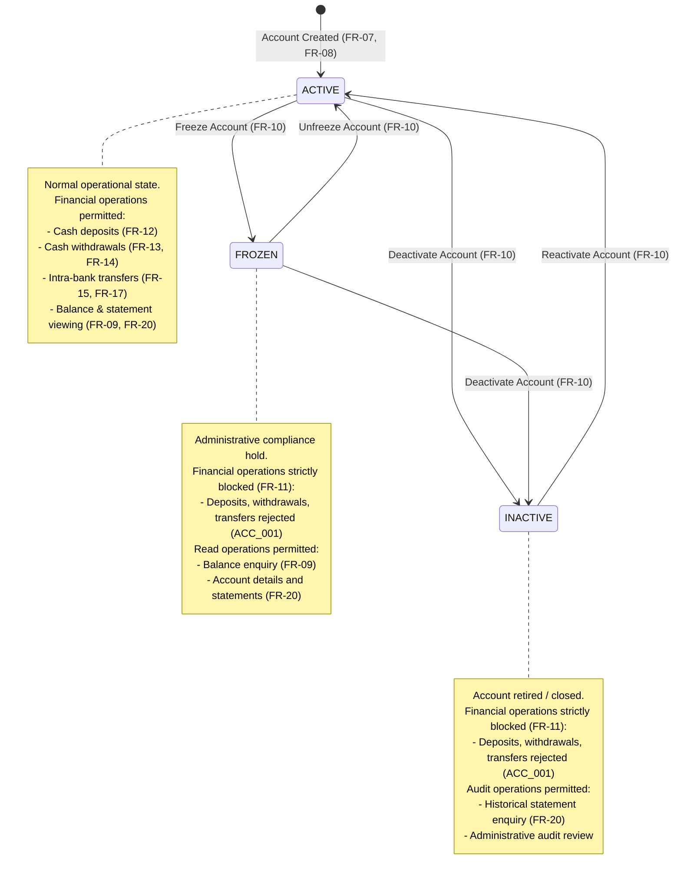

# State Machine Diagram — Bank Account Status Lifecycle

**Requirements supported:** FR-07, FR-08, FR-09, FR-10, FR-11, FR-12, FR-13, FR-14, FR-15, FR-16, FR-17, FR-20  
**Use cases supported:** UC-02, UC-03, UC-04, UC-06, UC-07  
**Implemented API:** `POST /api/accounts` (Create Account), `PATCH /api/accounts/:accountId/status` (Update Status)  

This diagram depicts the finite state machine governing bank account operational lifecycles in the Bank Management System. It specifies permitted states, administrative transitions, and the operational restrictions enforced by the banking transaction engine.

## State & Transition Specifications

| Current State | Target State | Triggering Action | Permitted Role | Audit Action Logged | Business Rules & Invariants |
|---|---|---|---|---|---|
| `[*] (None)` | `ACTIVE` | Open Account (`POST /api/accounts`) | `EMPLOYEE`, `ADMIN` | `ACCOUNT_CREATED` | Initial balance verified exactly zero (FR-08). Unique account number generated (`ACC-<TYPE>-<8-DIGITS>`). Default status is `ACTIVE`. |
| `ACTIVE` | `FROZEN` | Freeze (`PATCH /api/accounts/:id/status`) | `EMPLOYEE`, `ADMIN` | `ACCOUNT_FROZEN` | Applied for compliance review or suspicious activity. Blocks debits and credits immediately. Balance preserved intact. |
| `FROZEN` | `ACTIVE` | Unfreeze (`PATCH /api/accounts/:id/status`) | `EMPLOYEE`, `ADMIN` | `ACCOUNT_UNFROZEN` | Compliance hold lifted. Full transactional capability restored. |
| `ACTIVE` | `INACTIVE` | Deactivate (`PATCH /api/accounts/:id/status`) | `EMPLOYEE`, `ADMIN` | `ACCOUNT_DEACTIVATED` | Account closure. Account cannot be used for any transaction. Balance must be reconciled prior to closure. |
| `FROZEN` | `INACTIVE` | Deactivate (`PATCH /api/accounts/:id/status`) | `EMPLOYEE`, `ADMIN` | `ACCOUNT_DEACTIVATED` | Immediate closure from frozen state following investigation resolution. |
| `INACTIVE` | `ACTIVE` | Reactivate (`PATCH /api/accounts/:id/status`) | `EMPLOYEE`, `ADMIN` | `ACCOUNT_ACTIVATED` | Administrative reactivation of previously closed account. |

## Enforcement Mechanisms
1. **Transaction Validation (FR-11):** `transactionService.js` validates account status within an atomic database transaction (`withTransaction`). If either source or destination account status is `FROZEN` or `INACTIVE`, the transaction rolls back immediately and returns HTTP 409 `ACC_001` ("Account is frozen or inactive").
2. **Account Readability (FR-09, FR-20):** Status restrictions only apply to state-modifying financial operations. Account profile viewing (`GET /api/accounts/:id`) and running-balance statement generation (`GET /api/accounts/:id/statement`) remain fully accessible to authorized owners and bank staff regardless of account status.

