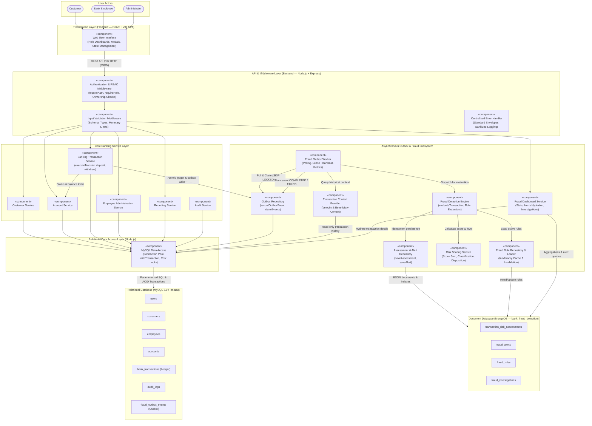

# Component Diagram

This diagram depicts the implemented software components of the Bank Management System and their dependencies. It illustrates the Layered / Three-Tier Architecture extended with Asynchronous Transactional Outbox Background Processing as specified in [Software Architecture and Design Specification](../architecture_design.md).

## Component Summary

| Component | Responsibility | Interacts with |
|---|---|---|
| **Web User Interface (React + Vite)** | Renders role-specific dashboards, interactive forms, navigation, transfer modals, and fraud monitoring console. Manages UI state and dispatches authenticated HTTP requests. | Customer, Employee, Admin, Authentication & RBAC Middleware |
| **Authentication & RBAC Middleware** | Authenticates incoming sessions via signed HTTP-only cookies (`bms.sid`), enforces role-based access barriers (`requireRole`), and validates horizontal customer ownership. | Web User Interface, Input Validation Middleware, Express Routing |
| **Input Validation Middleware** | Performs schema, data type, monetary format (up to 2 decimals), range, and parameter validation prior to executing business logic. Rejects malformed requests with `VAL_001`. | Authentication Middleware, Core Banking Services, Fraud Services |
| **Centralized Error Handler** | Catches operational and unhandled exceptions across all routes. Returns standard sanitized error envelopes (`{ success: false, error: { code, message, referenceId } }`) without leaking SQL syntax or stack traces. | All API routes and Express middleware |
| **Customer Service** | Manages customer registration, profile lookups, and authorized contact information updates. | Input Validation, MySQL Data Access Layer |
| **Account Service** | Handles account creation, collision-resistant unique account number generation (`ACC-<TYPE>-<8-DIGITS>`), balance retrieval, and account status management (`ACTIVE`, `INACTIVE`, `FROZEN`). | Input Validation, MySQL Data Access Layer, Transaction Service |
| **Banking Transaction Service** | Executes deposits, withdrawals, and customer fund transfers under atomic row-level locks (`SELECT ... FOR UPDATE`). Generates cryptographic references (`TXN-<TYPE>-<HEX>`), inserts immutable ledger records, and enqueues outbox events. | Account Service, Outbox Repository, MySQL Data Access Layer |
| **Employee Administration Service** | Provides administrative CRUD for employee staff accounts, secure salted bcrypt password initialization, status deactivation, and session revocation. | Input Validation, MySQL Data Access Layer, Audit Service |
| **Reporting Service** | Executes database-level SQL aggregations (`COUNT`, `SUM`, `AVG`) across customers, accounts, and ledger records to produce administrative summary reports and statement exports. | MySQL Data Access Layer |
| **Audit Service** | Records administrative, authentication, and status change events into the `audit_logs` table for institutional accountability. | MySQL Data Access Layer |
| **MySQL Data Access Layer** | Manages the MySQL connection pool, parameterized query execution, row-level locks, and transaction boundary control (`withTransaction`). | Core Banking Services, Outbox Repository, MySQL Database |
| **Outbox Repository** | Atomically inserts outbox records into `fraud_outbox_events` within banking transactions (`recordOutboxEvent`), and claims pending events using `FOR UPDATE SKIP LOCKED` (`claimEvents`). | Banking Transaction Service, Background Fraud Worker, MySQL Data Access |
| **Background Fraud Worker** | Polls the outbox table asynchronously, acquires lease-based claims, maintains active heartbeat renewals, orchestrates rule evaluation, and marks events `COMPLETED` or `FAILED` with exponential backoff. | Outbox Repository, Transaction Context Provider, Fraud Detection Engine |
| **Transaction Context Provider** | Queries authoritative historical transaction records and account transfer history from MySQL to construct analytical context (velocity count, beneficiary transfer history). | MySQL Data Access Layer, Background Fraud Worker |
| **Fraud Detection Engine** | Evaluates individual transactions against active configured rules, invokes rule evaluators, aggregates rule weights into risk scores (0–100), and classifies categorical risk levels. | Fraud Rule Repository, Risk Scoring Service, Assessment Repository |
| **Fraud Rule Repository & Loader** | Loads enabled rule definitions from MongoDB with in-memory caching and hot-cache invalidation. Supports integer paise monetary precision. | Fraud Detection Engine, Fraud Dashboard Service, MongoDB Database |
| **Risk Scoring Service** | Sums points from triggered rules capped strictly at 100, assigns categorical risk level (`LOW`, `MEDIUM`, `HIGH`, `CRITICAL`), and determines post-transaction assessment classifications (`APPROVED`, `REVIEW_REQUIRED`, `FLAGGED`) for investigation triage (does not block or alter banking transaction settlement). | Fraud Detection Engine |
| **Assessment & Alert Repository** | Persists risk assessment documents and fraud alert records into MongoDB idempotently using unique compound index constraints. | Fraud Detection Engine, Fraud Dashboard Service, MongoDB Database |
| **Fraud Dashboard Service** | Provides endpoints for employees and administrators to query system-wide fraud metrics via MongoDB aggregation pipelines, list paginated alerts with hydrated MySQL banking details, and manage investigations. | MySQL Data Access Layer, Assessment & Alert Repository, MongoDB Database |
| **Relational Database (MySQL 8.0)** | Authoritative relational store for banking ledgers, accounts, customers, users, audit logs, and transactional outbox events using InnoDB with ACID guarantees. | MySQL Data Access Layer |
| **Document Database (MongoDB)** | Flexible NoSQL store for fraud rules, risk assessments, alerts, and investigation cases in the `bank_fraud_detection` database. | Assessment & Alert Repository, Fraud Rule Repository |
