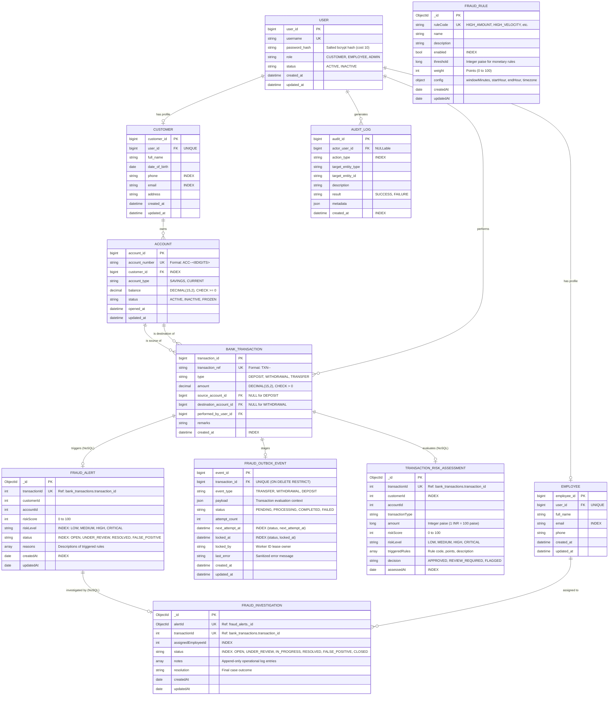
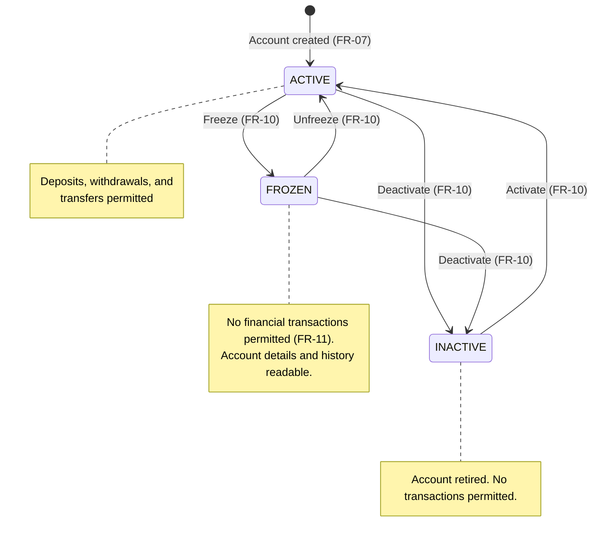
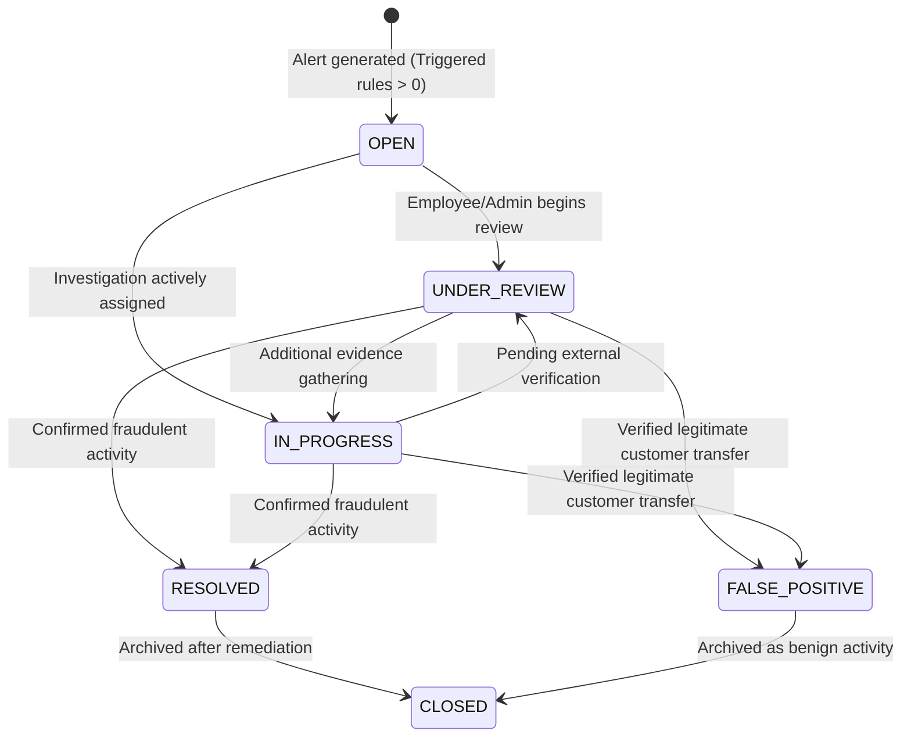

# Data Design — Dual-Database Model (MySQL & MongoDB)

This document specifies the dual-database architecture of the Bank Management System, supporting Section 7 of the [Software Architecture and Design Specification](../architecture_design.md).

The system implements a polyglot persistence architecture:
1. **Relational Database (MySQL 8.0 / InnoDB):** Authoritative transactional ledger for accounts, balances, users, and outbox events.
2. **Document Database (MongoDB):** Flexible store for fraud rules, risk assessments, alerts, and investigations.

## 1. Entity-Relationship & Document Model

## 2. Account Status State Machine

## 3. Fraud Investigation Lifecycle State Machine

