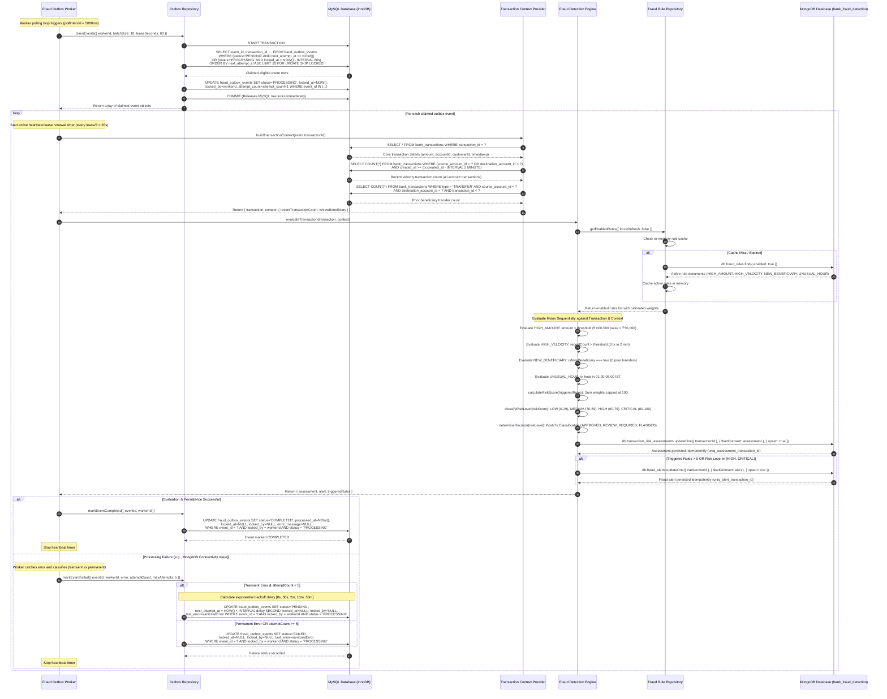

# Sequence Diagram 2: Asynchronous Fraud Detection (Outbox Pipeline)

**Requirements supported:** FR-19, FR-21, NFR-03, NFR-08, NFR-09, NFR-10, NFR-14, NFR-18  
**Use cases supported:** UC-27, UC-28, UC-30, UC-31  

This diagram depicts the asynchronous background fraud detection pipeline. The background worker polls MySQL using lease-based row locking (`SKIP LOCKED`), extracts historical banking context, evaluates configurable MongoDB fraud rules, persists risk assessments and alerts, and updates outbox status with exponential backoff retry support.

## Architectural Highlights
1. **Decoupled Resilience:** Banking transactions commit in MySQL independently of MongoDB availability. Even if MongoDB is completely offline, banking transactions succeed and events accumulate safely in `fraud_outbox_events`.
2. **Concurrency Safety (`FOR UPDATE SKIP LOCKED`):** Multiple background workers can operate concurrently on different nodes without contention or redundant processing.
3. **Lease Heartbeat & Crash Recovery:** If a worker node crashes mid-evaluation, its lease expires after 60 seconds, and another worker claims the event automatically.
4. **Idempotent Persistence:** Unique compound indexes in MongoDB (`uniq_assessment_transaction_id`, `uniq_alert_transaction_id`) guarantee that worker retries never duplicate risk assessments or alerts.
5. **Sanitized Error Logging:** Connection strings, database credentials, and secrets are systematically redacted from `last_error` before storage in MySQL.
6. **Stale Worker Protection:** Status updates enforce `WHERE event_id = ? AND locked_by = workerId AND status = 'PROCESSING'`. If a worker loses its lease due to timeout or network latency, it cannot overwrite or corrupt a subsequent worker's claim.
