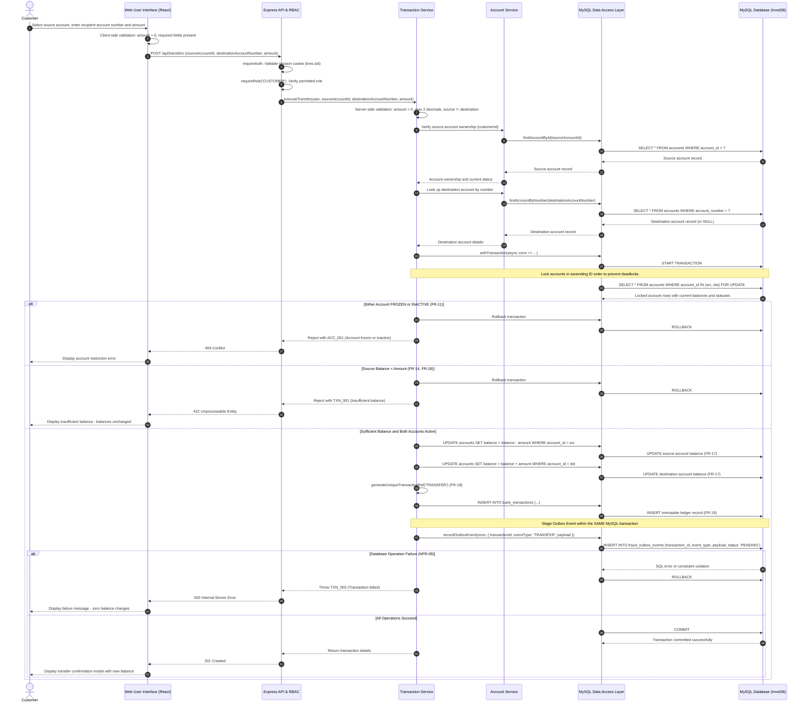

# Sequence Diagram 1: Banking Transaction Processing (Fund Transfer)

**Use case:** UC-04 (Transfer Funds)  
**Requirements supported:** FR-11, FR-15, FR-16, FR-17, FR-18, FR-19, NFR-03, NFR-04, NFR-07, NFR-08, NFR-09, NFR-10, NFR-17, NFR-18  
**Implemented API:** `POST /api/transfers` (or `POST /api/transactions/transfer`)  

This diagram depicts the synchronous banking transaction execution flow. The fund transfer updates both account balances, inserts an immutable ledger entry, and stages a transactional outbox event into MySQL within a single atomic database transaction. Downstream fraud evaluation is decoupled and asynchronous; it is not a synchronous prerequisite for banking transaction success.

## Architectural Highlights
1. **Financial Source of Truth (NFR-08):** MySQL is the sole authoritative authority for account balances.
2. **Atomicity and Consistency (NFR-09, NFR-17):** Balance debits, balance credits, immutable ledger entries, and outbox event records are committed together in one atomic MySQL transaction. If any step fails, `ROLLBACK` executes, leaving zero balance modifications and zero orphan outbox events.
3. **Deadlock Prevention:** Account rows are locked in ascending `account_id` order regardless of transfer direction.
4. **Decoupled Outbox Staging:** Staging the event in `fraud_outbox_events` avoids dual-write hazards and eliminates synchronous dependency on MongoDB availability, keeping transaction execution within design performance targets.
