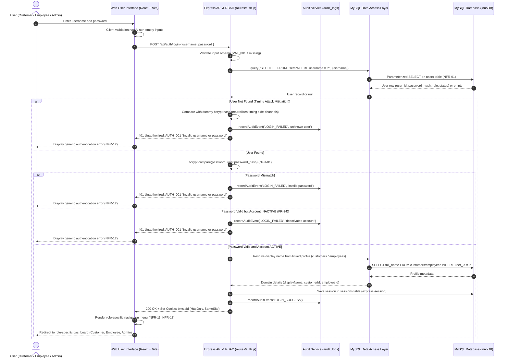

# Sequence Diagram — User Authentication and Session Management

**Use cases:** UC-01 (Customer Login), UC-08 (Employee Login), UC-19 (Administrator Login)  
**Requirements supported:** FR-01, FR-02, FR-03, FR-24, NFR-01, NFR-02, NFR-03, NFR-05, NFR-11, NFR-12, NFR-13  
**Implemented API:** `POST /api/auth/login` (see [API Design](../architecture_design.md#9-api-design))  

This diagram depicts the user authentication, security validation, and session creation sequence for all three system actors (Customer, Employee, Administrator). The system implements stateful server-side sessions stored in MySQL using `express-session`, issuing a cryptographically signed HTTP-only cookie (`bms.sid`).

## Architectural Highlights
1. **Timing Attack Mitigation (NFR-01):** When an unrecognised username is submitted, a dummy bcrypt comparison executes against a precomputed static hash. This equalizes execution latency, preventing malicious actors from enumerating valid usernames.
2. **Generic Error Disclosure (NFR-12):** Unknown usernames, incorrect passwords, and deactivated accounts all return identical HTTP 401 `AUTH_001` error envelopes.
3. **Stateful Session Architecture (MySQL Store):** Sessions are durably stored in the MySQL `sessions` table. The client receives an opaque, signed HTTP-only cookie (`bms.sid`). This allows instantaneous server-side session revocation when an employee account is deactivated (`FR-24`).
4. **Session Invalidation on Logout (FR-02):** Invoking `POST /api/auth/logout` explicitly destroys the session row in MySQL and clears the cookie, immediately preventing credential replay.
