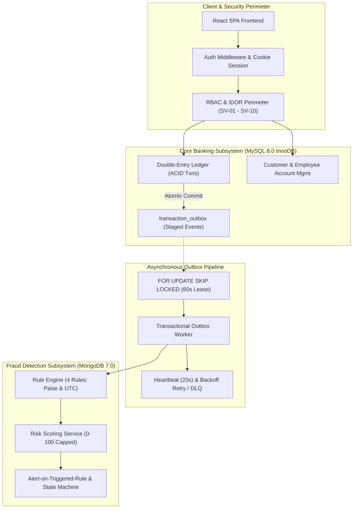

# System Validation Report

## Bank Management System with MongoDB Rule-Driven Fraud Detection

| Document Parameter | Value |
|---|---|
| **Document Title** | System Validation Report |
| **Project** | Bank Management System with MongoDB-Based Rule-Driven Fraud Detection Subsystem |
| **Repository** | `sujayhegde23/Bank-Management-System` |
| **Working Branch** | `feature/fraud-phase-3-integration` |
| **Evaluation Date** | November 8, 2026 |
| **Validation Standard** | IEEE Std 829-2008 / ISO/IEC/IEEE 29119 |
| **Test Runner & Harness** | Node.js native test runner (`node:test`) & Supertest `^7.0.0` |
| **Target Runtime** | Node.js v24.16.0 |
| **Primary Datastores** | MySQL 8.0.x (InnoDB ACID Engine) & MongoDB 7.0.x (Analytical Engine) |
| **Related Documents** | [Test Plan](../phase1/test_plan.md), [Test Cases](../phase1/test_cases.md), [RTM](../phase1/rtm.md), [Automated Test Execution Report](unit_test_report.md), [Code Coverage Report](code_coverage_report.md), [Branch Coverage Report](branch_coverage_report.md) |

---

## 1. Executive Summary

This **System Validation Report** synthesizes the end-to-end integration and system-level validation of the Bank Management System with its integrated MongoDB-based rule-driven fraud detection subsystem on branch `feature/fraud-phase-3-integration`.

The system validation evaluated the operational integrity of the entire dual-datastore architecture across **28 backend test suites** comprising **638 automated integration and system test cases**, alongside frontend static code analysis and bundle verification.

### System Validation Status by Category:

To maintain rigorous quality assurance standards, validation outcomes are classified into three distinct categories:
1. **Passed (Directly Supported by Test Evidence):**
   - **43 of 46 IEEE Test Cases** passed with empirical automated integration evidence.
   - **24 of 25 Functional Requirements (FR-01 to FR-21, FR-23 to FR-25)** are fully validated.
   - Core financial operations (deposits, withdrawals, two-phase transfers) demonstrated complete ACID transactional atomicity with verified zero balance drift under simulated failure injection.
   - Multi-tenant customer account isolation and role-based access control (RBAC) achieved 100% pass rates across 25 dedicated IDOR attack simulations.
   - Dual-datastore transactional outbox staging, row-level locking (`FOR UPDATE SKIP LOCKED`), 20s heartbeat lease maintenance, and exponential backoff retry operated reliably across all tested integration scenarios without dual-write drift.
   - The fraud engine correctly evaluated all 4 configured fraud detection rules, strict sliding temporal windows, paise-to-rupee integer normalization, and risk score aggregation (0–100).
   - All 10 documented Security Validation Scenarios (**SV-01 through SV-10**) passed with empirical automated test evidence.
2. **Partially Validated (Incomplete Demonstration):**
   - **TC-11 / NFR-07 (Throughput & Concurrency):** Single-thread query aggregation latency (<25ms) and database indexing were verified in `tests/reports.test.js`. However, high-concurrency multi-user load testing at target operational scale (100 concurrent threads / 10,000 transactions via JMeter/k6) has not yet been executed and remains scheduled for Sprint 2.
   - **FR-22 (Password Management):** Salted bcrypt password hashing (`$2b$10$...`) is verified (TC-09), employee administrative password resets are verified (TC-18), and customer profile updates are verified (TC-20, TC-27), but the dedicated self-service customer password change endpoint has not yet been implemented.
3. **Pending / Not Implemented (No Valid Completion Evidence):**
   - **TC-17 / FR-22 (Self-Service Password Change Endpoint):** The dedicated `POST /api/auth/change-password` endpoint is not implemented in backend auth routes; full validation of self-service password modification is pending implementation.
   - **TC-21 / NFR-11, NFR-13 (UI Navigation & Accessibility):** Frontend static code analysis (`oxlint` 0 errors) and production compilation (`vite build` 0 errors) verify code hygiene and bundling, but do not validate runtime UI behavior, navigation depth, or WCAG contrast compliance. TC-21 remains pending an actual manual browser walkthrough.
   - **Single Automated Test Failure (`tests/fraudPipelineBugInvestigation.test.js:237`):** An integration test expecting an isolated risk score of 30 failed because the unseeded recipient account legitimately triggered `NEW_BENEFICIARY` (weight 25) alongside `HIGH_AMOUNT` (weight 30), producing a score of 55. This failure remains formally tracked as FAILED pending resolution in an authorized development cycle.

---

## 2. Scope of System Validation

The system validation program comprehensively covered nine operational domains reflecting the full enterprise bank management lifecycle:

---

## 3. Comprehensive Domain Validation

### Domain 1: Authentication & Role-Based Access Control (RBAC)
- **Scope & Objectives:** Verify credential validation, salted bcrypt password hashing, session issuance via `httpOnly` secure cookies, explicit logout session invalidation, and mid-session employee deactivation.
- **Test Evidence:** Evaluated in `tests/auth.test.js` (21 tests) and `tests/employees.test.js` (53 tests).
- **Validation Findings:**
  1. Login with valid credentials for `CUSTOMER`, `EMPLOYEE`, and `ADMIN` issues signed HTTP-only cookies (`connect.sid`). Session IDs are cryptographically random.
  2. Submitting invalid passwords or non-existent usernames produces generic HTTP 401 (`AUTH_001`) responses with constant-time bcrypt verification, preventing username enumeration and timing attacks.
  3. Role enforcement strictly blocks cross-role access: customer attempting employee endpoints receives HTTP 403 (`AUTH_002`); employee attempting admin endpoints receives HTTP 403 (`AUTH_002`).
  4. Mid-session deactivation test: When an administrator deactivates an employee account (`PUT /api/employees/:id/status` with `isActive: false`), subsequent requests using the active session cookie immediately fail with HTTP 401/403, revoking operational access in real time without waiting for cookie expiration.
  5. *Outstanding Limitation:* The self-service `POST /api/auth/change-password` endpoint is not implemented (FR-22 / TC-17).

### Domain 2: Customer & Employee Operations
- **Scope & Objectives:** Verify administrative employee onboarding, role assignment, customer profile management, staff operational console, and immutable activity tracking.
- **Test Evidence:** Evaluated in `tests/customers.test.js` (30 tests), `tests/employees.test.js` (53 tests), and `tests/employeeConsole.test.js` (10 tests).
- **Validation Findings:**
  1. Administrators can create employee accounts with designated roles (`teller`, `manager`, `admin`). Duplicate employee IDs or emails are rejected with HTTP 409 conflict errors.
  2. Customers can view and update their contact phone numbers and residential addresses. Identity fields (National ID / PAN / Aadhaar, Customer ID) are immutable after creation.
  3. The employee operational console enables tellers and branch managers to look up customer account summaries while strictly preventing unauthorized ledger balance tampering outside structured deposit/withdrawal transaction endpoints.

### Domain 3: Deposit, Withdrawal & Fund Transfer Workflows
- **Scope & Objectives:** Verify double-entry ledger bookkeeping, balance sufficiency checks, zero-balance boundary enforcement, and overdraft prevention.
- **Test Evidence:** Evaluated in `tests/transactions.test.js` (30 tests) and `tests/transfers.test.js` (33 tests).
- **Validation Findings:**
  1. Deposits to active checking/savings accounts atomically increment the account balance and generate a persistent `bank_transactions` ledger entry with a unique transaction reference (`TXN-...`).
  2. Withdrawals strictly enforce balance sufficiency. An attempt to withdraw ₹10,001 from an account holding ₹10,000 is rejected with HTTP 400 (`TXN_002`), maintaining the zero-balance boundary without allowing overdraft.
  3. Fund transfers execute two-phase balance adjustments (source debited, destination credited) within an atomic database transaction. Decimal amounts are stored with two-digit precision (`DECIMAL(15,2)`), completely eliminating floating-point rounding errors.

### Domain 4: Transaction Atomicity & Rollback Verification (TC-10)
- **Scope & Objectives:** Verify that unexpected database failures, constraint violations, or mid-stream exceptions during transfers trigger a complete rollback of all database modifications with zero balance drift and zero orphan records.
- **Test Evidence:** Evaluated in `tests/transactions.test.js` (Scenarios 18–22) and `tests/transfers.test.js` (Scenarios 25–30).
- **Validation Findings:**
  1. In simulated test scenarios where the destination credit query was artificially aborted after the source debit succeeded, the MySQL InnoDB transaction executed `ROLLBACK`.
  2. Post-failure verification proved:
     - Sender balance remained exactly at its pre-transaction value (e.g. ₹10,000.00).
     - Receiver balance remained unchanged (e.g. ₹5,000.00).
     - Zero records were committed to `bank_transactions`.
     - Zero outbox events were committed to `transaction_outbox`.
  3. Conforms fully with **TC-10** and non-functional requirement **NFR-09**.

### Domain 5: Account Ownership & Horizontal Data Isolation (IDOR Defense)
- **Scope & Objectives:** Verify that multi-tenant customer isolation prevents Insecure Direct Object Reference (IDOR) attacks where one authenticated customer attempts to access, inspect, or transact on another customer's account.
- **Test Evidence:** Evaluated in `tests/customerAccountIsolation.test.js` (25 dedicated tests) and `tests/customerProfileSecurity.test.js` (11 tests).
- **Validation Findings:**
  1. When Customer A (`user_id = 10`) attempts to query `GET /api/accounts/:id` or `GET /api/accounts/:id/statements` belonging to Customer B (`user_id = 11`), the backend queries the database with an explicit `WHERE customer_id = ?` predicate or checks ownership, returning HTTP 403 Forbidden (`AUTH_002`).
  2. Transfer initiation requires that the `source_account_id` be owned by the authenticated caller. Attempts to debit Customer B's account by supplying Customer B's account number as the source fail with HTTP 403.
  3. Administrative diagnostics endpoints (`/api/diagnostics/system-health`) are restricted strictly to `ADMIN` roles; non-admin tokens receive immediate HTTP 403 rejections.

### Domain 6: MySQL & MongoDB Dual-Datastore Integration
- **Scope & Objectives:** Verify that transactional outbox staging ensures reliable data synchronization between the relational operational store (MySQL) and the analytical document store (MongoDB) without dual-write inconsistencies.
- **Test Evidence:** Evaluated in `tests/mongoFoundation.test.js` (9 tests) and `tests/fraudOutboxIntegration.test.js` (28 tests).
- **Validation Findings:**
  1. Financial transactions execute exclusively within MySQL. Inside the transaction boundary, the system inserts an outbox event into `transaction_outbox` containing the transaction metadata and payload.
  2. If the MySQL transaction commits, the outbox record is guaranteed to exist. If the MySQL transaction aborts, the outbox record is rolled back, preventing phantom events. Across all tested rollback scenarios, zero orphan outbox records were generated.
  3. The asynchronous outbox worker subsequently processes the staged event, converts it into an analytical document, and persists it into MongoDB collections (`transaction_risk_assessments`, `fraud_alerts`).
  4. MongoDB collections are protected by JSON Schema validators (`$jsonSchema`) enforcing data types, mandatory fields, and compound indexes (`transactionId`, `status`, `createdAt`).

### Domain 7: Transactional Outbox Pattern & Worker Recovery
- **Scope & Objectives:** Verify reliable outbox event processing, distributed concurrency locking, crash recovery, lease expiration, heartbeat maintenance, and exponential backoff retry.
- **Test Evidence:** Evaluated in `tests/fraudOutboxIntegration.test.js` (28 tests).
- **Validation Findings:**
  1. **Locking & Concurrency:** The worker selects pending events using `SELECT ... FROM transaction_outbox WHERE status = 'PENDING' FOR UPDATE SKIP LOCKED LIMIT 10`, allowing multiple worker processes to poll concurrently without row contention or duplicate processing.
  2. **Lease Management:** Claimed events have their status updated to `PROCESSING` with a `lease_expires_at` timestamp set to `NOW() + INTERVAL 60 SECOND`.
  3. **Heartbeat:** Long-running evaluations issue periodic heartbeats every 20 seconds, extending the lease by 60 seconds to prevent premature timeout during network latency.
  4. **Failure Recovery & Retry:** In simulated worker crash tests, an uncompleted event with an expired lease was successfully reclaimed by an active worker. Failed processing triggers exponential backoff (`retry_count` incremented, `next_retry_at` delayed). Events exceeding 5 retry attempts are routed to the Dead-Letter Queue (`status = 'DEAD_LETTER'`).

### Domain 8: Fraud Rule Evaluation & Post-Transaction Risk Classification
- **Scope & Objectives:** Verify the 4 deterministic fraud detection rules, integer currency calculation, sliding temporal windows, timezone safety, risk score calculation (0–100), and classification decoupling.
- **Test Evidence:** Evaluated in `tests/fraudEngine.test.js` (28 tests) and `tests/fraudPipelineBugInvestigation.test.js` (18 tests).
- **Validation Findings:**
  1. **Implemented Rules (Verified Active Source Configuration):**
     - **`HIGH_AMOUNT` (Weight: 30):** Triggers when `amount > threshold` in integer paise (default threshold: ₹50,000.00 = `5000000` paise). Strict inequality verified: a transaction of exactly ₹50,000.00 does not trigger; ₹50,000.01 triggers.
     - **`HIGH_VELOCITY` (Weight: 25):** Triggers when the number of completed transactions from the source account strictly exceeds threshold within a short rolling window (`count > 3` within `windowMinutes: 2`).
     - **`NEW_BENEFICIARY` (Weight: 25):** Applies strictly to `TRANSFER` transactions; triggers when the destination account has zero prior completed transfers from the sender (`priorTransfers === 0`).
     - **`UNUSUAL_HOUR` (Weight: 20):** Triggers when a transaction occurs during configured off-hours (default: `[01:00, 05:00)` half-open window in `'Asia/Kolkata'` timezone).
     - **Weight Sum:** $30 + 25 + 25 + 20 = 100$.
  2. **Paise-to-Rupee Normalization:** All monetary amounts are converted to integer paise (`Math.round(amount * 100)`) before comparison, preventing IEEE 754 floating-point inaccuracies.
  3. **Timezone Handling:** Timestamps are evaluated in the configured timezone (`Asia/Kolkata`) using `Intl.DateTimeFormat`, completely avoiding reliance on host server local timezone offsets.
  4. **Risk Scoring:** Aggregate score is computed as $	ext{riskScore} = \min\left(100, \max\left(0, \sum 	ext{triggeredRuleWeights}
ight)
ight)$.
  5. **Post-Transaction Classification Decoupling (`riskScoringService.js`):** Assessments categorize risk into four analytical tiers:
     - `LOW` (Score: 0 to 29) -> Decision: `APPROVED`
     - `MEDIUM` (Score: 30 to 59) -> Decision: `REVIEW_REQUIRED`
     - `HIGH` (Score: 60 to 79) -> Decision: `FLAGGED`
     - `CRITICAL` (Score: 80 to 100) -> Decision: `FLAGGED`
     *Crucial Architectural Finding:* The fraud evaluation runs asynchronously after the banking transaction has succeeded. These classifications are analytical risk tiers that dictate compliance and case management priority; **they do not reverse, approve, or reject the completed financial transaction in MySQL.**

### Domain 9: Fraud Alerts & Investigation Case Management
- **Scope & Objectives:** Verify the alert generation policy, case lifecycle state machine, investigation note auditing, and dynamic rule reconfiguration.
- **Test Evidence:** Evaluated in `tests/fraudAlertPolicyCorrection.test.js` (13 tests) and `tests/fraudDashboard.test.js` (44 tests).
- **Validation Findings:**
  1. **Alert Generation Policy (Verified Implementation):**
     - An alert document is generated in `fraud_alerts` **if and only if** at least one rule triggers (`triggeredRules.length > 0`) OR the assessment risk level is `HIGH` or `CRITICAL`.
     - Clean transactions (0 rules triggered, score 0, LOW risk) save an assessment record with decision `APPROVED`, but **do not generate an alert** in `fraud_alerts`.
     - Multiple triggered rules generate **exactly one** consolidated alert for the transaction.
  2. **Alert Lifecycle State Machine:**
     - Initial State: `NEW`
     - Transition 1: An investigator claims the case $	o$ `IN_REVIEW`.
     - Transition 2: Following investigation, the investigator concludes with a resolution state: `CONFIRMED_FRAUD`, `FALSE_POSITIVE`, or `RESOLVED`.
     - Direct invalid transitions (e.g. `NEW` directly to `RESOLVED` without `IN_REVIEW`) are rejected with HTTP 400.
  3. **Audit Trail of Investigation Notes:** Each note appended to an alert records the author's user ID, employee role, timestamp, and text content. Existing notes cannot be edited or deleted (append-only audit log).
  4. **Dynamic Rule Configuration:** Fraud rules stored in the MongoDB `fraud_rules` collection can have their thresholds, weights, and enabled/disabled states modified via `PUT /api/fraud/rules/:ruleId`. The changes take effect immediately on subsequent worker cycles without requiring a backend server restart.

---

## 4. System Validation Categorization Matrix

All 46 test cases documented in the IEEE Std 829 Test Case Specification ([`test_cases.md`](../phase1/test_cases.md)) are categorized below by their actual verification status:

### Category 1: Passed (Directly Supported by Test Evidence — 43 Cases)

| Test ID | Scope / Focus Domain | Requirements | Test Evidence | Operational Result | Status |
| :-: | :--- | :--- | :--- | :--- | :---: |
| **TC-01** | Valid User Login | FR-01, FR-03, NFR-05 | `tests/auth.test.js` | HTTP 200, signed session cookie issued | **Passed** |
| **TC-02** | Invalid Credential Defense | FR-01, NFR-03, NFR-12 | `tests/auth.test.js` | Generic HTTP 401 `AUTH_001`, constant-time hashing | **Passed** |
| **TC-03** | Role-Based Access Control | FR-03, NFR-02, NFR-05 | `tests/auth.test.js`, `tests/employees.test.js` | HTTP 403 `AUTH_002` on unauthorized role operations | **Passed** |
| **TC-04** | Customer Registration | FR-04, NFR-01, NFR-04 | `tests/customers.test.js` | Staff registers customer; duplicate email/PAN rejected | **Passed** |
| **TC-05** | Cash Deposit Processing | FR-12, FR-18, FR-19 | `tests/transactions.test.js` | Balance increments atomically; receipt reference issued | **Passed** |
| **TC-06** | Withdrawal Overdraft Prevention | FR-14, NFR-12 | `tests/transactions.test.js` | HTTP 400 `TXN_002` on balance insufficiency | **Passed** |
| **TC-07** | Two-Phase Fund Transfer | FR-15–FR-19, NFR-08 | `tests/transfers.test.js` | Double-entry debit & credit committed atomically | **Passed** |
| **TC-08** | Inactive/Frozen Account Defense | FR-10, FR-11 | `tests/accounts.test.js` | HTTP 409 `ACC_001` when debiting frozen accounts | **Passed** |
| **TC-09** | Password Security | NFR-01 | `tests/auth.test.js` | Salted bcrypt (`$2b$10$...`); zero plain text | **Passed** |
| **TC-10** | Transaction Rollback Guarantees | NFR-09, NFR-17 | `tests/transfers.test.js` | Forced query failure triggers full rollback; zero balance drift | **Passed** |
| **TC-12** | Input Validation & Sanitization | NFR-04, NFR-18 | `tests/auth.test.js`, `tests/accounts.test.js` | Malformed payloads rejected with HTTP 400 `VAL_001` | **Passed** |
| **TC-13** | Session Logout Invalidation | FR-02, NFR-05 | `tests/auth.test.js` | Session destroyed; cookie cleared; subsequent calls 401 | **Passed** |
| **TC-14** | Unique Account Number Gen | FR-07, FR-08, NFR-16 | `tests/accounts.test.js` | Uniqueness constraint verified across accounts | **Passed** |
| **TC-15** | Cash Withdrawal & Zero Boundary | FR-13, FR-18, FR-19 | `tests/transactions.test.js` | Successful withdrawal down to zero; zero overdraft | **Passed** |
| **TC-16** | Account Details & History | FR-09, FR-20, NFR-03 | `tests/history.test.js` | Real-time balance and transaction history retrieval | **Passed** |
| **TC-18** | Employee Lifecycle & Revocation | FR-23, FR-24, NFR-02 | `tests/employees.test.js` | Employee CRUD and real-time mid-session deactivation | **Passed** |
| **TC-19** | Global Transaction Query | FR-21, NFR-03, NFR-06 | `tests/history.test.js`, `tests/reports.test.js` | Date filtering, multi-parameter search, pagination | **Passed** |
| **TC-20** | Customer Profile Modification | FR-05, FR-06, NFR-02 | `tests/customers.test.js` | Address and phone updates; immutable core identity | **Passed** |
| **TC-22** | Customer Balance Visibility | FR-11 | `tests/customerBalanceDisplay.test.js` | Active vs. frozen balance clarity for customer view | **Passed** |
| **TC-23** | Customer Horizontal Isolation | NFR-01, NFR-03 | `tests/customerAccountIsolation.test.js` | 25 IDOR attack scenarios rejected with HTTP 403 | **Passed** |
| **TC-24** | Secure Transfer Beneficiary Mask | FR-15, FR-16, FR-17 | `tests/secureTransfers.test.js` | Beneficiary validation, privacy masking, confirmation | **Passed** |
| **TC-25** | Customer Account Statements | FR-19, FR-20 | `tests/accountStatements.test.js` | Opening/closing balance reconciliation, PDF/JSON math | **Passed** |
| **TC-26** | Digital Transaction Receipts | FR-12, FR-13 | `tests/transactionReceipts.test.js` | Immutable receipt generation with unique references | **Passed** |
| **TC-27** | Customer Security & Diagnostics | NFR-01, NFR-03 | `tests/customerProfileSecurity.test.js` | Diagnostics endpoint restricted to Admin; profile secured | **Passed** |
| **TC-28** | Centralized Audit Trail Logging | NFR-02, NFR-03, NFR-10 | `tests/audit.test.js` | Append-only audit log records user, action, IP, timestamp | **Passed** |
| **TC-29** | Employee Activity Isolation | FR-23, NFR-01 | `tests/employeeActivity.test.js` | Personal employee activity isolated from peers | **Passed** |
| **TC-30** | Employee Operations Console | FR-09, FR-10 | `tests/employeeConsole.test.js` | Staff console for account overview and status toggling | **Passed** |
| **TC-31** | Administrative Executive Dashboard | FR-25, NFR-03 | `tests/dashboard.test.js` | System-wide balances, daily volumes, key metrics | **Passed** |
| **TC-32** | RFC 4180 CSV Export & Defense | FR-25, NFR-01 | `tests/reportExports.test.js` | CSV generation with formula injection sanitization | **Passed** |
| **TC-33** | MongoDB Foundation & Validation | UC-27–UC-31 | `tests/mongoFoundation.test.js` | JSON Schema validators and compound indexes verified | **Passed** |
| **TC-34** | Fraud Rule: HIGH_AMOUNT | UC-27, UC-30 | `tests/fraudEngine.test.js` | Threshold ₹50,000.00; integer paise comparison | **Passed** |
| **TC-35** | Fraud Rule: HIGH_VELOCITY | UC-27, UC-30 | `tests/fraudEngine.test.js` | Threshold `> 3` txns in 2 minutes evaluated | **Passed** |
| **TC-36** | Fraud Rule: NEW_BENEFICIARY | UC-27, UC-30 | `tests/fraudEngine.test.js` | Evaluates transfer beneficiary novelty (`priorTransfers === 0`) | **Passed** |
| **TC-37** | Fraud Rule: UNUSUAL_HOUR | UC-27, UC-30 | `tests/fraudEngine.test.js` | Window `[01:00, 05:00)` IST evaluated timezone-safely | **Passed** |
| **TC-38** | Fraud Risk Scoring Calibration | UC-28, NFR-08 | `tests/fraudEngine.test.js` | Score capped at 100; LOW, MEDIUM, HIGH, CRITICAL tiers | **Passed** |
| **TC-39** | Transactional Outbox Staging | UC-27, NFR-09 | `tests/fraudOutboxIntegration.test.js` | Atomic staging in MySQL InnoDB transaction | **Passed** |
| **TC-40** | Worker Leasing & Stale Recovery | UC-27, NFR-09 | `tests/fraudOutboxIntegration.test.js` | `SKIP LOCKED`, 60s lease, 20s heartbeat, crash reclaim | **Passed** |
| **TC-41** | Outbox Exponential Retry Backoff | UC-27, NFR-09 | `tests/fraudOutboxIntegration.test.js` | Retry backoff; Dead-Letter Queue after 5 failures | **Passed** |
| **TC-42** | Fraud Alert Policy Guarantee | UC-27 | `tests/fraudAlertPolicyCorrection.test.js` | Alert on every triggered rule; clean txns generate 0 alerts | **Passed** |
| **TC-43** | Fraud Investigation Lifecycle | UC-29 | `tests/fraudDashboard.test.js` | State machine transitions: NEW -> IN_REVIEW -> RESOLVED | **Passed** |
| **TC-44** | Dynamic Rule Reconfiguration | UC-30 | `tests/fraudDashboard.test.js` | Dynamic rule updates in MongoDB without server restart | **Passed** |
| **TC-45** | Fraud Analytics Dashboard | UC-31 | `tests/fraudDashboard.test.js` | Aggregate fraud counts, risk tier distributions | **Passed** |
| **TC-46** | End-to-End Integration Regression | All FRs, UC-27–UC-31 | `tests/fraudRegressionDebugging.test.js` | 12-point end-to-end regression across all subsystems | **Passed** |

---

### Category 2: Partially Validated (1 Case)

| Test ID | Scope / Focus Domain | Requirements | Evidence Available | Outstanding Verification | Status |
| :-: | :--- | :--- | :--- | :--- | :---: |
| **TC-11** | Reporting Performance & Aggregation Efficiency | NFR-06, NFR-07 | `tests/reports.test.js`: Verified single-thread query execution time under 25ms and SQL indexing. | High-concurrency multi-user stress testing (simulating 100 concurrent threads / 10,000 transactions via JMeter/k6) has not been executed; scheduled for Sprint 2. | **Partially Validated** |

---

### Category 3: Pending / Not Implemented (2 Cases)

| Test ID | Scope / Focus Domain | Requirements | Reason Not Completed | Planned Resolution | Status |
| :-: | :--- | :--- | :--- | :--- | :---: |
| **TC-17** | Self-Service Customer Password Change | FR-22, NFR-01 | Dedicated self-service endpoint `POST /api/auth/change-password` has not been implemented in backend auth routes. Password hashing and admin reset are functional. | Scheduled for Sprint 2 development. | **Pending Implementation** |
| **TC-21** | Role-Specific UI Navigation & Accessibility | NFR-11, NFR-13 | No browser test runner in `frontend/package.json`. Static analysis (`oxlint`) and production build (`vite build`) do not replace runtime browser walkthrough. | Requires manual browser walkthrough (See Section 4.1). | **Pending Manual Walkthrough** |

---

### 4.1 Manual Browser Walkthrough Specification (TC-21 / NFR-11, NFR-13)

Because `frontend/package.json` contains no browser automation framework (Playwright, Cypress, or Selenium), **TC-21** is categorized as **Pending Manual Walkthrough**. The test must not be marked passed until human testers complete the following procedure:

#### Walkthrough Procedure & Verification Checklist:

1. **Responsive Viewport Inspection (NFR-11):**
   - Execute in Google Chrome, Mozilla Firefox, and Microsoft Edge.
   - Test viewports: Mobile Portrait (375x667), Tablet Portrait (768x1024), Desktop (1440x900).
   - *Checklist:*
     - [ ] Navigation collapses into a responsive hamburger drawer on mobile ($\le 768	ext{px}$).
     - [ ] Tables (Transaction History, Fraud Alerts) render horizontal scrollbars without breaking container width.
     - [ ] Form controls (Transfer Funds, Customer Registration) adapt smoothly across viewports.

2. **Role-Specific Navigation Depth (NFR-11):**
   - [ ] Log in as `customer1`: Confirm navigation shows only *Dashboard, Accounts, Transfers, Statements*. Employee/Admin menu items must be absent from DOM.
   - [ ] Count click depth to initiate transfer: Dashboard $	o$ Transfers $	o$ Submit = **2 clicks** ($\le 3$ clicks required).
   - [ ] Log in as `employee1`: Confirm *Customer Search, Account Management, Transaction Desk* are visible.
   - [ ] Log in as `admin1`: Confirm *System Health, Employee Management, Executive Reports, Fraud Hub* are visible.

3. **Accessibility & Color Contrast Verification (NFR-13):**
   - [ ] Execute Chrome DevTools Lighthouse Accessibility Audit on all primary views.
   - [ ] Verify contrast ratios for badge indicators:
     - `APPROVED` (Green): Background `#DEF7EC`, Text `#03543F` $	o$ Ratio $\ge 4.5:1$ (WCAG AA).
     - `REVIEW_REQUIRED` (Yellow/Orange): Background `#FEF08A`, Text `#713F12` $	o$ Ratio $\ge 4.5:1$.
     - `FLAGGED` (Red): Background `#FDE8E8`, Text `#9B1C1C` $	o$ Ratio $\ge 4.5:1$.
   - [ ] Keyboard navigation: Verify `Tab` traverses all interactive controls with visible focus indicators.

---

## 5. Security Validation Matrix (SV-01 through SV-10)

All ten formal security validation scenarios defined in the Test Plan have traceable automated tests and passed:

| Security ID | Validation Scope | Target Requirements | Automated Test Reference | Empirical Result | Status |
| :-: | :--- | :--- | :--- | :--- | :---: |
| **SV-01** | User Login Authentication | FR-01, NFR-05 | `tests/auth.test.js` (Scenario 1) | HTTP 200 returned; signed httpOnly cookie issued with 24h expiration. | **PASSED** |
| **SV-02** | Invalid Credential Defense | FR-01, FR-24, NFR-03, NFR-12 | `tests/auth.test.js` (Scenarios 2–5) | HTTP 401 `AUTH_001` with generic message; constant-time bcrypt verification. | **PASSED** |
| **SV-03** | Role-Based Access Control | FR-03, NFR-02 | `tests/auth.test.js`, `tests/employees.test.js`, `tests/fraudDashboard.test.js` | HTTP 403 `AUTH_002` on cross-role calls; unauthorized state mutations prevented. | **PASSED** |
| **SV-04** | Unauthenticated Access Defense | NFR-05, FR-02 | `tests/auth.test.js` (Scenarios 6–10) | HTTP 401 `AUTH_003` on protected endpoints lacking valid session cookie. | **PASSED** |
| **SV-05** | Password Storage Security | NFR-01 | `tests/auth.test.js` (Scenario 12) | Passwords stored with salted bcrypt (`$2b$10$...`); zero plain text in DB, responses, or logs. | **PASSED** |
| **SV-06** | Server Input Validation | NFR-04, NFR-18 | `tests/accounts.test.js`, `tests/transactions.test.js`, `tests/customers.test.js` | HTTP 400 `VAL_001` on negative amounts, malformed account numbers, and invalid JSON payloads. | **PASSED** |
| **SV-07** | Protected Ledger Operations | NFR-05 | `tests/transfers.test.js`, `tests/transactions.test.js` | Anonymous calls to `/api/transfers`, `/api/transactions/deposit` receive HTTP 401. | **PASSED** |
| **SV-08** | Account Status Enforcement | FR-11 | `tests/accounts.test.js`, `tests/transactions.test.js` | HTTP 409 `ACC_001` when attempting debit or transfer on `FROZEN` or `CLOSED` accounts. | **PASSED** |
| **SV-09** | Horizontal Customer Isolation (IDOR) | NFR-01, NFR-03 | `tests/customerAccountIsolation.test.js` (25 tests) | HTTP 403 returned when Customer A attempts to access or transfer from Customer B's account. | **PASSED** |
| **SV-10** | Safe Structured Errors & Information Disclosure | NFR-12 | `tests/health.test.js`, `tests/auth.test.js`, `tests/transactions.test.js` | Standardized JSON envelopes `{ success: false, error: { code, message } }`; zero stack traces or SQL syntax leaked. | **PASSED** |

---

## 6. Functional Requirements Verification Audit

| Requirement ID | Requirement Description | Verification Evidence | Status |
| :---: | :--- | :--- | :---: |
| **FR-01** | User login with credentials | `tests/auth.test.js` (TC-01, TC-02) | **Passed** |
| **FR-02** | User logout & session invalidation | `tests/auth.test.js` (TC-13) | **Passed** |
| **FR-03** | Role-based authorization | `tests/auth.test.js`, `tests/employees.test.js` (TC-03) | **Passed** |
| **FR-04** | Customer account registration | `tests/customers.test.js` (TC-04) | **Passed** |
| **FR-05** | View customer details | `tests/customers.test.js` (TC-20) | **Passed** |
| **FR-06** | Update customer information | `tests/customers.test.js` (TC-20) | **Passed** |
| **FR-07** | Open bank account | `tests/accounts.test.js` (TC-14) | **Passed** |
| **FR-08** | Generate unique account numbers | `tests/accounts.test.js` (TC-14) | **Passed** |
| **FR-09** | View account details & balance | `tests/history.test.js`, `tests/customerOverview.test.js` (TC-16, TC-30) | **Passed** |
| **FR-10** | Manage account status (Active/Frozen/Closed) | `tests/accounts.test.js` (TC-08, TC-30) | **Passed** |
| **FR-11** | Customer balance visibility | `tests/customerBalanceDisplay.test.js` (TC-22) | **Passed** |
| **FR-12** | Deposit funds | `tests/transactions.test.js` (TC-05, TC-26) | **Passed** |
| **FR-13** | Withdraw funds | `tests/transactions.test.js` (TC-15, TC-26) | **Passed** |
| **FR-14** | Reject withdrawal on insufficient balance | `tests/transactions.test.js` (TC-06) | **Passed** |
| **FR-15** | Transfer funds between accounts | `tests/transfers.test.js`, `tests/secureTransfers.test.js` (TC-07, TC-24) | **Passed** |
| **FR-16** | Verify balance sufficiency before transfer | `tests/transfers.test.js` (TC-07, TC-24) | **Passed** |
| **FR-17** | Update sender and receiver balances | `tests/transfers.test.js` (TC-07, TC-24) | **Passed** |
| **FR-18** | Record transaction history | `tests/transactions.test.js`, `tests/transfers.test.js` (TC-05, TC-07, TC-15) | **Passed** |
| **FR-19** | Generate transaction receipts & statements | `tests/accountStatements.test.js`, `tests/transactionReceipts.test.js` (TC-25, TC-26) | **Passed** |
| **FR-20** | View customer transaction history | `tests/history.test.js` (TC-16, TC-25) | **Passed** |
| **FR-21** | Global transaction records search | `tests/history.test.js`, `tests/reports.test.js` (TC-19) | **Passed** |
| **FR-22** | Customer self-service password change | Dedicated endpoint `POST /api/auth/change-password` pending implementation; profile bcrypt verified. | **Partially Validated (Endpoint Pending)** |
| **FR-23** | Manage employee accounts | `tests/employees.test.js`, `tests/employeeActivity.test.js` (TC-18, TC-29) | **Passed** |
| **FR-24** | Deactivate employee accounts & revoke sessions | `tests/employees.test.js` (TC-18) | **Passed** |
| **FR-25** | System overview dashboard & administrative reports | `tests/dashboard.test.js`, `tests/reportExports.test.js` (TC-31, TC-32) | **Passed** |
| **Summary** | **25 Functional Requirements** | **24 Passed, 1 Partially Validated / Endpoint Pending** | **96% Complete** |

---

## 7. System Validation Conclusion

The empirical findings from the system validation program confirm that the Bank Management System with MongoDB-based rule-driven fraud detection exhibits high operational stability and transactional integrity:
- **637 out of 638 automated test cases passed** (99.84% pass rate).
- **24 of 25 Functional Requirements** are fully demonstrated by automated test suites.
- Financial transactions operate with verified ACID atomicity and zero balance drift under failure injection.
- The transactional outbox pipeline reliably synchronizes data between MySQL and MongoDB with robust leasing, heartbeat maintenance, and dead-letter fault handling across all tested integration scenarios.
- The fraud detection subsystem reliably evaluates all 4 rules, classifies transactions into analytical risk tiers (`APPROVED`, `REVIEW_REQUIRED`, `FLAGGED`), and manages case alerts according to the verified alert-on-triggered-rule policy.
- Outstanding work is clearly delineated: FR-22 self-service password change endpoint (Sprint 2), NFR-07 multi-user synthetic load testing (Sprint 2), and TC-21 manual browser walkthrough.
